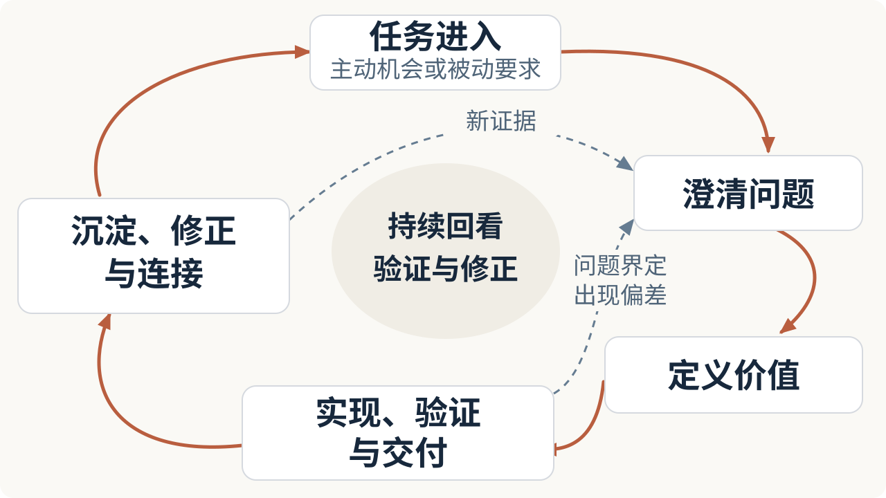

# AI 越来越强，怎样把一件事做出价值？

> AI 让搜集信息、生成方案和完成任务变得更容易，但当产出增长得比验证和吸收能力更快时，判断什么值得做、什么结果有价值，反而可能变得更费力。从最近的工作实践出发，我尝试整理出四个值得反复问自己的问题：要解决什么、什么结果有价值、怎样交付，以及如何让一次成果不再孤立。

---

国庆前，我和一位新来的实习生聊天，分享了一些基础的分析方法和思路。后来回想这次交流，我开始思考：如果 AI 已经能完成越来越多过去需要专门学习和反复练习的工作，那么除了教新人掌握某项技能、使用某个软件，还有什么更通用的东西值得分享？

过去，掌握工具本身就可能形成竞争优势。但当某些操作已经可以交给 AI 可靠地完成，继续把大量时间投入手工熟练度的竞争，未必还是最值得选择的成长路径。[《Generative AI at Work》](https://doi.org/10.1093/qje/qjae044)研究了一家企业的 5,172 名客服人员，发现引入生成式 AI 助手后，每小时解决问题的数量平均提高约 15%，经验较少、技能较弱的员工受益更明显。在这个场景中，一部分经验已经能够通过 AI 更快地传递给新人。

但调用能力，与形成自己的理解，仍然需要分别考虑。[Anthropic 针对 52 名开发者进行的一项随机实验](https://www.anthropic.com/research/AI-assistance-coding-skills)发现，AI 辅助组在学习新编程库后的理解测试中表现更差，尤其是在识别和理解错误方面。研究也观察到，主动追问概念和解释的人，理解表现相对较好。这项小规模实验测量的是任务结束后不久的理解程度，尚不能回答长期学习效果，却提醒我：**学习重点可以调整，但不能把完成任务直接当成已经学会。**

另一个变化来自产出本身。过去完成一份报告需要很多时间，现在 AI 可以迅速提供多种分析思路和候选方案。虽然它同样能够帮助筛选和判断，但如果缺少明确的问题、标准和验证方式，人的注意力反而可能被大量看似合理的结果占据。**AI 降低了生产结果的成本，却不保证判断这些结果的总成本同步下降；有时甚至会提高对判断能力的要求。** 对我来说，这意味着不只要考虑怎样生成，也要安排好怎样筛选、验证和吸收，而不是把所有结果都留到最后亲自检查。

回顾最近几个月的实践，我发现自己反复遇到的困惑，大致可以放进下面这个工作循环。

新证据可能要求重新定义问题，交付反馈也可能让我们调整原来的做法。图中的回环不是重复就会自动提升；只有反馈真正改变了判断和行动，积累才可能带来改善。

## 一、拿到一件事，先弄清楚要处理什么

前两个月，我接到过一项行业市场调研任务。刚开始的做法很直接：打开 AI，不断对话，让它帮我搜索市场信息、整理公司和产品资料，再沿着发现的新线索继续研究。这种方式启动很快，短时间内也确实能获得大量材料。

但经过第一轮的讨论，以及后续不断推进和反思，我才逐渐意识到，自己最初的行动缺少足够清晰的依据和方法。信息越来越多，为什么先研究这些、下一步应该看什么、最终要回答什么问题，却没有同步变得清楚。

这让我重新注意到一件基础的事情：**任务的名称，并不等于任务真正要解决的问题。** “做行业调研”描述的是工作类型，但它可能服务于完全不同的目的。比如，同样是调研，有时需要先了解市场的基本情况，有时需要判断是否值得进入一个方向，有时则是在已有产品计划的基础上，进一步理解客户需求和竞争情况。即使最后都交付一份行业报告，研究范围、资料选择和结论重点也会不同。

事情来到面前的方式也不一样。有些是主动选择的，比如研究一个技术方向、建立个人网站，这时需要判断为什么值得投入，以及相对其他事情应该排在什么位置。有些是被动接收的，比如工作任务、客户需求，或者突然出现的问题。此时可能没有多少“做不做”的选择空间，但仍然需要理解任务背后的目标、约束和实际交付要求。

两种情况最终都要回答：这件事为什么发生，当前真正需要解决什么，还有哪些条件并不清楚？AI 可以参与这个过程，帮助我们发现原先没有意识到的问题，但“开始搜索”不等于“已经理解任务”。探索性工作不需要一开始就拥有完整框架，关键是让每一次新的发散都有理由，让新增线索与当前问题建立联系，而不是仅仅因为又出现了一个可以继续搜索的方向。

## 二、信息可以不断发散，但结果需要有依据地收拢

当行业调研逐渐展开，另一个问题就出现了：什么时候应该停止搜集信息，开始形成判断？

AI 可以继续提供更多公司、案例和分析维度，每一个方向似乎都值得进一步了解。但研究总要在某个时候形成结果。哪些内容应该留下，哪些只是背景，哪些证据足以支持当前判断，哪些问题还存在明显的不确定性，这些事情不会因为信息变多而自动得到解决。

研究 AI 与工作方式的学者 Ethan Mollick，在[《Management as AI Superpower》](https://www.oneusefulthing.org/p/management-as-ai-superpower)中提供了一个实用的成本视角：决定是否把任务交给 AI，不能只比较生成速度，还要考虑提出要求、等待、检查结果，以及不满意时再次尝试的时间。如果检查一次结果就要花很久，而任务又反复做不对，使用 AI 的总成本可能超过自己完成。这个分析来自他的教学与使用观察，也为我的调研经历提供了一个参照：信息生成得很快，不代表整个研究过程已经高效。

我现在更倾向于把研究理解成一个不断往复的过程：从初始问题向外探索，再根据证据逐步比较、归纳和收束；如果发现原来的问题定义不成立，就返回去调整范围。发散不是为了尽可能多地搜集，收束也不只是把材料压缩成几页 PPT，而是让最终结果能够回应这次工作真正要解决的问题。

例如，一项市场调研最终可能没有找到值得立即投入的机会，但如果它帮助团队排除了不合理的方向、识别出关键限制，或者明确了下一步需要验证什么，也可能已经产生价值。反过来，一份报告即使覆盖几十家公司、包含大量图表，如果无法说明这些信息为什么重要、能够支持什么判断，依然可能很难被使用。**数量可以是研究产生的结果，却不应该自动成为研究的目的。**

类似的取舍也出现在我持续写 Blog 的过程中。我一直知道公开分享有意义，它可以让自己的思考被更多人看见，也可能连接到有共同兴趣的人，产生一些事先无法规划的交流与合作。但很长一段时间里，我并没有急着经营公众号、小红书等渠道，一个重要原因是担心自己过早被阅读量、关注数带偏。相比追求曝光，我更希望先沉下心来，把内容和自己的判断慢慢打磨好。

这并不是说传播指标没有价值。有人愿意阅读、讨论甚至使用这些内容，本身就是重要反馈；只是这些指标需要帮助我理解目标实现得怎么样，而不是悄悄取代原来的目标。无论是做市场调研还是做内容，最容易衡量的产出，都不足以完整代表我们真正追求的结果。

## 三、交付不是把自己知道的东西全部交出去

刚开始做产品经理时，我很喜欢把产品需求文档（PRD）写得非常详细。很多分析过程、思考依据和设计时考虑过的问题，我都希望尽可能写进去。因为这些内容确实帮助自己理解了需求，我也自然认为，别人应该同样需要知道。

但到了研发评审，我逐渐发现，对方并不一定希望跟着我重新走完全部思考过程。他们更关注需求一开始的介绍，以及最后要达到什么效果。对我有助于形成判断的材料，不一定都是那次评审中需要优先展示的内容。问题不在于所有过程都该删掉，而在于应该按照接收者理解和推进工作的需要组织成果，而不是按照自己探索问题的顺序，把全部过程重新讲一遍。

最近与 AI 协作时，我又遇到了类似的问题。AI 能产生大量输出，其中一些内容适合留下来支持后续工作，另一些则需要重新组织，才适合当前的人阅读。把分析过程全部展示出来，可能增加阅读负担；但为了简洁而丢掉重要依据，又会影响后续继续工作。

我在自己的 AI 协作系统，也就是之前写过的 Personal Harness 中，反复打磨的就包括这些细节：哪些过程需要记录，哪些内容需要面向人呈现，以及采用怎样的汇报形式。这里并不是要给“人”和“AI”划出两套互不相通的信息，而是不再默认，工作中产生的全部信息都应该原样成为每一次交付。

开发者 Simon Willison 在[《Your Job Is to Deliver Code You Have Proven to Work》](https://simonwillison.net/2025/Dec/18/code-proven-to-work/)中指出了另一种交付负担：让 AI 生成大量代码，自己没有充分测试，就交给同事或开源维护者审查，实际上是把尚未完成的工作转移给接收者。他要求交付同时包含代码能够工作的证据，也鼓励让编码 Agent 自己运行、测试和展示结果。

他的例子讲的是验证责任，我的 PRD 经历讲的是信息组织，二者不能混为一谈。但它们都可以用来检查同一个问题：交付之前，我究竟完成了什么，又把哪些理解和验证工作留给了别人？**交付的价值，不取决于我把多少信息交给对方，而取决于这些信息能否帮助对方理解问题、作出判断或推进下一步。**

交付也不只发生在明确的团队协作中。我最初建立个人网站，部分原因就是希望让自己做过的事情有一个可以访问的入口，而不只是留在简历的文字描述里。后来逐渐开始持续写 Blog，把一些常用成果同步到 GitHub，最近也在筹备通过更多渠道分享内容。

对我来说，公开作品提供了一种不同于自我介绍的交流方式：别人可以直接看内容，再决定是否值得继续讨论。分享不保证产生机会，但如果成果始终停留在自己的文件夹里，就少了一种与人发生联系的可能。我希望探索的是，在不让传播指标支配内容的前提下，让已有成果接触更多相关的人。

## 四、让一次成果不再孤立，也让自己的判断不断变化

以前提到工作沉淀，我首先想到的也是保存资料、整理模板、积累方法，方便下一次遇到类似问题时直接使用。但持续写 Blog 以后，我逐渐发现，积累的价值不只表现为向前复用。

每次开始研究一个新问题，我都会尝试寻找过去有没有写过相关内容。有时候，旧文章已经建立了一些可以直接使用的概念；有时候，新证据会让我意识到，过去的某个判断需要重新限定甚至修正；还有时候，原来分别讨论的几个问题，放到一起以后才发现它们之间存在共同机制。新成果不只是增加了一个文件，也可能改变我对已有成果的理解，以及它们之间的关系。

类似的问题，我之前在[《已经有知识库了，企业 AI 为什么又开始做 Wiki？》](https://marktian-long.github.io/tools/blog/posts/enterprise-ai-wiki.html)中讨论过：长期知识的价值不只是被保存，还在于新的材料出现时，能否判断已有认识是否仍然成立。在[《我为什么开始给自己搭 Harness？》](https://marktian-long.github.io/tools/blog/posts/personal-harness.html)里，我也讨论过任务状态、判断历史和方法的长期积累。不是所有信息都值得留下，一次成功也不应该直接变成永久规则；经验需要经过使用、范围判断和验证，才能决定怎样进入长期机制。

这些是可以保存在系统里的外部积累，但持续做一件事，还可能改变另一种不那么容易被看见的东西：自己下一次理解问题的方式。

我持续写 Blog，并不只是为了发布更多文章。一个很重要的目的，是希望通过不断研究、比较证据、寻找反例和修正观点，逐渐加深自己对产品、技术和商业问题的理解。这些认识如果能慢慢影响之后的工作，即使没有重新打开过去的文章，过去的研究也可能已经参与了当下的判断。

比如未来面对一个新的产品机会时，我希望自己能够更自然地追问：需求究竟是否真实，价值由谁获得，什么证据足以支持投入，今天的解决方案是不是可能很快过时。这些问题未必直接来自某一篇文章，而可能是长期处理相似问题后，逐渐形成的分析习惯。

负责 AI 邮件助手 Cora 的 Kieran Klaassen，在[《To Read—Or Not to Read the Code?》](https://every.to/source-code/to-read-or-not-to-read-the-code)中记录过一种反差：他不断把经验转化为系统能力，交付越来越多，却感觉自己的理解没有同步增长。后来，他专门安排了补足理解的过程，让 AI 结合真实系统解释运行方式和历史设计。对他来说，重新阅读代码不只是为了检查结果，也是为了学习。这是他的个人复盘，却点出了一个值得单独检查的问题：工作系统在改善，不代表使用它的人也在同步成长。

这与我持续写 Blog 的目标相通。我希望积累的不只是答案，还包括对问题的理解。但写过更多文章，不等于判断一定更准确；如果总在重复自己的解释，积累也可能强化原有偏差。因此，这种认知收益仍然需要在后续工作中检验：面对新证据时，能否调整看法；遇到新问题时，过去形成的认识究竟帮助了分析，还是限制了分析。

所以我希望留下的，不是一套越来越难改变的个人观点，而是一组仍然愿意接受新证据检验的认识。**过去的成果可以成为下一次判断的起点，但不应该因此拥有永久正确的地位。**

---

回到国庆前和实习生的交流，我最初只是想，能不能分享一些比具体操作技巧更通用的方法。现在看来，我真正想传递的并不是“不要再学专业技能”，也不是“把执行交给 AI，人只负责思考”。这些实践反而让我更在意：哪些理解需要自己建立，哪些工作可以借助 AI，以及怎样知道两者的配合确实产生了价值。

对我来说，这四个问题不需要变成复杂的工作制度，也不必每次严格按照顺序执行。它们只是帮助我在面对越来越强的 AI 时，不至于只关注自己又能更快生产多少东西，而忽略了研究是否有依据、交付是否适合接收者，以及这些工作有没有真正进入自己的积累。

我希望多年以后回头看，留下来的不只是越来越多的作品和工作记录，还有因为这些实践而逐渐形成、并且仍在改变的判断能力。

## 参考资料

### 学术研究

- [Brynjolfsson、Li、Raymond：Generative AI at Work，The Quarterly Journal of Economics，2025](https://doi.org/10.1093/qje/qjae044)

### 厂商研究

- [Anthropic：How AI Assistance Impacts the Formation of Coding Skills，2026](https://www.anthropic.com/research/AI-assistance-coding-skills)

### 从业者的一手观察与分析

- [Ethan Mollick：Management as AI Superpower](https://www.oneusefulthing.org/p/management-as-ai-superpower)
- [Simon Willison：Your Job Is to Deliver Code You Have Proven to Work](https://simonwillison.net/2025/Dec/18/code-proven-to-work/)
- [Kieran Klaassen：To Read—Or Not to Read the Code?](https://every.to/source-code/to-read-or-not-to-read-the-code)

### 历史文章

- [《已经有知识库了，企业 AI 为什么又开始做 Wiki？》](https://marktian-long.github.io/tools/blog/posts/enterprise-ai-wiki.html)
- [《我为什么开始给自己搭 Harness？》](https://marktian-long.github.io/tools/blog/posts/personal-harness.html)
