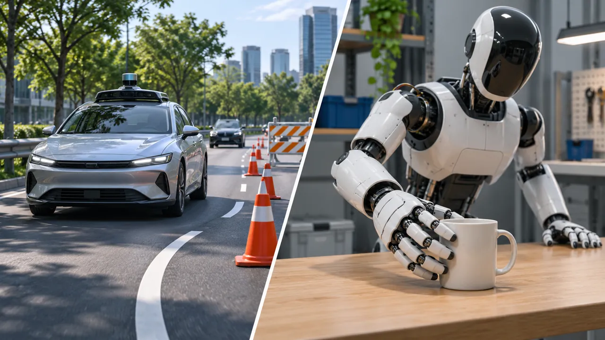
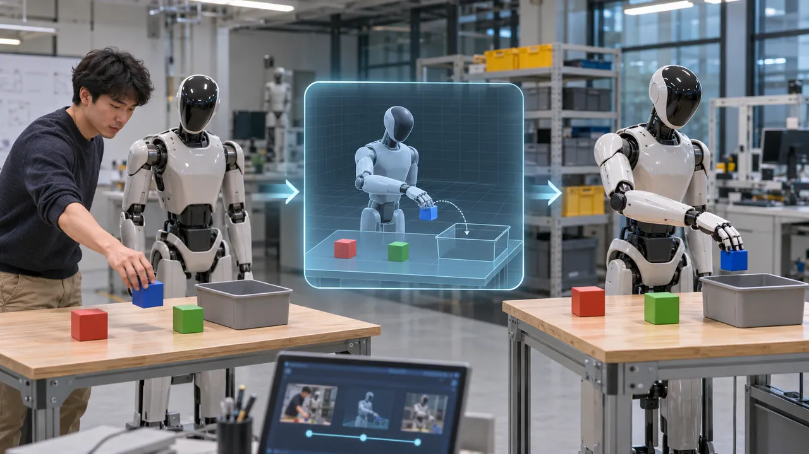

# 特斯拉的 FSD 经验，究竟能迁移到机器人多少？

> 特斯拉已经把部分自动驾驶技术和工程经验用于 Optimus，但会驾驶汽车与会操作物体之间，仍有很大的任务差异。FSD 的积累究竟能带来多少优势，取决于哪些经验能够复用、机器人还需要补上什么，以及这些积累最终能否减少学习和交付新任务的成本。

---

前段时间和几位做 LLM 基础模型的同学吃饭，最初聊的是大模型接下来的发展，后来话题延伸到了世界模型和具身智能。我们当时有一个比较积极的判断：特斯拉可能会是物理 AI 领域非常有竞争力的选手。

这个判断有它的依据。特斯拉已经在自动驾驶领域投入多年，拥有来自真实车辆的数据，也建立了模型训练、仿真、部署和持续改进的工程体系。相比一家从零开始研发人形机器人的公司，它似乎已经完成了一部分前期积累。而且，自动驾驶本身也是一个让 AI 观察物理世界、作出决策并执行动作的过程。但沿着这个思路往下想，就会碰到一个更具体的问题：**汽车已经学到的东西，究竟能让机器人少走多少弯路？**

我之前在[《物理世界会有自己的 LLM 时刻吗？》](https://marktian-long.github.io/tools/blog/posts/physical-world-llm.html)里讨论过，物理 AI 需要的不只是知识，还包括真实行动与反馈。在[《视频已经能“生成未来”，为什么还不等于会预测世界？》](https://marktian-long.github.io/tools/blog/posts/video-world-model.html)里，则讨论了视频学习与可靠物理预测之间的距离。这次想进一步研究的是：当一个 AI 系统已经在某类物理任务中积累了经验，这些经验能否迁移到另一类任务，甚至另一种身体上？特斯拉的 FSD 和 Optimus，恰好让这个问题变得具体。

## 一、Optimus 已经从 FSD 复用了什么？

Tesla 把自动驾驶技术用于机器人的尝试，至少可以追溯到 2022 年。在那年的 [Tesla AI Day](https://www.elonmuskarchive.org/video/tesla-ai-day-2022) 上，Milan Kovac 介绍，Optimus 沿用了部分自动驾驶视觉网络，包括用于识别周围三维空间占用情况的 Occupancy Network（占用网络）。团队还将机器人的行走控制代码接入 Autopilot 仿真系统，利用已有工具辅助开发和测试。

这两项复用各有意义。占用网络帮助模型理解周围哪里有物体、空间如何分布；仿真工具则可以用于测试动作和发现问题。机器人需要的场景、运动方式与汽车不同，但并非所有感知组件和工程工具都要重新设计。

同一场发布会上，Kovac 也明确提到，视觉网络可以沿用，但训练数据需要针对机器人重新采集。这句话比“自动驾驶技术全面迁移至机器人”更有解释力：可复用的可能是网络设计和训练方式，原有的数据与训练结果未必足以支撑新任务。

这里需要区分两种情况。第一种是模型能力的迁移，例如自动驾驶模型学到的视觉、空间或运动规律，经过适配后可能帮助 Optimus 更快完成任务；这不等于把现有 FSD 权重直接复制到机器人。第二种是工程体系的复用，例如继续使用相似的数据处理、仿真、模型训练和部署工具。后者即使不涉及驾驶模型知识的直接继承，也可能减少研发工作量。

Tesla 的公开披露已经能支持一部分实际工程复用，但还不能把这两种收益分别量化。尤其是，**使用同一套网络或工具，并不等于证明 FSD 的驾驶数据已经显著提高 Optimus 的操作能力。** 要判断这种复用的上限，还得先看看两类任务究竟有多大差异。

## 二、李飞飞的提醒：从“不碰东西”到“必须碰东西”

在这件事上，李飞飞提供了一个很有价值的不同视角。

2025 年 11 月，她在 [Lenny’s Podcast](https://www.lennysnewsletter.com/p/the-godmother-of-ai) 中谈到，自动驾驶汽车可以被理解为一种相对简单的机器人：它主要沿着二维路面移动，目标是避免碰撞；而更通用的机器人需要在三维世界里活动，并主动接触和操作物体。同年 12 月，她又在[《赵何娟Talk》访谈视频节选](https://www.tmtpost.com/video/7819529.html)中用类似的说法解释这一差异。这里引用的是她本人对任务差异的描述，而不是两项独立的实验结论。

这个对比很形象，但需要理解它的准确含义。自动驾驶当然需要三维空间感知，Tesla 自己在 2022 年介绍的占用网络就是用来建立三维环境表示的。李飞飞所说的“二维”，主要是指汽车运动受道路平面约束；她强调的是任务目标和动作自由度的不同，而不是汽车眼中的世界只有两个维度。

想象一辆汽车从停着的车辆旁边驶过。它需要识别障碍物、判断距离、规划路线并安全通过。现在换成一个机器人，把任务改成从桌面拿起水杯。机器人同样要识别物体、判断距离、规划动作，但任务在接触水杯时才真正进入关键部分：抓在哪里、用多大力、水杯有没有滑动、拿起来后能否保持稳定。前面一部分能力可能相通，后面一部分却涉及新的经验。

为了看清两类任务的差异，可以按实际控制目标作一个简化比较。

| **比较维度** | **自动驾驶** | **机器人操作** |
| --- | --- | --- |
| 主要任务 | 安全移动到目标位置 | 移动并操作目标物体 |
| 运动约束 | 主要受道路空间约束 | 全身与多关节协调 |
| 与物体的关系 | 通常需要避免碰撞 | 需要主动、受控接触 |
| 关键反馈 | 路径、车辆状态、风险 | 位置、接触、力量、结果 |

*这是用于理解任务差异的本文归纳，不是对两类系统能力的完整分类。自动驾驶有复杂的三维感知和控制任务，机器人也包含避障与移动任务。*

这张表揭示的不是“汽车简单、机器人复杂”这样一个笼统的排名，而是两者的**有效经验覆盖范围不同**。驾驶过程中积累的大量避障和运动经验，可能对机器人的空间理解与移动有帮助；但抓取、搬运和精细操作还需要新的动作与接触反馈。

李飞飞也强调，自动驾驶本身是一项了不起的技术成就。她的观点提醒我们，不能因为两者都在物理世界中行动，就默认完成一种任务所需的经验足以覆盖另一种任务。不过，任务不同也不意味着经验完全无法共享，关键要看不同任务之间能否找到可供学习的共同规律。

## 三、任务不同，经验为什么仍然可能迁移？

研究跨本体学习的一个重要思路，是寻找不同身体背后的共同任务，而不是要求它们使用完全相同的动作。例如，汽车要通过视觉信息接近一个目标位置，机械臂也要通过视觉信息让手部接近目标物体。虽然一个使用车轮，另一个使用关节和机械臂，但它们可能共享一部分关于目标位置、空间距离和运动方向的规律。

2024 年 RSS 的研究 [*Pushing the Limits of Cross-Embodiment Learning for Manipulation and Navigation*](https://arxiv.org/html/2402.19432v1) 就尝试把导航与机械臂操作放进同一个训练体系。研究者通过对齐目标和动作的表达，让不同来源的数据能够共同参与学习。实验发现，某些导航数据确实可以提高机械臂面对新环境时的表现，但并非所有导航数据都有效；数据与目标任务之间的关联仍然重要。

这项研究说明，李飞飞指出的身体和任务差异，并不意味着完全没有共享空间。即使两个系统最终执行的动作不同，也可能在接近目标、理解相对位置等局部问题上共享经验。

2026 年另一项 RSS 研究 [*Emergence of Human to Robot Transfer in Vision-Language-Action Models*](https://vision.ics.uci.edu/papers/emergence-of-human-to-robot-transfer-in-vision-2026/) 进一步发现，当机器人模型已经接触过足够多样的任务和本体数据后，人类操作视频可以帮助它学习新的机器人任务，甚至改善部分底层动作预测。不过，实验使用了手部轨迹等信息来帮助建立人类动作与机器人动作之间的对应关系，而且效果依赖模型已有的训练基础。不能据此认为普通视频可以直接变成机器人控制能力。

也有不同的实验结果。2026 年的一篇[机器人联合训练研究](https://arxiv.org/html/2602.01067v1)发现，在机器人自身数据较少时，额外利用视频提取的潜在动作信息可以带来收益；但随着目标机器人数据增加，这种训练方式的额外收益会减弱。在数据和计算都更充分的基线下，额外加入该视频潜在动作训练阶段没有带来收益。论文同时发现，视觉语言数据、其他机器人数据以及人类视频的语言标注，在不同条件下仍然可能有帮助，所以这不是“视频训练对机器人无用”的结论。

把上述研究的训练条件与反例放在一起，可以更清楚地看到跨本体迁移的不同边界：

| 研究与迁移对象 | 关键条件 | 实验结果 | 证据边界 |
| --- | --- | --- | --- |
| [RSS 2024](https://arxiv.org/html/2402.19432v1)：导航→机械臂 | 目标条件与动作对齐 | 部分数据提升操作表现 | 并非所有导航数据有效 |
| [RSS 2026](https://vision.ics.uci.edu/papers/emergence-of-human-to-robot-transfer-in-vision-2026/)：人类视频→机器人 | 多样预训练与手部轨迹 | 特定泛化任务表现近翻倍 | 不等于普通视频直接控机器人 |
| [2026 预印本](https://arxiv.org/html/2602.01067v1)：视频潜在动作 | 目标机器人数据较少 | 小数据有益，数据足时无增益 | 不代表其他视频信号无效 |

这是对三项不同实验的条件性归纳，不是统一数据集上的横向排名，也不是 Tesla FSD → Optimus 的直接验证。

这些实验共同指向一个判断：**迁移价值不是由数据来源或数量单独决定的，而是取决于它是否包含目标任务能用上的规律，以及目标模型有没有能力吸收这些规律。**

对 Tesla 来说，FSD 的车队规模能够说明它拥有大量驾驶经验，却不能直接告诉我们这些经验能让 Optimus 少采集多少数据、少经历多少训练，或者提高多少操作成功率。前面的实验还说明，外部经验的收益往往与目标机器人已有的数据和训练基础有关。这就把问题引向了 Optimus 自己：如果 FSD 提供了一部分空间理解和工程起点，机器人还必须积累什么经验，才能完成接触和操作任务？

## 四、Tesla 自己为什么还要建立 Optimus 的训练体系？

Tesla 在 2026 年第三季度财报电话会上的表述，恰好提供了一个有价值的对照。

负责 AI 的 Ashok Elluswamy 提到，Cybercab 能够利用 Model 3、Model Y 等已有车型的数据，因此不需要先建立规模同样庞大的 Cybercab 车队，才能获得训练所需的经验。不同车型虽然有硬件差异，但它们主要完成的是同一种驾驶任务，数据复用相对直接。

讨论 Optimus 时，管理层强调的却是另一件事。在[这场电话会](https://www.fool.com/earnings/call-transcripts/2026/10/22/tesla-tsla-q3-2026-earnings-call-transcript/)中，马斯克表示，Tesla 希望建设 Optimus Academy，让机器人练习大量不同任务，并提出未来可能需要约 1 万至 2 万台机器人参与训练。Elluswamy 则解释，机器人可以先通过观察人类学习任务，再依靠自己在现实和仿真环境中的练习不断改进。这些是当时披露的训练设想和建设目标，并不代表该规模的机器人训练体系已经建成。

这里恰好能看到迁移条件对 Tesla 实际路线的影响。对 Cybercab 来说，既有车辆已经产生大量与目标任务高度相关的数据；对 Optimus 来说，汽车提供的经验虽然可能有用，但机器人自己仍然要积累操作物体、全身协调和任务失败后的调整经验。前一节研究中提到的任务关联与机器人已有能力，在这里变成了具体的数据和训练需求。

因此，**Optimus Academy 并不是 FSD 技术复用失败的证明，而是跨任务迁移仍然需要付出的现实成本。** 已有能力可以提供学习起点，但目标任务特有的经验仍需持续补充。

更值得观察的是这些新增经验怎样被利用。如果机器人练习一次任务，只是简单留下更多视频，那并不一定产生足够价值；如果团队能够识别失败发生在哪里，改进训练后再让机器人完成原本失败的任务，新增数据才真正转化成能力。

这条路线也并非 Tesla 独有。有的团队重点采集真实机器人操作数据，有的团队研究用人类示范补充训练，也有团队利用仿真生成更多任务经验。它们并不都依赖汽车数据。由此，Tesla 的领先假设需要进一步拆开：它究竟能从 FSD 继承多少现成的学习能力，又能凭借已有工程体系，把 Optimus 需要的新经验积累得更快、更有效？

## 五、从技术积累到竞争优势，中间还差什么？

回到最初与同学讨论时的判断，我仍然认为 Tesla 在物理 AI 领域值得重点关注，但“拥有 FSD 积累”与“形成持续竞争优势”之间，需要经过实际效果检验。

首先看**模型和数据是否带来额外的学习收益**。假设两组 Optimus 使用相同的硬件、机器人数据与训练投入，其中一组额外使用 FSD 积累的模型或数据。如果后者能更快学会新任务、在陌生环境中表现更好，才可以较有把握地说，FSD 的相关知识产生了独立增益。Tesla 公开披露的技术复用已经说明这种研究方向具有现实基础，但还不足以量化增益。即使未来 Optimus 的能力显著提升，也要进一步区分这种进步来自 FSD 的积累，还是来自新采集的机器人数据、算法和硬件改进。

其次看**工程体系是否提高研发和迭代效率**。即使驾驶模型本身不能直接让机器人学会拿杯子，Tesla 仍可能利用已有的数据采集、模型训练、仿真和部署经验，更快建立机器人的学习体系。这种优势可以体现在更短的研发周期、更快的失败修复和更低的开发成本上。不过，采用类似工具与真正获得效率提升之间还隔着实际运行结果，不能根据汽车业务过去的成功自动确认。

这两项讨论的是可能的优势来源。**它们能否进一步转化为持续的商业优势，是另一道检验。** 客户最终购买的并不是训练速度或模型分数，而是机器人能否在具体场景中长时间、低成本地完成工作。设备能否稳定运行，需要多少人工干预，维护费用是多少，任务范围是否足够有价值，都决定了机器人是否具备实际购买理由。

而要判断竞争优势，还得把 Tesla 放到其他技术路线旁边比较。如果其他厂商通过专门采集的机器人数据，也能用相近甚至更低的成本实现同样可靠的任务交付，那么 Tesla 的 FSD 积累即使有帮助，也未必构成难以追赶的壁垒。

这里存在两种不同的可能结果。如果未来能够观察到，Tesla 不仅让 Optimus 更快掌握新任务，还能依靠已有工程能力持续降低训练和交付成本，那么 FSD 的积累就可能从研发起点转化为长期优势。如果机器人学习仍然主要依赖与竞争对手相近的专门数据和投入，那么 FSD 的价值可能更多体现在工程工具与组织经验的复用，而不是某种难以复制的机器人学习能力。

这两种结果都有可能，也不必要求模型迁移收益和工程收益同时成立。真正需要检验的是，Tesla 由此获得的额外收益是否足够明显、持久，并能够在真实客户任务中兑现。

---

回头看那次与同学的讨论，我对 Tesla 的关注没有改变，但判断它的依据需要更具体一些。Cybercab 可以较直接地继承其他车型的驾驶数据，Optimus 却仍然需要建立自己的训练体系。这种差异，恰好说明了 FSD 积累的价值与边界。

**FSD 可能让 Optimus 提前起跑，却不能直接替它跨过接触和操作物体这道门槛。** 接下来真正值得观察的，是 Tesla 能否利用已有的模型与工程积累，比其他技术路线更快、更经济地让机器人掌握新任务，并将这种学习优势转化为稳定交付。

如果能，这些积累才有机会形成持续竞争优势；如果不能，FSD 仍可能是一份有价值的工程资产，却未必是决定机器人竞争格局的独特壁垒。

## 参考资料

### 人物访谈与 Tesla 管理层公开发言

- [Lenny's Podcast：The Godmother of AI on jobs, robots & why world models are next（2025-11-16）](https://www.lennysnewsletter.com/p/the-godmother-of-ai)。李飞飞本人访谈。
- [钛媒体《赵何娟Talk》：李飞飞谈自动驾驶与三维机器人（2025-12-24）](https://www.tmtpost.com/video/7819529.html)。原访谈视频节选。
- [Tesla AI Day 2022 文字稿](https://www.elonmuskarchive.org/video/tesla-ai-day-2022)。Tesla 公开活动的第三方转录，非独立性能验证。
- [Tesla 2026 Q3 财报电话会文字稿](https://www.fool.com/earnings/call-transcripts/2026/10/22/tesla-tsla-q3-2026-earnings-call-transcript/)。管理层公开发言的媒体转录；Optimus Academy 规模为计划。

### 同行评审研究

- [Pushing the Limits of Cross-Embodiment Learning for Manipulation and Navigation — RSS 2024](https://arxiv.org/html/2402.19432v1)
- [Emergence of Human to Robot Transfer in Vision-Language-Action Models — RSS 2026](https://vision.ics.uci.edu/papers/emergence-of-human-to-robot-transfer-in-vision-2026/)

### 预印本（尚未同行评审）

- [A Systematic Study of Data Modalities and Strategies for Co-training Large Behavior Models for Robot Manipulation — 2026](https://arxiv.org/html/2602.01067v1)

### 图片素材与授权

- [Ulf Klingström（Ulkl）：StockholmOptimus01.jpg（2024-05-13）](https://commons.wikimedia.org/wiki/File:StockholmOptimus01.jpg)。Wikimedia Commons；作者声明作品置于公共领域（Public Domain）。

### 相关历史文章

- [物理世界会有自己的 LLM 时刻吗？](https://marktian-long.github.io/tools/blog/posts/physical-world-llm.html)
- [视频已经能“生成未来”，为什么还不等于会预测世界？](https://marktian-long.github.io/tools/blog/posts/video-world-model.html)

来源可信度说明：Tesla AI Day 与 Q3 电话会为第三方转录的管理层公开发言，不是独立性能验证；RSS 研究证明的是特定实验条件下的迁移现象，不能直接代表 Tesla 内部实现；2026 年联合训练研究为预印本。
