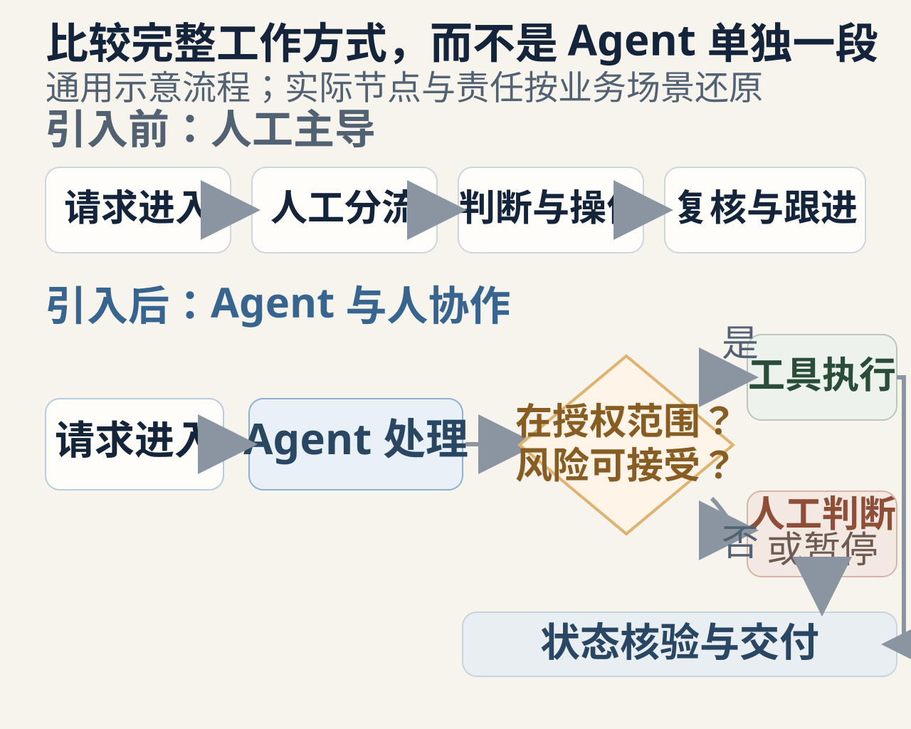

# Agent 上线后，怎样量出真实业务价值？

> 企业引入 Agent，可能希望降低成本、增加产能、改善客户体验、促进增长或控制风险，但自动化率和任务成功率都不能单独证明这些结果。本文从价值目标、工作系统变化、结果归因和价值兑现四步，说明怎样判断 Agent 是否改善了业务，以及扩大任务范围是否仍值得。

---

Agent 指标看起来不错，企业却未必因此得到更多价值。

Intercom 在 2026 年 8 月调整其客服 Agent Fin 的表现指标时，给出过一个说明分母变化的例子：1,000 次会话中，Fin 解决了 250 次；旧口径把 750 次 Fin 参与会话（Fin Involved）作为解决率分母，得到约 33%；新口径只把 Fin 实际有机会回答的 500 次纳入分母，解决率变成 50%。解决数量仍是 250 次，自动化率也保持在 25%，变化的是解决率的分母。[Intercom 对 Fin 指标口径的说明](https://www.intercom.com/help/en/articles/15599377-update-to-fin-performance-metrics)明确指出，Fin 没有机会回答的受限会话不再计入 Fin Involved。这个口径更适合诊断 Fin 在适格会话中的表现，但新旧解决率不能直接当作同一条业务结果曲线比较。

人工参与也会改变指标的含义。Fin 的人工协同（Human in the Loop）功能允许它向同事请求信息、审批或判断，再由 Fin 发出最终回复；如果最终由 Fin 完成解决，这类会话仍计入 Fin 的解决率和自动化率。若同事直接接管，才会被报告为升级处理。[Intercom 的人工协助规则](https://www.intercom.com/help/en/articles/16198358-ask-a-teammate-for-help-with-fin-s-replies-human-in-the-loop)说明，产品指标中的“自动完成”未必意味着全程没有人。

计费口径又是另一层。Fin 的计费文档把解决（Resolution）、流程交接（Procedure handoff）等列为不同的可计费结果（outcome），每段会话最多计一次；计费结果、解决率和自动化率不是同一指标。[Fin 的 outcome 定义](https://www.intercom.com/help/en/articles/8205718-fin-ai-agent-outcomes)

这些例子引出本文真正关心的问题：看板上的自动化率、解决率和成功率，究竟说明了什么？它们能否证明企业降低了成本、增加了产能、获得了新增收入，或者让客户得到更好的结果？

本文关注企业采用方在 Agent 上线后的持续衡量，不重讲模型排行榜和概念验证（POC）的投入前验证。金融 B 端 AI POC 的业务基线、价值假设、验证门槛和阶段决策，已在[《AI POC 到底在验证什么？》](https://marktian-long.github.io/tools/blog/posts/ai-poc-financial-b2b-guide.html)中展开。这里所说的 Agent（智能体），是能在限定任务中读取业务状态、调用工具并推进工作、必要时请求人工介入的系统；只生成文本的聊天助手不在主讨论范围内。本文仍引用 AI 辅助人工和生成式 AI 工作流研究作为对照证据，但不会把它们直接当作自主 Agent 的效果。这里继续追问的是：当系统进入日常运营后，怎样证明它改变了真实业务，以及这些变化是否值得持续投入？

为了把这些问题变成可执行的衡量顺序，本文归纳为四步；这是本文的工作框架，不是行业统一标准。

## 一、企业引入 Agent，究竟希望获得谁的什么价值？

先不要问 Agent 能完成多少任务，而要问：**谁希望得到什么结果，谁为它付钱，又由谁承担成本和风险？**

同一个 Agent 项目，可能同时影响几类主体：

| 价值主体 | 可能获得的价值 | 也可能承担的代价 |
|---|---|---|
| 客户 | 更快得到答复、少重复说明、问题被完整解决 | 错误建议、反复补充信息、失去人工服务入口 |
| 员工 | 少做重复劳动，把精力转向复杂判断 | 额外审核、异常处理、任务切换和责任压力 |
| 企业采用方 | 降低可变成本、增加合格产出、改善转化或控制风险 | 模型与工具费用、集成运维、质量和合规责任 |
| Agent 供应商 | 获得订阅、调用或交易收入，积累产品使用反馈 | 推理和服务成本、客户流失、故障与服务责任 |

价值创造和价值捕获不能混为一谈。客户等待时间下降，说明客户体验可能改善；员工每小时完成的合格任务增加，说明运营产能可能提高；只有当这些变化进一步形成可验证的收入、已兑现的成本下降或风险损失减少时，企业才获得相应的经济回报。客户收益、企业回报与资本市场估值之间的区别，已在[《技术最领先的人，为什么不一定拿走最大的价值？》](https://marktian-long.github.io/tools/blog/posts/ai-innovation-value-capture.html)中讨论过；本文把问题落到 Agent 上线后的结果衡量与经营决策。

有些价值暂时无法可靠折算成现金。企业可能愿意为更稳定的服务质量、降低重大错误风险，或者过去无法经济提供的新服务投入资源。这些结果可以单独报告，但不应为了得到一个 ROI 数字而强行折算。

**先选业务目标，再选主指标。**

不同的采用理由，对应不同的结果变量：

| 主要目标 | 更接近业务结果的观察项 | 需要同时防止的副作用 |
|---|---|---|
| 效率与成本 | 每个合格交付的全成本、实际外包或加班支出 | 质量下降、返工和人工审核增加 |
| 产能与吞吐 | 单位时间的合格产出、积压量、端到端周期 | 低价值任务堆积、员工负荷转移 |
| 收入与增长 | 可归因的新增转化、收入、留存或复购 | 退款、投诉、渠道替代和获客成本 |
| 质量与客户结果 | 一次解决、重开、错误、客户满意度 | 只优化平均值而伤害复杂用户 |
| 风险与合规 | 预期损失、违规事件、严重错误和控制有效性 | 误报、漏报、审批成本和授权失控 |
| 新能力与服务范围 | 原本无法经济提供的任务、新服务采用率和贡献毛利 | 需求不足、交付质量与服务成本 |

表中的结果是候选项，不是要求每个项目全部设置一遍关键绩效指标（KPI）。销售 Agent 应优先衡量它试图改善的转化或收入，同时监控错误承诺、退款和投诉；风险审核 Agent 则可能优先关注损失事件和违规风险，同时控制误报及人工复核负担。每个项目先选一个与采用理由一致的主结果，再配少量不可忽略的质量、安全或成本护栏，避免在结果出来后才挑选最好看的数字。

真实业务研究也说明，结果方向会随任务类型变化。一项在线聊天随机实验发现，AI 建议能改善客服效率和客户情绪，但在重复投诉等超出系统能力的场景中效果较弱。研究还发现，先经历聊天机器人理解失败的客户，随后转给 AI 辅助人工客服时，情绪评价可能更差；研究者将其解释为 AI 更快的回复让客户误以为仍在和机器人交流，先前的失败体验因此延续。[这项 Management Science 研究](https://pubsonline.informs.org/doi/10.1287/mnsc.2022.03920)研究的是 AI 辅助人工，不是自主 Agent，但它说明平均处理时间不能代替客户结果。

收入增长也需要看具体业务场景。一个跨境零售平台在 2023—2024 年把生成式 AI（GenAI）增强能力接入客服、商品匹配、广告和卖家服务等七类业务应用，覆盖数百万用户和商品。随机现场实验发现，各应用的销售影响从 0 到 16.3% 不等；这项研究已于 2026 年 11 月 6 日在线发表于 *Management Science*。[零售平台 GenAI 现场实验](https://doi.org/10.1287/mnsc.2026.00623)证明了 GenAI 在部分业务流程中可能带来销售增量，但它不是自主 Agent 的部署实验，也不能据此推断 Agent 普遍提高销售。

## 二、Agent 实际改变了哪段业务工作？

确定目标后，第二个问题不是“Agent 做了多少次调用”，而是：**原来哪一项业务工作，现在由谁、通过什么路径完成？**

衡量单位应当尽可能贴近业务对象，而不是模型调用或聊天轮次。客服场景可能是一件客户问题，交易场景可能是一笔订单，金融场景可能是一项审核申请，研发场景可能是一项最终合并的代码变更。同一业务对象可能经过多个会话、系统和人员；如果只统计 Agent 处理过的那一段，后续接管、返工或重开就容易漏掉。

引入 Agent 不等于流程节点必然减少。它可以替人收集上下文、查询系统、生成方案或执行低风险动作，也可能引入新的授权检查、状态核验和异常升级。节点数量只是表面变化，端到端交付是否更快、更好、更可靠才是判断依据。

**把人机分工拆开记录。**

人工参与至少有三种不同形态：

- **提供信息或建议：**人补充背景、纠正事实，Agent 继续处理。
- **审批关键动作：**Agent 准备结果，人确认后再执行或发送。
- **完整接管：**Agent 无法继续，业务转回人工完成。

三者的人工成本、风险和业务含义不同。一次必要审批可能是高质量交付的组成部分，不应自动计为失败；但如果团队把完整接管也算成“自动完成”，就会低估人工负担。

因此，至少要区分业务需求总量、适格任务、分配给 Agent 的任务、实际启动、最终验收、人工协助、完整接管、失败和后续重开。分母规则应在观察前确定；任务一旦分配给 Agent，无论最终成功、失败、超时还是转人工，都要留在部署效果的统计范围内。对无法跨渠道关联的对象，后续重开和补救成本应记为未知，而不是当作零。

淘宝客服的一项随机现场实验展示了这种全局影响。研究在 2024 年 8 月 15—31 日随机分配 647 名客服人员，其中 302 人进入实验组、345 人进入对照组，实验期间共观察 680,676 次会话；其中 39,432 次（5.8%）被预先标记为 AI 适格。论文把适格会话定义为可由 Agent 自主处理的标准化问题，非适格会话则是需要人工完整处理的非标准化问题。实验组员工监督 Agent 处理适格会话，同时继续处理非适格会话；每个适格会话仍由指定员工监督，必要时可以接管，因此这不是无人监督的全自动部署。

实验期间，整体聊天时长下降约 3.2%，但总体客户评分和 7 天内同一问题再次联系的变化都不显著。分组后，适格会话时长下降 16.8%、客户评分下降 0.412 分；非适格会话时长下降 1.8%、客户评分上升 0.091 分。[Wang 等人的淘宝客服现场实验预印本](https://arxiv.org/abs/2605.14830)

另一项同行评审研究 *Generative AI at Work* 分析了 5,172 名客服人员分批使用 AI 助手后的表现，观察到每小时解决问题数量平均增加约 15%。[这项 Quarterly Journal of Economics 研究](https://doi.org/10.1093/qje/qjae044)说明，即使人仍在关键环节，AI 也可能改善真实产出；它研究的是人工使用 AI 助手，不是自主 Agent，不能把“有人参与”简单判成自动化失败，也不能把它当作全自动部署的效果证明。

## 三、怎样证明业务结果确实因 Agent 而改变？

流程图说明工作方式可能怎样变化，但它本身不能证明结果改善。第三步要回答：**相对于原来的工作方式，业务结果是否变好？有多少变化能够归因于 Agent 介入？**

为避免把不同层级的数字混在一起，本文把指标分为三类：

- **业务结果指标**回答企业最终得到了什么，例如合格产出、收入、客户结果或风险变化。
- **流程机制指标**解释变化通过什么发生，例如等待时间、交接次数、人工接管、返工、积压和重开。
- **Agent 诊断指标**解释系统在限定任务中的表现，例如最终状态是否正确、完整验收率、重复可靠性、工具错误、延迟和调用成本。

这三类指标是诊断层级，不与前面的四步一一对应；每一步都可能同时使用业务结果、流程机制和 Agent 诊断指标。授权、安全、合规和关键质量要求是不可折抵的护栏，不能用平均收益抵消一次越权操作或严重质量事故。

### 先建立可比较的基线

一个可信的比较至少需要明确五件事：

1. **目标结果：**最初希望改善的业务结果是什么，质量门槛是什么？
2. **业务对象与分母：**哪些需求进入观察，哪些符合 Agent 的适用条件？
3. **完整策略：**任务被分配后，无论成功、失败、超时还是人工接管，都记录最终结果。
4. **比较对象：**没有采用 Agent 时，类似业务对象会怎样处理？
5. **观察窗口：**是否覆盖后续重开、退款、投诉、复访或风险事件？

如果可以随机分配，随机化单位应匹配真实资源边界。客服人员共享队列和审核资源时，按单条会话分配可能产生组间影响；团队、班次或分阶段上线有时更适合，但仍要控制需求和人员结构差异。无法随机化时，可以使用匹配样本或前后对照，但应降低因果结论的强度。

尤其要防止任务选择偏差：如果团队只把最容易处理的请求交给 Agent，再用这些成功任务与人工处理的复杂请求比较，结果很可能高估 Agent 的效果。应按事先定义的分配规则观察整体策略，而不是只分析最终成功的子样本。如果上线时同时更换了模型、知识库、审批规则和人员分工，初期最多只能把效果归因于这套组合改造；除非有额外的实验设计，否则不能把全部改善单独归给模型。

### 技术评测能解释什么，不能证明什么？

技术评测仍然重要，但它回答的是局部能力和交付约束，不直接等于经营结果。

2026 年 11 月发布的 ShellBench 预印本给出一个直观例子：在一项晚餐餐厅推荐任务中，Agent 531 次尝试里有 522 次选对了餐厅，但只有 152 次满足全部九项要求；其中 331 次仅因为没有写明支持预算和时间判断的文件来源而失败。[ShellBench 预印本](https://arxiv.org/html/2611.32946v1)把任务正确性和证据完整性分开评分，说明“选对答案”不等于“交付已经完成”。

该基准的 90 项任务使用大模型评审，抽样的 278 条判据与人工共识有 89.9% 的一致率；这个数字只描述抽样判据的一致性，不是整项任务的准确率。全体 53,100 次运行中，15.7% 至少违反一条安全判据；其中 2,589 次虽然通过全部正确性判据，仍未通过安全要求。这里的安全失败是该基准规则下的判据违例，不等于真实业务伤害发生的概率。

成本也不能只看 Token（词元）单价。Arize 与 Fireworks 的公开示例在 40 项 Terminal-Bench 终端操作任务、10 个模型、每项 6 次试验中计算成功任务成本。最便宜的配置每个成功任务约 0.054 美元，但按至少 4/6 次成功定义的稳定覆盖只有 8/40 项；更贵的配置每个成功任务约 0.636 美元，却能稳定完成 25/40 项。[这份 cost-per-success benchmark](https://github.com/Arize-ai/fireworks-cost-benchmark)

这份由厂商维护的公开示例从更大的 Terminal-Bench 中筛选了任务子集，不是可直接横向比较的排行榜；价格按 2026 年 7 月的 API 价计算，不是当前报价。它只计算模型运行成本，没有包含人工审核、集成和运维。因此，成功任务成本必须和能力覆盖范围一起看。

[《AI Agents That Matter》](https://arxiv.org/abs/2407.01502)指出，面向产品采购的 Agent 评测应把美元成本与准确率放在一起看；基准还需要与任务泛化层级相匹配的留出集，避免模型利用训练集捷径。

对于需要稳定履责的场景，重复成功与偶尔成功不是同一回事。[τ-bench](https://arxiv.org/abs/2406.12045)把两种统计方式区分开：pass@k 表示多次尝试中至少成功一次的概率；pass^k 则表示 k 次尝试全部成功的概率。前者可以衡量“多试几次能否找到一次可用答案”，后者更接近“能否稳定承担这项工作”。

时间也应拆开记录：员工实际投入时间、业务端到端历时和 Agent 执行时长不能互相替代。METR 在 2026 年更新开发者生产率实验设计时指出，使用多个 Agent 并行会让部分参与者难以准确填报单项任务耗时；同时，30%—50% 的受访开发者表示，他们会跳过一些不愿在没有 AI 的情况下完成的任务。[METR 的实验更新](https://metr.org/blog/2026-02-24-uplift-update/)提醒我们，任务选择和时间测量本身都会影响生产率估计。这不是企业 Agent 的效果数据，而是衡量方法上的警告。

## 四、价值是否兑现，下一步是否值得扩大？

结果得到改善之后，还要区分企业已经拿到了什么、哪些只是潜在能力，以及扩大范围是否仍然划算。

### 不同价值需要不同的兑现证据

| 观察到的变化 | 可以报告什么 | 还不能直接声称什么 |
|---|---|---|
| 人工少花时间 | 可释放的产能 | 工资支出已经下降 |
| 相同团队处理更多合格任务 | 吞吐和运营能力提高 | 每个新增任务都产生了收入 |
| 更多客户完成购买 | 交易或转化增加 | 全部订单都是净新增 |
| 客户体验改善 | 服务质量或满意度改善 | 企业利润必然增加 |
| 严重错误减少 | 风险暴露降低 | 所有风险都能可靠货币化 |
| 原本不可行的服务开始可提供 | 新业务能力或战略选择权 | 已形成可验证的短期投资回报率（ROI） |

如果项目需要一个可审计的净经济贡献，可以按统一观察期采用一条简化核算式：

**净经济贡献 = 可归因的增量贡献毛利 + 未计入上述毛利的已兑现可变支出节省 + 可合理估算的预期损失减少 − Agent 全生命周期增量成本。**

这里的口径需要先统一：增量贡献毛利按扣除原有业务变动成本、但尚未扣除本项目 Agent 增量成本计算；第二项只计未在毛利中体现的已兑现节省，Agent 的模型、工具、人工协助、接管、集成与运维等增量成本统一在最后扣除。员工节省一小时，如果工资没有减少，也没有发生实际外包或加班支出下降，这一小时首先是可用产能，而不是现金节省；如果这段时间又被用于处理新增业务，可以计算新增产出的贡献毛利，但不能再把同一小时算作工资节省。风险降低只有在发生概率和损失金额可以合理估算时，才进入预期损失；客户体验、合规韧性和新服务能力等难以货币化的收益应单独报告。

成本也必须按完整交付周期核算。除了模型推理和工具调用，还要考虑重试、失败、人工审核、异常接管、系统集成、监控运维、权限治理、培训和流程变更。

### 扩围要看新增任务的边际影响

扩大 Agent 的任务范围后，自主完成比例可能下降，但整体经济性仍可能改善；反过来，共享人工资源被挤占，也可能抵消扩围收益。

下面是一个纯假设算例：一个观察窗口内有 100 个常规问题和 20 个复杂问题，全部按相同质量门槛交付。人工处理常规问题每件 10 元，复杂问题每件 50 元。Agent 方案的单件成本已经包含模型、工具、人工协助和接管支出；这里假定人工支出是可变的外包或加班成本，不把固定工资自动当作节省。

| 方案 | 常规任务成本 | 复杂任务成本 | 总变动成本 | 未发生完整接管比例 |
|---|---:|---:|---:|---:|
| 全部人工 | 1,000 元 | 1,000 元 | 2,000 元 | — |
| Agent 只处理常规任务 | 600 元 | 1,000 元 | 1,600 元 | 80% |
| Agent 扩大到复杂任务 | 600 元 | 700 元 | 1,300 元 | 76.7% |
| 扩围并挤占原有复核资源 | 600 元 + 400 元 | 700 元 | 1,700 元 | 76.7% |

在第二种 Agent 方案中，100 个常规任务的全部变动成本是每件 6 元，其中 80 件没有发生完整接管。扩大到复杂任务后，假设复杂任务每件成本 35 元，其中 12 件没有发生完整接管。未发生完整接管的任务比例变成 92/120，约为 76.7%，低于原来的 80%；但总成本从 1,600 元降到 1,300 元。

新增复杂任务的单件成本仍低于原有人工处理成本，因此整体成本仍可能下降；自主完成比例下降只说明更多任务需要人工参与，不能单独决定扩围是否划算。但如果新增复杂任务挤占共享复核资源，使原有任务额外增加 400 元成本，总成本就会变成 1,700 元；相较于不扩围的 1,600 元，扩大范围反而多花 100 元。

这个算例没有计入新增固定建设成本，也没有把满意度、风险和战略价值强行折算成钱。它说明扩围决策要看新增任务本身，以及它对原有工作系统的共同影响，而不是把原有任务的平均收益直接外推。

### 同一套衡量问题，怎样迁移到五个研究方向？

这五个方向的研究对象不同，但可以沿用相同的四个问题：

| 研究方向 | 更值得观察的业务结果 | 关键护栏 |
|---|---|---|
| 技术评测与执行框架（Harness） | 合格交付量、返工、交付周期 | 正确性、安全和可追溯性 |
| 多 Agent（多智能体）工作组织 | 净合格吞吐、端到端周期 | 协调成本、冲突和人工审查负担 |
| 个人 Agent（Personal Agent） | 完整事务是否推进、用户少承担多少跟进 | 授权、遗漏和补救能力 |
| 企业治理与金融 Agent | 安全可执行的业务范围、风险事件 | 权限、审计、撤权和责任 |
| Agentic Commerce（Agent 参与的商业交易） | 净新增交易、贡献利润和复购 | 用户授权、退款、履约和信任 |

多 Agent 系统不能只比较并行任务数，还要扣除协调、冲突和审查成本；Personal Agent 不能只看一次任务成功率，还要看完整事务是否持续推进，这与[《Personal Agent：当 AI 开始长期接手你的事》](https://marktian-long.github.io/tools/blog/posts/personal-agent.html)讨论的持续委托价值相呼应；面向交易的 Agent 则必须区分来源订单和净新增交易，相关的渠道迁移、交易完成与贡献利润问题已在[《当 AI 开始替用户付款，谁真正拥有交易？》](https://marktian-long.github.io/tools/blog/posts/agentic-commerce-transaction-control.html)中展开。

这些方向不需要使用同一个主指标。它们共享的是同一套衡量顺序：先确定价值主体和目标，再描述工作方式变化，证明结果及归因，最后判断价值是否兑现、扩围是否仍然划算。

## 结语：不要只问 Agent 做了多少事

Agent 的业务价值，不在于它完成了多少动作，而在于它是否让目标主体在完整工作系统中获得了可验证的业务结果。企业因此要同时观察任务如何进入系统、人与 Agent 如何分工、业务结果如何验收，以及新增成本和风险落在了哪里。

技术能力决定某些工作是否可能交给 Agent；产品设计决定它如何进入真实流程；组织安排决定人和 Agent 如何协作；商业衡量则要证明这些变化是否带来了企业真正需要的结果。

**Agent 上线不是价值证明的终点，而是持续衡量的起点。**

---

## 参考资料

### 产品指标与官方规则

- [Intercom：Update to Fin performance metrics](https://www.intercom.com/help/en/articles/15599377-update-to-fin-performance-metrics)
- [Intercom：Human in the Loop](https://www.intercom.com/help/en/articles/16198358-ask-a-teammate-for-help-with-fin-s-replies-human-in-the-loop)
- [Intercom：Fin AI Agent outcomes](https://www.intercom.com/help/en/articles/8205718-fin-ai-agent-outcomes)

### 同行评审研究

- [Brynjolfsson, Li & Raymond：Generative AI at Work](https://doi.org/10.1093/qje/qjae044)
- [Zhang & Narayandas：Engaging Customers with AI in Online Chats](https://pubsonline.informs.org/doi/10.1287/mnsc.2022.03920)
- [Generative Artificial Intelligence and Sales Productivity: Field Experiments in Online Retail](https://doi.org/10.1287/mnsc.2026.00623)

### 预印本研究与现场实验

- [Wang et al.：Agentic AI and Human-in-the-Loop Interventions](https://arxiv.org/abs/2605.14830)
- [ShellBench：What Matters More for AI Agents, Models, or Harness for Everyday Tasks](https://arxiv.org/html/2611.32946v1)
- [AI Agents That Matter](https://arxiv.org/abs/2407.01502)
- [Yao et al.：τ-bench](https://arxiv.org/abs/2406.12045)

### 公开基准与实验设计

- [Arize × Fireworks：Cost per Successful Task benchmark](https://github.com/Arize-ai/fireworks-cost-benchmark)（厂商维护的公开基准）
- [METR：We are Changing our Developer Productivity Experiment Design](https://metr.org/blog/2026-02-24-uplift-update/)（研究机构的实验设计说明）

### 相关历史文章

- [AI POC 到底在验证什么？](https://marktian-long.github.io/tools/blog/posts/ai-poc-financial-b2b-guide.html)
- [技术最领先的人，为什么不一定拿走最大的价值？](https://marktian-long.github.io/tools/blog/posts/ai-innovation-value-capture.html)
- [Personal Agent：当 AI 开始长期接手你的事](https://marktian-long.github.io/tools/blog/posts/personal-agent.html)
- [当 AI 开始替用户付款，谁真正拥有交易？](https://marktian-long.github.io/tools/blog/posts/agentic-commerce-transaction-control.html)
