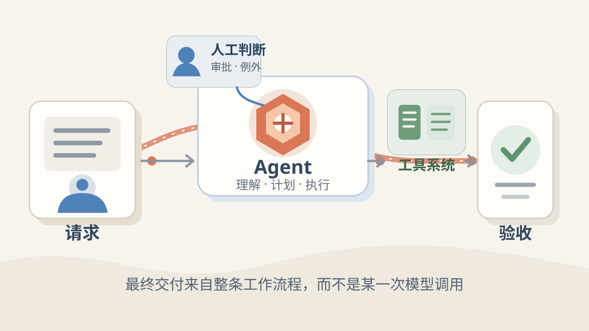
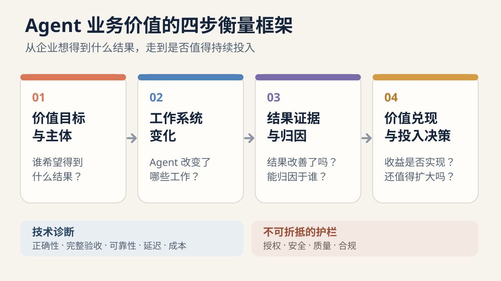
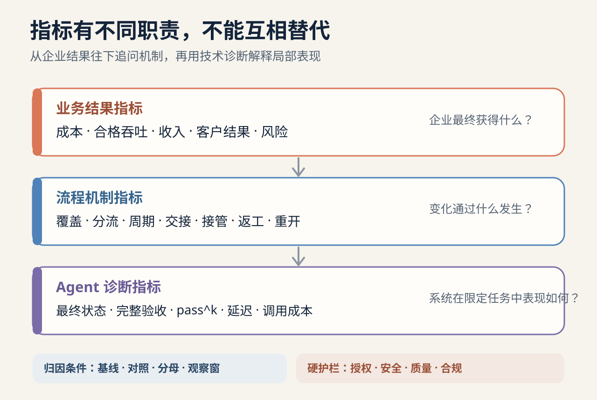
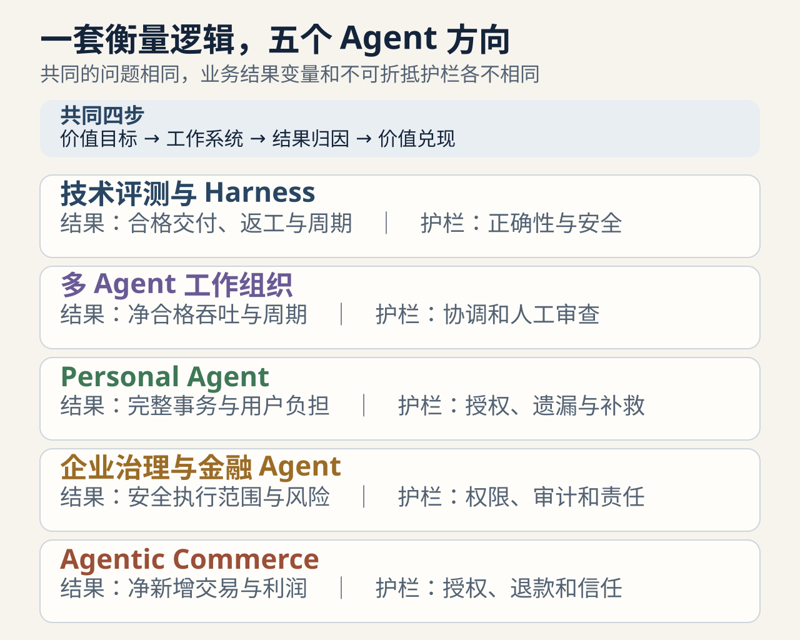

# Agent 上线后，怎样量出真实业务价值？

> 企业引入 Agent，可能希望降低成本、增加产能、改善客户体验、促进增长或控制风险，但这些目标不能由自动化率或任务成功率统一代表。本文从价值目标、工作系统变化、结果归因和价值兑现四步，说明怎样判断 Agent 是否改善了真实业务，以及扩大任务范围是否仍然值得。

---

如果只看一个指标，Agent 的业务价值很容易被高估。

Intercom 在更新 Fin 的表现指标时，给出过一个说明分母变化的示例：1,000 次会话中仍有 250 次得到解决；如果把 750 次有回答机会的会话作为分母，解决率约为 33%；如果新口径只把 500 次纳入分母，解决率就变成 50%。解决数量没有增加，比例却明显提高。[Intercom 对 Fin 指标口径的说明](https://www.intercom.com/help/en/articles/15599377-update-to-fin-performance-metrics)并不是说新口径不合理。它把“有机会由 Fin 回答的会话”单独拿出来，能帮助诊断产品表现；但新旧口径不能被当作同一条业务结果曲线直接比较。

还有一个容易忽略的边界：Fin 的 Human in the Loop 功能允许人工补充信息或审批回复，再由 Fin 发出最终答复；在符合规则的情况下，这类会话仍可能计入自动化率和解决率。[Fin 的人工协助机制](https://www.intercom.com/help/en/articles/16198358-ask-a-teammate-for-help-with-fin-s-replies-human-in-the-loop)说明，“Agent 参与并完成了会话”不一定等于“整个过程没有人”。

这两个例子把问题带到一起：看板上的自动化率、解决率和成功率，究竟说明了什么？它们能否证明企业降低了成本、增加了产能、获得了新收入，或者让客户得到更好的结果？

本文讨论的是 Agent 进入业务后的持续衡量，而不是模型排行榜，也不是再讲一次 POC 的投入前验证。要回答这个问题，必须把 Agent 放回企业真实的工作系统中。

## 一、企业引入 Agent，究竟希望获得谁的什么价值？

先不要问 Agent 能完成多少任务，而要问：**谁希望得到什么结果，谁为它付钱，又由谁承担成本和风险？**

同一个 Agent 项目，可能同时影响几类主体：

| 价值主体 | 可能获得的价值 | 也可能承担的代价 |
|---|---|---|
| 客户 | 更快得到答复、少重复说明、问题被完整解决 | 错误建议、反复补充信息、失去人工服务入口 |
| 员工 | 少做重复劳动，把精力转向复杂判断 | 额外审核、异常处理、任务切换和责任压力 |
| 企业采用方 | 降低可变成本、增加合格产出、改善转化或控制风险 | 模型与工具费用、集成运维、质量和合规责任 |
| Agent 供应商 | 获得订阅、调用或交易收入，积累产品使用反馈 | 推理和服务成本、客户流失、故障与服务责任 |

因此，价值创造、价值实现和价值捕获不能混为一谈。可以把它们分开理解：价值创造是相对于原有做法，业务结果改善了多少；价值实现是这些改善真正进入运营并被使用；价值捕获则是某一方通过收费、成本下降或利润保留获得了多少经济回报。

客户少等了十分钟，说明客户体验可能改善；企业每小时处理的有效请求增加，说明运营产能可能改善；只有当这些变化进一步带来可验证的收入、成本或风险结果时，才形成相应的经营回报。供应商按次收费，也不意味着客户已经获得同等规模的收益。

这并不是说所有价值都必须换算成钱。企业可能愿意为更稳定的服务质量、降低严重错误风险，或者过去无法经济提供的新服务投入资源。但这些结果应当分别报告，不能为了得到一个 ROI 数字，把它们强行折算成现金。

### 先选业务目标，再选主指标

不同的采用理由，对应不同的结果变量：

| 主要目标 | 更接近业务结果的观察项 | 需要同时防止的副作用 |
|---|---|---|
| 效率与成本 | 每个合格交付的全成本、实际外包或加班支出 | 质量下降、返工和人工审核增加 |
| 产能与吞吐 | 单位时间的合格产出、积压量、端到端周期 | 低价值任务堆积、员工负荷转移 |
| 收入与增长 | 可归因的新增转化、收入、留存或复购 | 退款、投诉、渠道替代和获客成本 |
| 质量与客户结果 | 一次解决、重开、错误、客户满意度 | 只优化平均值而伤害复杂用户 |
| 风险与新能力 | 损失事件、违规、可安全执行的业务范围、新服务 | 误报、漏报、授权失控和治理成本 |

这张表是候选结果的导航，不是要求每个项目全部设置一遍 KPI。一个销售 Agent 应优先衡量它试图改善的转化或收入，同时监控错误承诺、退款和投诉；一个风险审核 Agent 则可能优先关注损失事件和违规风险，同时控制误报及人工复核负担。

每个项目最好先选一个与采用理由一致的主结果，再配少量不可忽略的质量、安全或成本护栏。若一开始就把十几个指标并列，团队往往会在结果出来后挑选最好看的数字，而不是验证最初的业务假设。

## 二、Agent 实际改变了哪段业务工作？

确定目标后，第二个问题不是“Agent 做了多少次调用”，而是：**原来哪一项业务工作，现在由谁、通过什么路径完成？**

衡量单位应当尽可能贴近业务对象，而不是模型调用或聊天轮次。客服场景可能是一件客户问题，交易场景可能是一笔订单，金融场景可能是一项审核申请，研发场景可能是一项最终合并的代码变更。同一业务对象可能经过多个会话、系统和人员；如果只统计 Agent 处理过的那一段，就可能把后续接管、返工或重开漏掉。

这张图表达的是一种可能的工作方式变化，不是说 Agent 一定让流程节点变少。Agent 可以替人收集上下文、查询系统、生成方案或执行低风险动作；但它也可能引入新的授权检查、状态核验和异常升级。节点数量减少只是表面变化，端到端交付是否更快、更好、更可靠才是判断依据。

### 把人机分工拆开记录

人工参与至少有三种不同形态：

- **提供信息或建议：**人补充背景、纠正事实，Agent 继续处理。
- **审批关键动作：**Agent 准备结果，人确认后再执行或发送。
- **完整接管：**Agent 无法继续，业务转回人工完成。

三者的人工成本、风险和业务含义不同。一次必要审批可能是高质量交付的组成部分，不应自动计为失败；但如果团队把完整接管也算成“自动完成”，就会低估人工负担。

因此，至少要能区分业务需求总量、适格任务、分配给 Agent 的任务、实际启动、最终验收、人工协助、完整接管、失败和后续重开。分母规则应在观察前确定；任务一旦分配给 Agent，不能因为失败、超时或接管，就从整体部署效果中悄悄删除。

还要追踪 Agent 没有直接处理的那部分工作。Wang 等人对 2024 年淘宝客服部署的随机现场实验，覆盖 647 名客服人员和 680,676 次会话，AI 适格会话约占 5.8%。研究观察到整体处理时长改善，但适格与非适格会话的评分变化方向不同，总体评分变化并不显著，也没有观察到重访减少。[原始研究](https://arxiv.org/abs/2605.14830)提示：Agent 接走一部分简单任务后，人工可能把更多注意力转向复杂任务；这会影响整个队列，而不仅是 Agent 直接处理的样本。

如果跨渠道无法把同一业务对象可靠关联起来，也要报告关联覆盖率和未知结局。没有记录到重开，不等于证明没有重开。

## 三、怎样证明业务结果确实因 Agent 而改变？

流程图说明工作方式可能怎样变化，但它本身不能证明结果改善。第三步要回答：**相对于原来的工作方式，业务结果是否变好？有多少变化能够归因于 Agent 介入？**

指标至少有三种职责：

- **业务结果指标**回答企业最终得到了什么，例如合格产出、收入、客户结果或风险变化。
- **流程机制指标**解释变化通过什么发生，例如等待时间、交接次数、人工接管、返工、积压和重开。
- **Agent 诊断指标**解释系统在限定任务中的表现，例如最终状态是否正确、完整验收率、重复可靠性、工具错误、延迟和调用成本。

授权、安全、合规和关键质量要求则应当作为不可折抵的护栏，而不是可以用平均收益抵消的普通指标。

### 先建立可比较的基线

一个可信的比较至少需要明确五件事：

1. **目标结果：**最初希望改善的业务结果是什么，质量门槛是什么？
2. **业务对象与分母：**哪些需求进入观察，哪些符合 Agent 的适用条件？
3. **完整策略：**任务被分配后，无论成功、失败、超时还是人工接管，都记录最终结果。
4. **比较对象：**没有采用 Agent 时，类似业务对象会怎样处理？
5. **观察窗口：**是否覆盖后续重开、退款、投诉、复访或风险事件？

如果可以随机分配，随机化单位应匹配真实资源边界。客服人员共享队列和审核资源时，按单条会话分配可能产生组间影响；团队、班次或分阶段上线有时更适合，但仍要控制需求和人员结构差异。无法随机化时，可以使用匹配样本或前后对照，但应降低因果结论的强度。

尤其要防止任务选择偏差：如果团队只把最简单的请求交给 Agent，再用这些成功任务与人工处理的复杂请求比较，结果很可能高估 Agent 的效果。应按事先定义的分配规则观察整体策略，而不是只分析最终成功的子样本。

如果上线时同时更换了模型、知识库、审批规则和人员分工，初期最多只能把效果归因于这套组合改造。除非有额外的实验设计，否则不能把全部改善单独归给模型。

### 技术评测能解释什么，不能证明什么？

技术评测仍然重要，但它回答的是局部能力和交付约束，不直接等于经营结果。

例如，[ShellBench 的研究](https://arxiv.org/html/2611.32946v1)中，一个餐馆推荐任务有 531 次尝试，其中 522 次选对了餐馆，但最终只有 152 次满足全部任务要求。相当一部分失败来自没有提供规定的证据引用。这个例子说明，答案看起来正确，不代表交付已经完整。

同样，[Arize 与 Fireworks 的成本基准](https://arize.com/blog/cost-per-successful-task-ai-model-benchmark/)说明，按 Token 或调用价格排序，与按成功任务成本排序，可能得到不同的模型选择；但它主要计算 API 成本，并没有覆盖所有人工和运维支出。

重复可靠性也不能被单次成功率替代。[τ-bench](https://arxiv.org/abs/2406.12045)区分了多次尝试中至少成功一次的 pass@k，与每次尝试都成功的 pass^k。对企业来说，偶尔能完成和稳定承担职责，是不同的上线条件。

时间也应拆开看：人真正投入的活跃时间、业务从开始到结束的日历时间、Agent 累计运行时间不能互相替代。[METR 对开发者生产率实验设计的说明](https://metr.org/blog/2026-02-24-uplift-update/)提醒，任务选择偏差和并行 Agent 都会让自报时间失真。

这些技术指标的价值，在于定位系统为什么没有交付、成本从哪里产生，以及哪些风险不能放行。它们不能替代企业真正关心的业务结果。

## 四、价值是否兑现，下一步是否值得扩大？

结果得到改善之后，还要区分：企业已经拿到了什么，哪些只是潜在能力，以及扩大范围是否仍然划算。

### 不同价值需要不同的兑现证据

| 观察到的变化 | 可以报告什么 | 还不能直接声称什么 |
|---|---|---|
| 人工少花时间 | 可释放的产能 | 工资支出已经下降 |
| 相同团队处理更多合格任务 | 吞吐和运营能力提高 | 每个新增任务都产生了收入 |
| 更多客户完成购买 | 交易或转化增加 | 全部订单都是净新增 |
| 客户体验改善 | 服务质量或满意度改善 | 企业利润必然增加 |
| 严重错误减少 | 风险暴露降低 | 所有风险都能可靠货币化 |
| 原本不可行的服务开始可提供 | 新业务能力或战略选择权 | 已形成可验证的短期 ROI |

成本也必须按完整交付周期核算。除了模型推理和工具调用，还要考虑重试、失败、人工审核、异常接管、系统集成、监控运维、权限治理、培训和流程变更。

尤其要避免重复计算：如果员工节省了一小时，但工资没有减少，也没有发生实际外包或加班支出下降，这一小时首先是可用产能，而不是现金节省。如果这段时间又被用于处理新增业务，可以报告新增合格吞吐或相应贡献利润，但不能再把同一小时重复算成工资节省。

### 扩围要看新增任务的边际影响

下面用一个纯假设算例说明：扩大 Agent 的任务范围后，自主完成比例可能下降，但整体经济性仍可能改善；反过来，共享人工资源被挤占，也可能抵消扩围收益。

假设一个观察窗口内有 100 个常规问题和 20 个复杂问题，全部按相同质量门槛交付。人工处理常规问题每件 10 元，复杂问题每件 50 元。这里假定人工支出是可变的外包或加班成本，不把固定工资自动当作节省。

| 方案 | 常规任务成本 | 复杂任务成本 | 总变动成本 | 无人工接管比例 |
|---|---:|---:|---:|---:|
| 全部人工 | 1,000 元 | 1,000 元 | 2,000 元 | — |
| Agent 只处理常规任务 | 600 元 | 1,000 元 | 1,600 元 | 80% |
| Agent 扩大到复杂任务 | 600 元 | 700 元 | 1,300 元 | 76.7% |
| 扩围并挤占原有复核资源 | 600 元 + 400 元 | 700 元 | 1,700 元 | 76.7% |

在第二种 Agent 方案中，100 个常规任务的全部变动成本是每件 6 元，其中 80 件无需人工接管。

扩大到复杂任务后，假设复杂任务每件成本 35 元，其中 12 件无需人工接管。整体无人接管比例变成 92/120，约为 76.7%，低于原来的 80%；但总成本从 1,600 元降到 1,300 元。

这并不矛盾。新增任务的单件成本仍低于原有人工处理成本，因此即使自主完成比例下降，整体经济性仍可能改善。

但如果新增复杂任务挤占共享复核资源，使原有任务额外增加 400 元成本，总成本就会变成 1,700 元。相较于不扩围的 1,600 元，扩大范围反而多花 100 元。

这个算例没有计入新增固定建设成本，也没有把满意度、风险和战略价值强行折算成钱。它只说明：扩围决策应该看新增任务本身，以及它对原有工作系统的共同影响，而不是把原有任务的平均收益直接外推。

### 同一套衡量问题，怎样迁移到不同 Agent？

这也是本文作为基础方法文章的意义。不同 Agent 的业务结果不同，但可以沿用相同的四个问题：

| 研究方向 | 更值得观察的业务结果 | 关键护栏 |
|---|---|---|
| 技术评测与 Harness | 合格交付量、返工、交付周期 | 正确性、安全和可追溯性 |
| 多 Agent 工作组织 | 净合格吞吐、端到端周期 | 协调成本、冲突和人工审查负担 |
| Personal Agent | 完整事务是否推进、用户少承担多少跟进 | 授权、遗漏和补救能力 |
| 企业治理与金融 Agent | 安全可执行的业务范围、风险事件 | 权限、审计、撤权和责任 |
| Agentic Commerce | 净新增交易、贡献利润和复购 | 用户授权、退款、履约和信任 |

例如，多 Agent 系统不能只比较并行任务数，还要扣除协调、冲突和审查成本；Personal Agent 不能只看一次任务成功率，还要看完整事务是否持续推进；Commerce Agent 则必须区分来源订单和净新增交易。

这些方向不需要使用同一个北极星指标。它们需要的是同一套衡量纪律：先确定价值主体和目标，再描述工作方式变化，证明结果及归因，最后判断价值是否兑现和能否持续扩大。

## 结语：不要只问 Agent 做了多少事

Agent 的业务价值，不在于它完成了多少动作，而在于它是否让目标主体在完整工作系统中获得了可验证的业务结果。

这要求企业不只观察模型调用和自动化率，还要看任务如何进入系统、人与 Agent 如何分工、业务结果如何验收，以及新增成本和风险落在了哪里。

技术能力决定某些工作是否可能交给 Agent；产品设计决定它如何进入真实流程；组织安排决定人和 Agent 如何协作；商业衡量则要证明这些变化是否带来了企业真正需要的结果。

**Agent 上线不是价值证明的终点，而是持续衡量的起点。**

---

## 参考资料

### 产品指标与计量规则

- [Intercom：Update to Fin performance metrics](https://www.intercom.com/help/en/articles/15599377-update-to-fin-performance-metrics)
- [Intercom：Fin outcomes](https://www.intercom.com/help/en/articles/8205718-fin-ai-agent-outcomes)
- [Intercom：Human in the Loop](https://www.intercom.com/help/en/articles/16198358-ask-a-teammate-for-help-with-fin-s-replies-human-in-the-loop)

### 业务现场研究

- [Wang et al.：Agentic AI and Human-in-the-Loop Interventions](https://arxiv.org/abs/2605.14830)
- [Brynjolfsson, Li & Raymond：Generative AI at Work](https://doi.org/10.1093/qje/qjae044)
- [Engaging Customers with AI in Online Chats](https://pubsonline.informs.org/doi/10.1287/mnsc.2022.03920)
- [Generative AI and Firm Productivity: Field Experiments in Online Retail](https://arxiv.org/abs/2510.12049)

### Agent 评测与成本方法

- [Arize × Fireworks：Cost per Successful Task](https://arize.com/blog/cost-per-successful-task-ai-model-benchmark/)
- [ShellBench 预印本](https://arxiv.org/html/2611.32946v1)
- [Anthropic：Demystifying Evals for AI Agents](https://www.anthropic.com/research/demystifying-evals-for-ai-agents)
- [τ-bench](https://arxiv.org/abs/2406.12045)
- [METR：We are Changing our Developer Productivity Experiment Design](https://metr.org/blog/2026-02-24-uplift-update/)

### 相关历史文章

- [AI POC 到底在验证什么？](https://marktian-long.github.io/tools/blog/posts/ai-poc-financial-b2b-guide.html)
- [技术最领先的人，为什么不一定拿走最大的价值？](https://marktian-long.github.io/tools/blog/posts/ai-innovation-value-capture.html)
- [当 AI 开始替用户付款，谁真正拥有交易？](https://marktian-long.github.io/tools/blog/posts/agentic-commerce-transaction-control.html)
- [Personal Agent：当 AI 开始长期接手你的事](https://marktian-long.github.io/tools/blog/posts/personal-agent.html)
