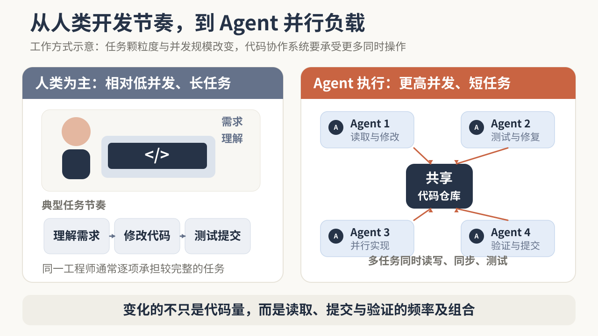
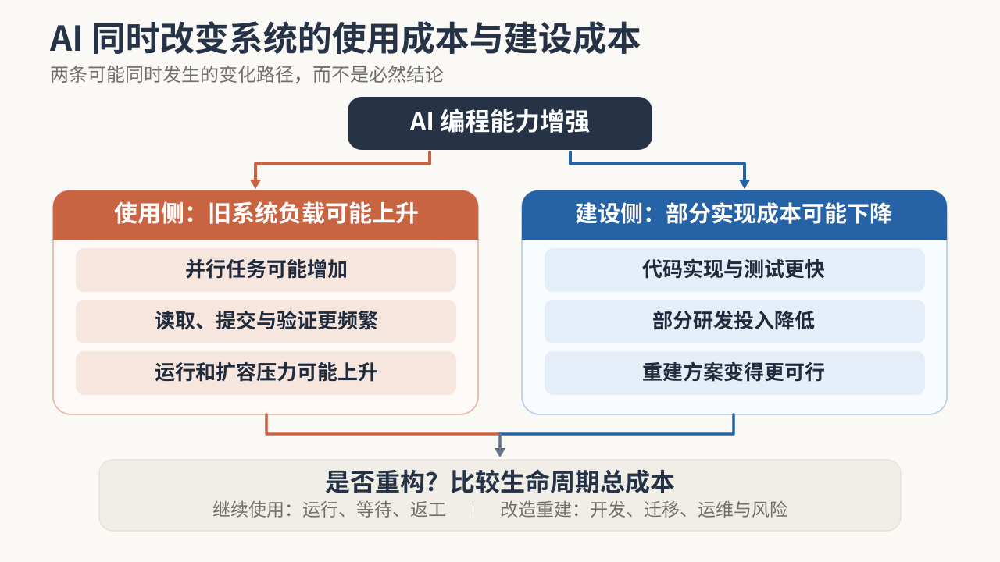

# 当 AI Agent 开始大规模写代码，Git 还够用吗？

> Anthropic 用 Scion 重建了内部版本管理系统，OpenAI 则保留 Git 协议、重做服务端。两家公司都在应对 Agent 带来的并发压力，却因客户端工作方式、兼容目标和迁移约束作出不同选择。这场分歧也说明，AI 改变的不只是旧系统的负载，还可能同时改变重构成本。

---

2026 年秋天，几条关于 Git 的工程新闻引起了我的注意。

10 月，Anthropic 宣布完成内部代码仓库向 [Scion](https://www.anthropic.com/research/redesigning-source-control) 的迁移。11 月 2 日，OpenAI 介绍了支撑内部开发的 [Pando](https://openai.com/index/scaling-git-at-openai/)。11 月 5 日，[GitHub 公开了新一代 Git 存储架构 Rubicon](https://github.blog/engineering/architecture-optimization/inside-githubs-new-git-storage-architecture/)。

三家公司都在解决一个问题：当大量 AI Agent 开始同时写代码，原来的版本管理和协作基础设施能否继续支撑这种规模？

但它们没有选择同一条路线。Anthropic 更换了内部版本管理系统；OpenAI 保留 Git 客户端和协议，重新建设底层服务；GitHub 则希望在用户几乎无须改变习惯的情况下升级平台。

最让我感兴趣的，是 Anthropic 与 OpenAI 的分歧。两家公司都是前沿模型企业，都大量使用编程 Agent，为什么没有得出相同的技术答案？

要解释这个差异，需要先弄清楚 Git 原本为什么这样设计，以及 AI 究竟改变了哪些条件。

## 一、Git 没有突然过时，变化的是它所处的环境

Git 的成功，很大程度上来自分布式设计。开发者可以把代码仓库复制到本地，独立修改、提交和查询历史，即使暂时离线也能工作；团队需要协作时，再把修改共享和合并。工程师不必依赖随时在线的中央服务器，每个人都能掌握自己的工作历史。这套设计长期非常合理。

大型代码仓库带来的压力并不是 Agent 首次创造的。Google 在 [2016 年介绍 Piper](https://research.google.com/pubs/pub45424.html) 时，已经讨论过超大规模代码库的协作与工程成本；Meta 的 [Sapling](https://engineering.fb.com/2022/11/15/open-source/sapling-source-control-scalable/) 生态则包括 [Mononoke 服务端](https://github.com/meta/sapling/tree/main/eden/mononoke/docs)和 EdenFS 虚拟文件系统，后者按需获取文件，而不是一开始就把整个仓库全部放到本地。它们说明，仓库规模、读取效率和团队协作一直是基础设施问题。

这段历史还有一个直接联系：Anthropic 在 Scion 文章的脚注中承认，Meta 的 Mononoke 已经探索过 Scion 借鉴的部分做法，包括把提交历史放在服务端统一组织。Agent 规模化并不意味着从零发明一套系统，过去为大型开发团队积累的工程经验，仍然可以成为新架构的起点。

Git 自身也提供了[部分克隆](https://git-scm.com/docs/partial-clone)、[稀疏检出](https://git-scm.com/docs/git-sparse-checkout)等方式，减少客户端需要获取的数据。Anthropic 也披露，自己已经尝试过浅克隆、稀疏检出、按需获取对象、内部镜像和仓库快照；高峰期运营过数百个内部 Git 镜像。这些办法一度缓解了压力，但随着合并速度提高，维护成本也变得更高。

Agent 改变的是这类工作负载的频率与组合：高并发、短生命周期、持续联网的代码操作变得更加普遍。一个 Agent 可能只处理几项文件修改，却会反复读取代码、创建环境、提交变更并触发测试。多个 Agent 同时工作时，这些操作又会相互叠加。

Anthropic 披露，其内部每天合并的代码变更从 2026 年 5 月的约 2,500 项增长到 9 月的 30,000 多项；持续集成（CI）每天执行约 2,500 万次代码检出。这些都是 Anthropic 的内部数据，不代表普通团队的负载。Anthropic 也明确表示，对绝大多数仓库而言，Git 仍然是合适的设计，近期并不认为多数组织都会遇到同样的问题。

**一种技术过去的优势，在使用条件变化后，也可能成为需要重新权衡的成本。**

这给了我一个观察成熟软件的新角度。看到某种旧技术受到 AI 冲击，首先应该问的不是“新工具能否取代它”，而是“它当初为什么这样设计，支撑这个选择的条件现在是否还成立”。

这与我在[《AI 正在把“使用软件”和“操作软件”拆开》](https://marktian-long.github.io/tools/blog/posts/human-ai-boundary-shift.html)中讨论的变化相连：当 Agent 接管原本由人完成的操作，变化的不只是交互界面，还包括软件与执行者之间的分工。本篇继续往下一层看，当执行者改变后，支撑代码生产的基础设施是否也需要调整。

## 二、AI 不仅增加旧系统的压力，也可能降低重建系统的部分成本

如果只把 AI 编程理解为“写代码更快”，我们会漏掉它对技术演进的另一面影响。

过去，企业即使发现某套基础设施越来越不合适，也未必会选择重做。重新建设意味着投入工程师，处理复杂的边界情况，迁移已有工具，还要确保新系统不会破坏正在进行的业务。旧系统虽然不完美，继续维护却可能仍然更划算。

Agent 可能同时推动两种变化。一方面，更便宜的代码生成使企业能够并行安排更多任务，仓库读取、提交、测试和环境准备的成本随之上升；另一方面，同样的工具也能参与新系统的实现和测试，降低部分开发投入。

这两种变化并非必然同时出现，但当旧系统的持续运行成本增加、新系统的部分建设成本下降时，重新计算改造的收益就有了意义。架构设计、数据迁移、长期运维和失败风险，仍须单独核算。

Scion 的建设提供了一个具体例子。Anthropic 官方披露，一个七人团队在五个月内建设并迁移了 Scion，同时交付代码审查工具 Antique、代码搜索、源代码管理权限系统等配套能力。Claude 帮助团队更快实现和测试系统，但工程师仍然负责理解各系统之间的关系、确定架构边界和权衡设计取舍。Anthropic 甚至提到，工程师的一项重要工作经常是对 Agent 说“不”，防止它为了完成局部任务而破坏系统约束。

Anthropic 自报，Scion 将代码检出从分钟级降到秒级，CI 单项释放了约 25% 的计算资源。这些是厂商内部结果，不是独立横评，也不能直接外推到其他团队。它们说明的是：在特定负载下，AI 参与建设新系统后，重构的部分实现成本和运行收益都可能发生变化。

**一项技术是否值得替换，不只取决于旧方案的成本上升了多少，也取决于新方案的建设成本下降了多少。**

这也能帮助我们重新理解 AI 编程对企业自建软件的影响。过去因为研发成本太高而必须采购的内部工具，现在可能出现更可信的自建选择。但初始开发便宜，不等于后续维护、兼容、数据迁移和责任承担也同样便宜。

我此前在[《当 AI 能替你造软件，哪些服务仍值得买？》](https://marktian-long.github.io/tools/blog/posts/ai-saas-build-vs-buy.html)中讨论过 AI 如何改变软件的买建经济性。本篇把同一问题延伸到基础设施：AI 既可能提高旧系统的持续运行成本，也可能降低重建它的部分成本。

## 三、同样是模型公司，为什么 Anthropic 和 OpenAI 选择不同路线？

如果只用“Agent 数量增加”解释 Scion 和 Pando，就很难回答一个问题：为什么 Anthropic 愿意改变版本管理系统本身，OpenAI 却认为保留 Git 仍然值得？

两家公司同属前沿模型公司，业务方向相近，并不意味着内部工程环境也相同。版本管理选型并不由模型架构直接决定，而是由客户端怎样工作、团队依赖哪些工具、是否需要离线能力、能否改变现有工作流，以及组织愿意承担多少迁移成本共同决定。公开资料没有披露两家公司完整的内部选型讨论，因此能比较的是它们明确公开的工作负载和设计取舍，不能推断哪家 Agent 更多或哪套方案绝对更先进。

两家公司公开披露的负载并不完全一致，但都面对大量任务并发操作同一套大型代码库、并持续触发读取、测试和同步的压力。它们的共同方向，是减少无关操作之间的等待，让重复读取代码的成本更低，也避免每个临时任务都承担一套昂贵的仓库维护工作。

真正的分歧在于：为了获得这些效率改善，企业愿意改变原有系统的哪一部分？

| **比较维度** | **Anthropic：Scion** | **OpenAI：Pando** | **GitHub：Rubicon** |
|---|---|---|---|
| 改造对象 | 内部版本管理体系 | Git 服务端 | 平台存储与服务架构 |
| 保留的既有能力 | 代码历史与协作；客户端按需取数 | Git 协议、客户端和工作流 | Git 操作方式与既有保护机制 |
| 主要取舍 | 客户端依赖在线服务，配套工具一并重建 | 不同分支可并行更新，但跨分支读取可能对应不同时间点 | 大量代码内容可并行写入，只在更新分支指向时协调 |
| 当前状态 | 已完成内部迁移 | 已投入内部生产 | 有限私有预览，计划于 2027 年初扩大开放范围 |

*依据三家官方工程说明整理。表格比较的是改造选择，不是性能排名；各家的负载和统计口径不同。GitHub Rubicon 截至 2026 年 11 月 5 日仍处于有限私有预览。*

Anthropic 的选择，首先来自它对客户端工作方式的判断。官方说明称，其内部几乎所有代码仓库客户端都是持续联网的 Agent 和自动化任务。Anthropic 并不是认为 Git 的分布式设计本身错误，而是发现自己的客户端已经很少需要完整离线仓库。对它而言，继续让每个临时任务准备和维护完整仓库，带来的成本已经超过了这项能力的价值。

Scion 因此采用更偏服务端的方式：服务器承担历史查询、创建提交、合并等操作，客户端只保留有限的本地缓存和工作文件，需要什么再从服务端获取什么。它不以兼容通用 Git 客户端为目标，Anthropic 也同步建设了代码审查、搜索、权限和其他配套工具。Anthropic 同时强调，Git 对绝大多数仓库仍然是合适的设计；Scion 是针对其特殊工作负载作出的内部选择，不是面向行业的通用替代方案。它还明确表示，这种方案只适合极其庞大的单一代码仓库、数万名工程师或大量 Agent 并发写代码的环境；Anthropic 能为内部 Agent 使用投入的模型资源，也远高于普通企业通常愿意承担的水平。

OpenAI 的选择不同。它在 [Pando 的官方说明](https://openai.com/index/scaling-git-at-openai/)中明确表示，希望在不打断现有开发、不改变团队使用 Git 方式的前提下，解决高并发推送和大量代码读取带来的问题。OpenAI 还希望把在 Git 兼容路径上做出的改进贡献回 Git 项目，让已有客户端和开发习惯继续发挥价值。

OpenAI 还披露，旧系统的合并可靠性一度低于 90%，说明问题不只是速度，也包括开发者能否稳定完成合并。因此，Pando 重建的是 Git 服务端，而不是开发者使用的整个工作方式。不同分支的更新可以相对独立地进行，服务器也能复用已经准备好的代码数据，避免为每个读取请求重复处理相同历史。

这也有代价。同一分支上的更新仍保持必要的先后关系，写入后也能读到自己的修改；但一次读取多个分支时，它们不一定反映整个仓库在同一时刻的状态。OpenAI 接受这项取舍，以换取不同分支更高的并发能力。官方披露，Pando 已经支撑 OpenAI 内部大型代码仓库的全部开发，生产环境中的推送延迟中位数降低约 80%，约为原来的五分之一。这是公司内部相对原有系统的结果，不适合拿来与 Scion 直接比较。

这条保留 Git 兼容性的路线也开始被外部开发者尝试。2026 年 11 月 5 日，Reason Machines 公布了 [Aspen](https://reasonmachines.com/blog/aspen)，一个借鉴 Pando 设计的开源 Git 服务端项目。其[代码仓库](https://github.com/reason-machines/aspen)明确标注为 pre-alpha，尚无正式发行版，也未完成长期稳定性和独立性能验证。Aspen 不是 Pando 的开源版本，更不能据此判断两者性能相当；它只是让我们看到，成熟系统的底层设计可以被借鉴，而真正生产可用还要跨过另一道验证门槛。

代码工作流还不只有版本存储。11 月 4 日，OpenAI 在[官方公告](https://openai.com/index/openai-to-acquire-pierre/)中宣布拟收购 Pierre Computer Company。公告说明，Codex 已经使用 Pierre 的 Trees 和 Diffs 组件浏览文件、查看变更；Code Storage 则是收购交割后计划进一步整合的能力。公告发布时交易尚未完成，仍需满足惯常交割条件，包括监管批准。因此，这只能证明代码浏览与差异审查组件已经采用，Code Storage 的整合仍属于交割后的计划，不能写成收购完成或存储能力已全面进入 Codex。它也提醒我们，Agent 时代的代码基础设施不只是一套 Git 后端，还包括开发者和 Agent 如何理解、审查与追踪变更。

GitHub 的情况又不同。它要服务的是大量不同规模、不同工具链的开发者和企业，而不是只优化一家公司的内部大型单一代码仓库。因此，Rubicon 在保留 Git 操作方式和既有保护机制的同时，把代码内容的存储、请求处理和后台维护拆开，让它们能够分别扩展。GitHub 的解释是，代码对象本身不可变，可以由不同写入者并行保存；真正需要协调的是分支指向的更新。该架构当时处于有限私有预览，GitHub 计划在 2027 年初扩大开放范围，不能把内部压力测试结果写成全面上线后的生产表现。

**相似的技术能力和需求，不会自动导向相同的最优方案；已有系统、兼容性要求、风险承受能力和迁移成本，都可能改变合理的选择。**

这对 AI Builder 有一个直接启发：观察领先企业采用某种 AI 原生架构，不应马上问自己如何复制，而要先弄清它为了什么负载而设计、放弃了什么、保留了什么。否则，可能只是把别人的特殊约束变成自己的额外复杂性。

## 四、减少协调成本，不等于所有工作都可以不再等待

前面几家公司有一个共同方向：让彼此无关的操作尽可能独立完成。

但什么样的等待可以删除，什么样的协调本来就是为了保证结果正确？

设想两个 Agent 同时开发一套业务系统。Agent A 把接口返回的金额单位从“元”改成“分”，Agent B 仍然按照旧单位开发下游计算。两者修改不同文件，各自通过局部测试，合并时也未必出现文本冲突。但放在一起运行，金额就可能计算错误。

版本管理能够记录变更怎样发生，却不能仅凭修改成功合并，就证明业务行为正确。合并只说明修改进入了共享代码；测试通过只说明它在给定测试范围内没有暴露问题；部署后是否解决真实需求，还需要业务验收。

这也是为什么代码更新加速以后，系统仍然需要知道：哪些修改已经接受了什么检查，哪些变更必须一起验证，以及测试结果是否仍然适用于准备交付的版本。

[GitHub 的合并队列（Merge Queue）](https://docs.github.com/en/repositories/configuring-branches-and-merges-in-your-repository/configuring-pull-request-merges/managing-a-merge-queue)早已提供了一种解决办法：把待合并修改与目标分支及队列中的相关修改组合起来，再执行必要检查。这类集成问题并不是 Agent 时代才出现的。

更广泛的开发数据也显示，代码生产和软件交付之间存在明显差距。Mert Demirer、Leon Musolff 和 Liyuan Yang 的 [NBER Working Paper 35275](https://www.nber.org/papers/w35275)基于超过 50 万名 GitHub 开发者及 AI 使用数据。研究估计，自主编码 Agent 的采用与代码提交活动累计增加约 240% 相关，但项目数量增加约 80%，实际发布数量增加约 30%。这是一项匹配事件研究，并非随机实验；采用行为也不是随机分配，不能把这些数字当成普遍因果效应。它的价值在于揭示，从写代码到发布软件，产出增幅会逐层衰减。该文是尚未同行评审的工作论文；作者披露其中一位作者曾在微软任博士后，现担任付费研究顾问。

Agent 时代的变化，是验证被更频繁地自动触发，部分失败也能由 Agent 尝试修复，但验证本身仍有成本。

[Stripe 的 Minions](https://stripe.dev/blog/minions-stripes-one-shot-end-to-end-coding-agents)提供了一个实际例子。Stripe 官方披露，其内部每周有超过一千个完全由 Agent 编写的代码合并请求（PR）被合并，但这些 PR 仍然经过人工审查。Minions 会先运行快速的本地检查，再根据需要执行相关测试；部分失败可以自动修复，其他问题交回 Agent 处理。为了控制计算、模型调用和等待成本，CI 最多执行两轮。Stripe 认为，反复执行完整测试的边际收益会逐渐下降。

这个做法并不是让人重新承担全部工作，而是把自动检查放在适合的位置，同时明确什么时候继续修复、什么时候停止。

**当执行方式改变，必须重新决定哪些事情可以并行、哪些状态需要统一、哪些结果必须经过验证。**

例如，一套企业审核产品可以让 Agent 自动生成规则、执行检查甚至修正问题，但仍然需要明确规则版本、适用范围和正式生效状态。人工参与可以减少，操作界面可以改变，但正式结果所依赖的事实与责任不能因此变得含糊。

## 五、从 Git 回到现实：怎样判断一个系统需要重构到什么程度？

现在回到最初的问题：Git 还够用吗？

对于拥有特殊代码规模和高频 Agent 负载的组织，重建版本管理系统可能有足够的收益。对普通软件团队，如果现有 Git 工作流没有明显影响交付，分支、自动测试与现有协作机制已经能够稳定完成工作，那么迁移到一套专门为极端并发设计的新系统，未必值得。

判断改造范围，可以先看当前系统究竟哪里出了问题。

| **当前系统状况** | **更合适的改造方向** |
|---|---|
| 核心业务和数据机制仍然适用，只是人工操作较多 | **保留核心，增加 Agent 自动化** |
| 核心系统可靠，但跨系统协作、数据传递和等待成本较高 | **局部改造接口与协作机制** |
| 核心数据、状态或规则机制已无法承接新负载，长期修补成本更高 | **评估整体重构** |

*这是本文归纳的三种改造范围，不是所有企业都必须经历的三个阶段，也不意味着三种方式完全互斥。*

假设一家企业正在考虑重新建设内部审核流程。原来的方式由员工上传材料、配置规则、执行检查，再由系统生成结果。现在引入 Agent 后，材料整理、规则建议和部分审核都能够自动完成。

如果当前系统已经提供稳定的规则记录、审核结果和权限管理，只是人工操作较多，那么增加 Agent 入口和自动化能力，也许就足够了。

如果 Agent 经常需要跨多个系统读取材料、等待重复授权或重新准备相同的上下文，那么真正需要调整的可能是系统之间的接口与协作方式，而不是整个审核系统。

只有当原有系统的数据结构、规则生效机制或任务组织方式已经无法承受新的工作负载，且局部改造长期成本更高时，才有理由考虑更彻底的重构。

这三种选择都可能合理。决定因素不是哪一种更像 AI 原生产品，而是哪一种能在满足业务约束的情况下，以更合适的成本持续交付有效结果。

同样，判断一次基础设施改造是否成功，也不应只看某个技术指标。写入和读取性能值得关注，但还需要考虑迁移风险、测试与运维成本，以及这些改善最终能否缩短可靠交付的周期。Agent 可以帮助更快写出一套新系统，却不能仅凭开发时间缩短就推断它更容易维护、更适合迁移，或者长期拥有成本更低。

对 AI Builder 来说，技术选型需要同时回答两个问题：现有系统哪里已经不适合当前任务，以及新方案是否真的比保留和改进现有系统更合算。

---

Git 的答案不是“被替代”或“保持不变”。对大多数团队，现有 Git 工作流仍然够用；对极端并发的内部代码平台，服务端架构和协作机制可能需要重新设计。

这类变化也不只发生在代码管理领域。当 AI 降低部分执行和实现成本，成熟系统的设计前提可能开始松动，重建也可能变得更可行。但旧技术是否值得被替换，仍然取决于真实负载、必要约束，以及新旧方案的生命周期成本。

**AI 扩大了企业可选的技术方案，却不会替企业决定哪一种方案值得选择。**

下一次看到某种成熟软件正在被 AI 重新设计，我更想了解的，不只是它用了什么最新技术，而是它为什么原来那样设计、现在为什么需要改变，以及这次改变究竟让整个系统变好了多少。

## 参考资料

### 厂商一手工程文档

- [Anthropic — Redesigning source control at Anthropic（2026-10-13，10 月 15 日更新）](https://www.anthropic.com/research/redesigning-source-control)
- [OpenAI — Scaling Git at OpenAI（2026-11-02）](https://openai.com/index/scaling-git-at-openai/)
- [GitHub — Inside GitHub's new Git storage architecture（2026-11-05）](https://github.blog/engineering/architecture-optimization/inside-githubs-new-git-storage-architecture/)
- [OpenAI — OpenAI to acquire Pierre Computer Company, Inc.（2026-11-04）](https://openai.com/index/openai-to-acquire-pierre/)
- [Reason Machines — Aspen: scaling agentic commits beyond what Git was built for（2026-11-05）](https://reasonmachines.com/blog/aspen)
- [Reason Machines — Aspen open-source repository / README](https://github.com/reason-machines/aspen)
- [Stripe — Minions: Stripe’s one-shot, end-to-end coding agents（2026-02-09）](https://stripe.dev/blog/minions-stripes-one-shot-end-to-end-coding-agents)
- [GitHub Docs — Managing a merge queue](https://docs.github.com/en/repositories/configuring-branches-and-merges-in-your-repository/configuring-pull-request-merges/managing-a-merge-queue)
- [Git — Partial clone](https://git-scm.com/docs/partial-clone)
- [Git — Sparse checkout](https://git-scm.com/docs/git-sparse-checkout)

### 工程历史与既有系统

- [Potvin & Levenberg — Why Google Stores Billions of Lines of Code in a Single Repository（2016）](https://research.google.com/pubs/pub45424.html)
- [Meta Engineering — Sapling: Source control that's user-friendly and scalable（2022-11-15）](https://engineering.fb.com/2022/11/15/open-source/sapling-source-control-scalable/)
- [Meta Sapling — Mononoke documentation](https://github.com/meta/sapling/tree/main/eden/mononoke/docs)

### 独立研究

- [Demirer, Musolff & Yang — Writing Code vs. Shipping Code（NBER Working Paper 35275，2026-05；2026-09 修订）](https://www.nber.org/papers/w35275)

### 相关历史文章

- [《AI 正在把“使用软件”和“操作软件”拆开》](https://marktian-long.github.io/tools/blog/posts/human-ai-boundary-shift.html)
- [《当 AI 能替你造软件，哪些服务仍值得买？》](https://marktian-long.github.io/tools/blog/posts/ai-saas-build-vs-buy.html)
