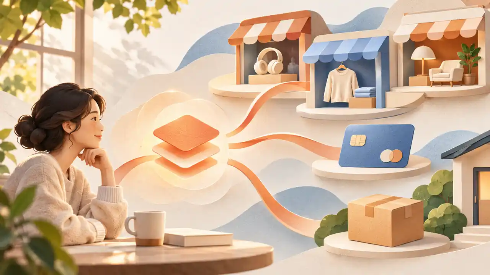
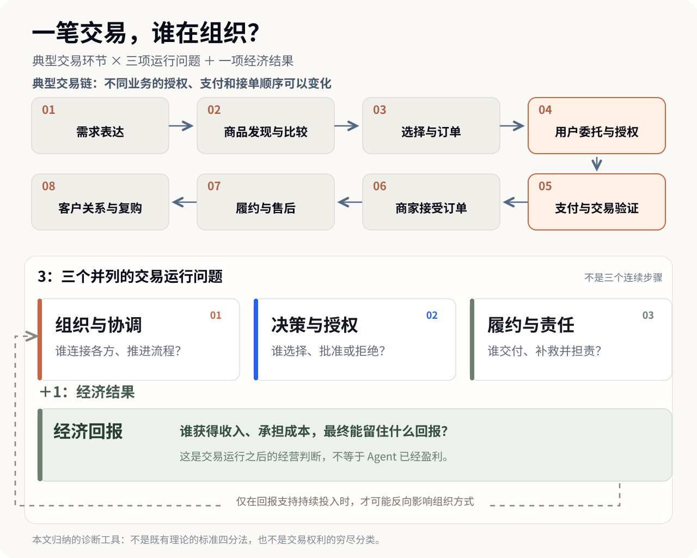
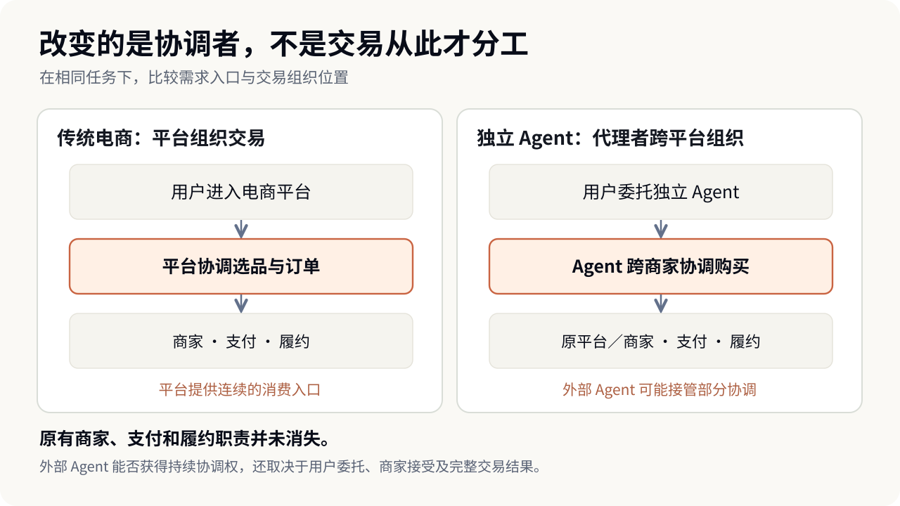

# 当 AI 开始替用户付款，谁真正拥有交易？

> AI Agent 正在从购物助手走向交易代理，但能够推荐商品、发起支付并不代表拥有整笔交易。当消费者开始通过独立 Agent 组织交易，原有电商平台的需求入口、交易协调和客户关系会发生什么变化？

---

2026 年 11 月，OpenAI 发布了 [ChatGPT Wallet](https://openai.com/index/introducing-chatgpt-wallet/)。用户可以让 AI 帮自己寻找商品、准备订单，再通过保存的银行卡完成购买。几个月前，阿里已经把千问与淘宝、天猫的商品和交易体系连接起来，让消费者通过自然语言搜索商品、比较价格和管理订单。支付宝则在推进另一类能力：它不一定替用户选择商品，却希望让不同平台上的 Agent 获得支付能力，并解决 Agent 身份、商业授权和交易验证问题。

这些变化容易让人得出一个结论：AI 开始接管购物，电商平台可能要失去交易入口了。

但这里有两个不同的问题。AI 能不能替用户购买商品？在部分受支持场景中，已经可以。**当 AI 能够组织一笔交易，原有平台究竟失去了什么？** 这个问题远没有那么简单。

传统电商从来不是一个平台独自完成所有交易。商家管理商品和库存，支付机构处理付款，银行参与资金授权，物流公司负责交付，消费者决定是否购买。平台的价值，部分来自它把这些参与者组织在一起，并成为消费者进入交易的主要入口。

**Agent 改变的不是交易第一次出现多方分工，而是消费者有机会通过独立代理者重新组织原有交易能力。** 这种新协调方式能否持续，以及由谁获得商业回报，才是 Agentic Commerce 值得研究的问题。

## 一、AI 开始替用户付款，但交易并没有因此属于 AI

### ChatGPT Wallet：从商品推荐进入真实支付

[OpenAI 2026 年 11 月 13 日的产品公告](https://openai.com/index/introducing-chatgpt-wallet/)明确，ChatGPT Wallet 首期通过 Dots 向美国符合资格的成年 Pro 用户逐步开放。用户保存合格的支付卡后，Agent 可以在结账时使用与银行卡关联的令牌化支付凭证，而不接触实际卡号。当前流程仍要求用户检查商家、商品、总额与银行卡，并完成安全验证。

[Wallet 服务条款](https://openai.com/policies/chatgpt-wallet-terms/)预留了提前授权的合同安排，但条款允许不等于当前面向所有用户开放无监督购买。产品公告描述的逐笔安全确认，与未来更广的持续委托能力，需要分开讨论。

更重要的是，Wallet 没有让 OpenAI 成为商品卖方。发卡机构仍决定是否批准支付，商家决定是否接单，并负责商品、交付、退款和售后。用户批准提交订单，也不保证商家最终接受。Wallet 证明 AI 平台开始进入真实交易执行环节，却不能证明 OpenAI 已经取得整笔交易的控制权。

### 千问：把 AI 接入已有的消费生态

阿里采取了不同路线。2026 年 1 月，千问开始连接淘宝、淘宝闪购、支付宝、飞猪和高德等服务。同年 5 月，阿里宣布将千问连接到淘宝和天猫超过 40 亿件商品，并在淘宝 App 内上线千问购物助手。相关能力覆盖商品搜索比较、下单、订单管理、物流及售后。[阿里巴巴 5 月 11 日官方公告](https://home.alibabagroup.com/en-US/document-1991231293551017984)对此有具体说明。

这不是给淘宝增加聊天框那么简单。阿里已经拥有商品目录、商家关系、订单系统和履约网络。千问可以调用既有能力，而不像一个独立 AI 平台那样从头寻找商品供给和结账服务商。

OpenAI 从 AI 消费入口向外连接商家和支付网络；阿里从既有消费生态内部整合 Agent 能力。两种路线显示了不同的起点，但谁真正增加了交易、保留了客户，还需要另行验证。

## 二、一笔交易由谁组织？先看传统电商，再看 Agent

判断 Agent 带来了什么变化，必须先看没有 Agent 时，一笔交易如何完成。

传统淘宝购物中，一笔交易由多个主体共同完成：

| 参与者 | 主要职责 |
|---|---|
| 电商平台 | 商品搜索与推荐、交易规则、订单管理和平台内协调 |
| 商家 | 商品、价格、库存、是否接单，以及商品交付相关义务 |
| 支付机构、银行与支付网络 | 支付处理、资金授权与结算 |
| 物流服务商 | 仓储、运输和配送 |
| 商家与平台 | 按各自规则承担售后、退款和争议处理 |

它们原本就不是同一个权力主体。

消费者之所以感觉自己只在一个 App 里购物，是因为平台承担了大量协调工作：把商品、商家、支付、订单状态和售后组织到连续体验中。平台的优势不只是入口，还来自真实交易所需的数据、规则和商业关系。

假设用户不打开淘宝，而是向独立 Agent 提出需求：「找一台适合视频剪辑、价格不超过 8000 元、这周能够送达的电脑。」Agent 可以跨商家搜索，比较配置、价格、库存和配送条件，再准备订单、请求授权并发起付款。商品仍可能来自淘宝，支付仍需要银行批准，履约仍由商家负责；但需求理解、跨商家比较和部分交易协调工作，可能已经由平台之外的 Agent 承担。

### 同一条交易链，三个分析视角

下面这张主地图同时适用于传统电商和 Agent Commerce。它不是 Agent 创造的新交易环节，而是我们比较**由谁协调、谁能决策、谁承担责任、谁取得回报**的共同基线。

这里的顺序是分析用的典型路径，不是所有交易都必须遵循的固定技术流程：用户可以在搜索前授予长期权限，具体支付授权和商家接单的先后也可能因业务模式不同而变化。

| 观察维度 | 要回答的问题 | 例子 |
|---|---|---|
| 控制权 | 谁可以决定、批准或阻止交易？ | Agent 推荐商品，商家仍可以拒绝订单 |
| 责任 | 出错后谁承担履约或赔付义务？ | 支付机构处理支付风险，商家负责商品售后 |
| 经济价值 | 谁获得收入、降低成本或留住客户？ | Agent 影响选择，商家仍获得商品销售收入 |

同一企业可能同时承担多个环节，同一环节也可能由多方完成。不能从「用户在 ChatGPT 里买了商品」推出「OpenAI 拥有整笔交易」，也不能因为订单仍在淘宝履约，就认为外部 Agent 不可能影响原平台的商业地位。

### 真正变化的是协调关系

这组对照要区分三种变化。**需求入口变化**是用户先向谁表达购买意图；**交易协调变化**是谁跨商家组织选品、订单与付款；**代理决策变化**是用户是否把选品、时机甚至预算范围内的决定委托给 Agent。三者可能一起发生，也可能只发生其中一项。

此前在[《Personal Agent：当 AI 开始长期接手你的事》](https://marktian-long.github.io/tools/blog/posts/personal-agent.html)中，讨论的是用户把一类事务长期交给 Agent 后，如何持续跟进未完事项并协调不同应用和相关方。本文沿用的是“用户委托 Agent 组织跨服务任务”这一前提，进一步研究当委托进入商品选择、资金授权和真实交易后，商家、支付机构与原有平台的职责边界如何变化。两篇文章相关，但研究对象不同：前者关注个人事务能否被持续接手，本文关注交易链如何被重新协调。

此前在[《AI 正在把“使用软件”和“操作软件”拆开》](https://marktian-long.github.io/tools/blog/posts/ai-software-operator-shift.html)中讨论过：用户不再亲自操作软件，不代表软件已经消失。在交易里，这个区别还要进一步延伸到订单、付款、履约与客户关系。

## 三、阿里与蚂蚁，正在争夺交易链的不同位置

沿交易链观察，中国市场有两条可以协同、却并不相同的路线。阿里利用已有消费生态整合 Agent 交易，蚂蚁则尝试让不同 Agent 获得跨平台支付与信任能力。

### 阿里：把 AI 入口连接到供给和履约

阿里已经拥有商品目录、商家运营、交易数据和订单物流体系。千问接入淘宝商品后，可以把自然语言需求转化为既有商品和订单能力的调用，减少跨平台接入摩擦。商品缺货、配送延误、退款等真实状态，又能够约束 Agent 后续行动。推荐能力只有连上这些业务系统，才能持续完成购买任务。

这一路线能够减少部分协调成本，但不自动创造新增 GMV。如果消费者原本就会在淘宝购买，只是改由千问发起订单，集团不一定增加收入。千问仍需证明能提高转化、创造新增需求或降低全链路交易成本。

### 蚂蚁：为跨平台 Agent 提供可信交易能力

[支付宝 AI 付开发者概览](https://aipay.alipay.com/docs/overview.html)同时覆盖 AI 服务如何收费与 Agent 如何付款：Vibe Pay 面向 AI 应用收款，Skill Pay 处理技能收费，Machine Pay 支持机器或 API 按量支付，Token Pay 涉及模型额度与订阅，Agent Pay 则面向 Agent 代表用户购买商品和服务。

其中有一个清楚的边界：**Agent Pay 聚焦最终购买环节，不负责 Agent 的商品选择和供应商决策。** 支付宝不必掌握每个用户的购物入口，也能成为不同 Agent 调用的交易服务方。

但 Agent 发起支付后，支付系统需要回答比过去更多的问题。用户说「替我找一张周五从上海到杭州、不超过 680 元的车票」，对人来说容易理解，对跨平台运行的 Agent 来说，还需要转换成能够验证的购买目标、时间、价格和授权条件。否则，商家和支付机构很难判断付款请求有没有超出用户委托范围。

蚂蚁提出的 [ACT 协议](https://www.act-protocol.com/documentation/delegation)支持两类委托：SPECIFIED 适用于购买对象已指定的情况；BOUNDED 允许 Agent 在用户给定的目标和约束下作出具体选择。协议还设计授权暂停、恢复、撤销和过期机制，试图把自然语言委托转化为跨环节可核验的商业对象。

另一项能力 [APASS](https://aipay.alipay.com/act/apass) 关注 Agent 的静态身份、运行时身份和责任主体身份。Agent 可能更新代码、切换环境、调用不同工具；固定的 Agent ID 不足以证明当前执行支付的实例仍然可信。因此，身份、授权和执行状态需要分别核验。

这并不意味着 ACT 已成为行业通用标准，或 APASS 接入规模可以直接换算为真实消费订单。它们证明的是蚂蚁正在建设哪种能力，而不是最终商业模式已经获得市场验证。

### 生态整合与跨平台基础设施，不是同一家公司的一套战略

[阿里巴巴 2026 财年 Form 20-F](https://data.alibabagroup.com/ecms-files/1514386754/b0f928b2-88f0-469d-905e-a714d19fb913/2026%20SEC%20Form%2020-F.pdf)披露阿里持有蚂蚁约三分之一股权，但不控制蚂蚁。双方有长期支付合作，却不能把千问、淘宝、支付宝和蚂蚁的全部能力视为一个公司内部可自由调度的资产。

阿里更接近消费生态内部的 Agent 整合；蚂蚁更接近跨 Agent 的支付与信任基础设施。它们可以互补，但客户、控制点和商业利益并不完全相同。

## 四、全球玩家争夺的不是同一个位置

把中国市场放进全球对照，就能看到不同企业正在争夺交易链上的不同位置。

OpenAI 靠消费者 AI 入口接近需求与选择，再通过 Wallet 延伸至支付；但仍依赖外部商家提供商品、接受订单和履约。Google 与 Shopify 共同推动的 [Universal Commerce Protocol（UCP）](https://www.shopify.com/ucp) 则试图用结构化接口连接 Agent 和商家，覆盖商品发现、购物车、结账及购买后流程，降低商家重复接入多种 Agent 的成本。

Google 的 [Agent Payments Protocol（AP2）](https://blog.google/products-and-platforms/platforms/google-pay/agent-payments-protocol-fido-alliance/) 侧重用户授权与支付验证。2026 年 4 月，Google 宣布将 AP2 捐赠给 FIDO Alliance；其后续版本进一步探索用户不在场时的预授权交易。但协议目标相似，并不等于 ACT、AP2 和 UCP 已经互相兼容。

支付网络则从原有职能向 Agent 身份和支付控制延伸。2026 年 10 月，[Visa、BILL 与 Billtrust](https://corporate.visa.com/en/sites/visa-perspectives/press-releases/visa-bill-billtrust-launch-pilot.html)宣布一项实际运行的 B2B 发票支付试点：买方 Agent 在预先批准的规则内使用令牌化支付凭证，通过供应商门户付款。这是企业发票结算的生产试点，不是消费者购物已经普及的证据。

| 主要竞争位置 | 代表企业 | 重点能力 |
|---|---|---|
| 消费者需求入口 | OpenAI、阿里千问 | 理解需求、影响选择、组织购买 |
| 商业交互与授权 | Google、Shopify、蚂蚁 | 让 Agent、商家与支付系统跨平台协作 |
| 支付与交易信任 | 支付宝、Visa、Mastercard、Stripe | 身份、令牌、授权及风险验证 |

这不是互斥的公司分类。同一家企业可以覆盖多个位置，不同企业也可能合作。一笔交易可能由独立 Agent 理解需求，Shopify 商家提供商品，支付网络核验付款，再由商家完成交付。Agent Commerce 不必然形成一个拥有所有能力的超级平台。

## 五、Agent 带来的交易，究竟是新增收入还是渠道迁移？

沿交易链讨论完参与者的位置，才应该进入商业价值判断。此前在[《技术最领先的人，为什么不一定拿走最大的价值？》](https://marktian-long.github.io/tools/blog/posts/ai-innovation-value-capture.html)中已经讨论过互补资产与价值捕获，这里不需要重讲理论，而是检验一笔真实 Agent 交易究竟给谁增加了收入、减少了成本。

### Agent 来源订单，未必是新增订单

假设一位用户原本每月在淘宝购物五次，现在改为通过千问下单。千问的 Agent 来源订单占比提高了，但如果购买商品、次数、金额都没有变化，阿里整体未必获得新增 GMV。

反过来，如果 Agent 帮用户发现了原本不知道的商品，或持续追踪库存和价格，促成了一笔过去会放弃的购买，就可能带来新增需求。

所以，**Agent 来源订单不等于 Agent 净新增订单。** 要判断增量，需要回答反事实问题：如果没有 Agent，交易是否仍会发生？订单来源标签不能回答。更可靠的证据是可比用户与商品条件下的对照实验，或能够合理剔除渠道替代的经营数据。

### 用户少操作，不意味着全链路成本下降

Agent 可以减少搜索、比较、填写表单的时间，但也带来新的成本：商家需要维护可供 Agent 使用的商品数据，平台要开放受控的订单接口，支付机构要核验 Agent 身份与授权，交易失败还要处理重试、取消、退款和争议。

例如，Agent 推荐了正确商品，但商家拒绝接单；或者付款获得授权，但商品库存已经变化。用户可能最终仍然需要人工处理。若 Agent 在预算边界内买了不合适的商品，还可能增加退货成本。

因此，用户体验更流畅，不等于整个交易系统更便宜。Agent 真正创造的效率收益，必须扣除接入、风控、异常处理和售后新增支出。

### 可能收费，不等于已经形成利润池

Agent 平台可能获得订阅费、推荐费或交易分成，但需要证明自己持续带来有价值的订单。支付机构可能获得支付处理收入，但如果 Agent 只是替换旧渠道，整体支付需求未必增加。身份和授权服务也可能独立收费，却需要跨平台接入、持续调用和可验证的安全效益。

即使基础设施重要，也不保证单一提供方可以获得高利润。若商家能在多个兼容服务商之间选择，供应商仍受竞争约束。

判断这门生意是否成立，至少应该分开观察：

| 指标 | 实际回答什么 |
|---|---|
| Agent 来源订单量 | Agent 参与了多少交易 |
| 完整交易成功率 | 选品、授权、支付、商家接单有多少真正走通 |
| 净新增 GMV | 相比没有 Agent 的情况，多产生多少购买 |
| 渠道替代率 | 有多少订单只从旧入口迁移过来 |
| 单笔贡献利润 | 扣除新增成本后，还留下多少收益 |
| 持续委托与复购 | 用户是否形成稳定使用习惯 |

支付宝公开披露的 AI 付交易数量覆盖模型、AI 应用、技能收费、电商、本地生活等多个场景，不能全部写成 Agent 自主完成的消费购物。现有公开材料也不足以确认 Agent Pay 独立收入、净新增 GMV 或完整单位经济。

**Agent 参与了越来越多交易，与 Agent Commerce 已经创造出一个新的利润池，是两种不同判断。**

## 六、为什么交易跑通了，却还没有出现明确赢家？

真正完成技术链路，与消费者持续委托、商家长期接入、平台形成新增利润之间仍有距离。

### AI 购物的使用率，不等于购买率

[McKinsey 2026 年 10 月调查分析](https://www.mckinsey.com/capabilities/growth-marketing-and-sales/our-insights/who-wins-when-ai-does-the-shopping-new-evidence-on-agentic-commerce)基于当年 6 月约 21,000 名消费者的反馈。全球 11 个市场平均有 53% 的消费者在过去三个月使用过 AI 完成至少一项购物任务；但全球 AI 用户中，只有 14% 表示曾使用 AI 工具完成购买，折算到总体消费者约为 9%。

这说明 AI 辅助搜索与决策已经很常见，实际购买则仍是另一个门槛。调查还发现，到结账阶段，零售商自有 AI 助手和独立 AI 工具的使用比例接近，分别约 15% 和 14%。两组题项的措辞不完全相同，不能将它们当成精确市场份额，但至少说明独立 AI 在发现阶段的优势没有自动延续到付款阶段。

这属于消费者自报调查，不是交易日志，更不能用来计算新增 GMV。

### 原有平台会把 Agent 能力留在自己的入口里

Uber 提供了一个现实参照。[2026 年第三季度财报电话会](https://s23.q4cdn.com/407969754/files/doc_events/2026/Nov/04/Uber-Q3-Earnings-Call-Transcript.pdf)披露，万圣节所在的一周，第三方 Agent 只带来约 500 笔 Uber Eats 订单和 4 笔 Uber Rides。这个规模说明外部 Agent 已经可以形成实际交易，但仍处于早期。不能拿不同业务的季度或周度总体订单直接计算这一场景的转化率。

Uber 同时在建设自己的购物助手，并强调司机实时匹配、商家供给、价格、库存、取货位置和履约体系仍然关键。[Uber 官方经营说明](https://s23.q4cdn.com/407969754/files/doc_earnings/2026/q3/transcript/Uber-Q3-26-Prepared-Remarks.pdf)提供了更多背景。外部 Agent 可以提出任务，但真正完成出行或配送仍需要 Uber 的实时服务网络。

Google Maps 则提供了一个更接近日常服务的反例。2026 年 11 月 16 日，[Google 宣布扩展 Ask Maps](https://blog.google/products-and-platforms/products/maps/ask-maps-holiday-travel-features-2026/)：用户可以通过自然语言查询美容、宠物护理、汽车或房屋维修等本地服务的可用时段，也可以选择让 Google 代为致电商家询问，然后由用户查看时段并决定预约哪项服务。

这里要注意：**查询到空余时段、联系商家，不等于已经完成预约或支付。** 相关预约查询能力也首先在美国推出，不能把 Ask Maps 更广的地理覆盖理解为这些功能同步全球可用。

但它仍然说明了重要的竞争路径。Google Maps 本来就拥有地点、商家、营业状态、路线和用户收藏信息。通过在原产品中增加 Agent 能力，它可以继续留住消费者的需求入口并承担部分服务协调工作。消费者使用了自然语言，不代表入口必然迁移到外部 AI 平台。

Uber 和 Google Maps 的任务不同，共同点却很清楚：**原有平台可以利用真实供给和业务数据，自行吸收 Agent 能力，而不是只能被动接受第三方 Agent 分发的订单。**

### 购物也不只有效率价值

消费者购物未必只是为了买到确定商品。探索、比较、发现品牌、寻找礼物、审美表达，本身也可能构成体验价值。

如果购买目标明确、可验证、风险较低，Agent 可以替用户承担更多重复工作；但如果用户希望发现新选择，过早自动下单反而可能损害体验。Uber 在经营说明中披露的大量用户主动调整出行选项、尝试新的餐厅，也从自身业务角度提示了选择与发现的价值；这些数据不能外推为所有消费者行为。

因此，Agent Commerce 不太可能简单地把全部消费场景变成自动采购。真正的产品设计问题是：**用户愿意把哪部分判断交出去，又希望保留哪部分参与？**

## 七、谁真正拥有交易？要看哪一种控制发生了迁移

回到标题。如果「拥有交易」指法律上的卖方身份、商品所有权或资金权利，就必须看具体合同和交易关系，不可能一概归给 Agent。

如果讨论的是商业上的交易控制力，那么需要区分三种变化。

**第一，交互入口迁移。** 用户不再先打开电商 App，而是向独立 Agent 提出需求。这可能改变商品被发现与推荐的方式，但商家、订单和履约系统仍可能完全保留在原平台。

**第二，交易协调权迁移。** Agent 能够稳定地跨商家组织发现、比较、授权、订单和付款，用户不再需要分别进入多个平台完成交易。这比聊天界面变化更深，但不意味着原有商家和履约系统失去价值。

**第三，商业价值迁移。** Agent 形成持续的新增交易、降低全链路成本，或者获得稳定客户关系与合理收费能力，才有更充分的依据讨论商业价值真正发生迁移。

这三个阶段不一定同时发生。独立 Agent 可以成为需求入口，却高度依赖淘宝、Shopify 商家或 Uber 的供给和履约；也可以承担大量协调工作，却因无法创造新增需求而缺乏独立商业回报。反过来，原平台即使不再是消费者首先打开的 App，也可能凭借商家关系、实时业务状态和自营 Agent 保留交易价值。

因此，未来谁占据优势，不应该只看谁的模型更聪明、谁发布了更多支付协议。沿一笔真实交易继续追问才有意义：用户把需求交给谁，谁决定商品和条件，谁获得授权，谁可以接受或拒绝交易，谁负责交付，最后谁因为这种新组织方式得到持续收益？

**Agent 改变的不是交易第一次出现多方分工，而是消费者有机会通过独立代理者重新组织原有交易能力。** 能力已经开始出现，但这种协调方式是否成为稳定习惯、能否创造净新增经济价值，目前仍需要真实交易数据来回答。

## 参考资料

### 一手文件、协议与官方披露

- [OpenAI：Introducing ChatGPT Wallet（2026-11-13）](https://openai.com/index/introducing-chatgpt-wallet/)
- [OpenAI：ChatGPT Wallet Terms](https://openai.com/policies/chatgpt-wallet-terms/)
- [阿里巴巴：Alibaba Opens All of Taobao to Qwen AI（2026-05-11）](https://home.alibabagroup.com/en-US/document-1991231293551017984)
- [支付宝：AI 付产品概览](https://aipay.alipay.com/docs/overview.html)
- [ACT：委托授权规范](https://www.act-protocol.com/documentation/delegation)
- [支付宝：APASS 智能体身份体系](https://aipay.alipay.com/act/apass)
- [阿里巴巴：2026 财年 Form 20-F](https://data.alibabagroup.com/ecms-files/1514386754/b0f928b2-88f0-469d-905e-a714d19fb913/2026%20SEC%20Form%2020-F.pdf)
- [Shopify：Universal Commerce Protocol](https://www.shopify.com/ucp)
- [Google：AP2 与 FIDO Alliance（2026-04-28）](https://blog.google/products-and-platforms/platforms/google-pay/agent-payments-protocol-fido-alliance/)
- [Visa：BILL 与 Billtrust Agent 支付试点（2026-10-20）](https://corporate.visa.com/en/sites/visa-perspectives/press-releases/visa-bill-billtrust-launch-pilot.html)
- [Google Maps：Ask Maps 新增本地服务能力（2026-11-16）](https://blog.google/products-and-platforms/products/maps/ask-maps-holiday-travel-features-2026/)
- [Uber：Q3 2026 Prepared Remarks](https://s23.q4cdn.com/407969754/files/doc_earnings/2026/q3/transcript/Uber-Q3-26-Prepared-Remarks.pdf)

### 独立研究与企业经营披露

- [McKinsey：Who wins when AI does the shopping?（2026-10-28）](https://www.mckinsey.com/capabilities/growth-marketing-and-sales/our-insights/who-wins-when-ai-does-the-shopping-new-evidence-on-agentic-commerce)
- [Uber：Q3 2026 Earnings Call Transcript](https://s23.q4cdn.com/407969754/files/doc_events/2026/Nov/04/Uber-Q3-Earnings-Call-Transcript.pdf)

### 相关历史文章

- [《技术最领先的人，为什么不一定拿走最大的价值？》](https://marktian-long.github.io/tools/blog/posts/ai-innovation-value-capture.html)
- [《AI 正在把“使用软件”和“操作软件”拆开》](https://marktian-long.github.io/tools/blog/posts/ai-software-operator-shift.html)
- [《Personal Agent：当 AI 开始长期接手你的事》](https://marktian-long.github.io/tools/blog/posts/personal-agent.html)
