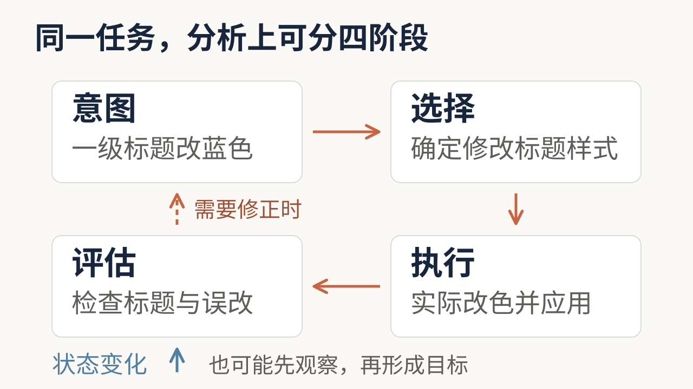

# AI 时代，什么时候该用聊天，什么时候该保留其他界面？

> AI 让用户可以用自然语言表达目标，却没有让信息比较、状态观察、精确操作和结果核验自动消失。产品不必在聊天界面与图形界面之间二选一，而应从任务如何开始、推进和结束出发，组合不同交互方式。

---

前段时间讨论 AI 产品的交互设计时，我重新想起一个原本很自然的判断：既然 AI 已经能理解自然语言、调用工具替用户完成操作，未来多数软件是不是只需要一个聊天入口？但当这个想法落到具体产品里，卡片、列表和表格能同时展示很多信息、方便横向比较，这些优势并没有因为 AI 能回答问题就消失。

更让我在意的是用户重新打开产品时会遇到什么。在以聊天记录为主要组织方式的产品里，上次生成的表格可能仍停留在当时的结果；如果想知道现在有哪些待办、哪个任务出现异常，往往还得再问一次。一个接入持续更新数据的看板，则可以在打开时直接看到当前状态。这不是聊天技术无法实时刷新，而是过去的回答和当前业务状态本来就不是同一回事。

我也注意到，不少手机 App 把 AI 助手放到了首页或一级导航，却保留搜索、浏览、卡片和原有业务界面。一个更灵活的入口出现以后，为什么这些界面仍然有用？这让我想讨论的，不再只是聊天会不会取代 GUI，而是用户在同一个任务的不同环节，究竟需要怎样表达意图、看见信息、修改对象和接续工作。

## 一、聊天成为入口，不等于聊天适合承担整个产品

聊天最容易体现的优势，是把过去需要寻找功能、理解表单和连续点击的操作，压缩成一句自然语言请求。用户不必知道按钮在哪里，也可以让 AI 帮忙选择路径、执行中间步骤。对意图还不清楚、操作入口又复杂的任务，这种变化很有吸引力。

但得到一次回答，不等于拥有一个可以持续使用的工作对象。用户可能需要并排比较几个结果、反复修改其中一项，也可能隔一段时间回来，接着处理已经发生变化的业务状态。如果产品只能让用户从对话历史里寻找上次的答案，就把查找、比较和恢复上下文的成本留给了下一次使用。**一段对话记录不会自动成为一个持续维护的业务状态。** 数据来源、更新时间、对象版本和可操作范围，都需要产品另外设计。

这些能力不一定只能放在固定图形界面里：聊天可以连接实时数据，也可以嵌入可直接操作的卡片；原有业务页面同样能加入 AI。值得比较的是，同一个任务在不同环节需要什么信息和控制方式，以及如何让用户不用反复解释同一个对象。这也是为什么要先理解用户的行动过程，再讨论 Chat 和其他界面怎么分工。

## 二、先分析用户在做什么，再决定用什么界面

要判断聊天和 GUI 的分工，可以先拆开看用户如何完成任务。Donald Norman 在 1984 年的[《Stages and Levels in Human–Machine Interaction》](https://www.laurahuisinga-design.com/698Research/wp-content/uploads/2013/05/Norman_Stages_Levels_HCI.pdf)中，将这个过程概括为形成意图、选择行动、执行行动、评估结果四个阶段。

下面用一个假设任务说明：文档已经使用标题样式，现在要把全文的一级标题统一改成蓝色。

| 行动阶段 | 同一任务中具体在做什么 |
|---|---|
| 意图 | 想让全文一级标题都变成蓝色 |
| 选择 | 决定修改「标题 1」样式，确定要使用的命令 |
| 执行 | 实际打开样式设置，把颜色改成蓝色并应用 |
| 评估 | 检查一级标题是否全部改好，正文和其他级别标题有无误改 |

中间两项的区别是确定怎样做，以及实际把操作做出来。熟悉编辑器的人可能顺手就完成了，不会明显感到自己经过两个阶段。遇到困难时，这个区分更有用：不知道该用哪个命令，与已经知道正确命令却手滑点错，通常需要不同的帮助。Norman 在[论文第 367—369 页](https://www.laurahuisinga-design.com/698Research/wp-content/uploads/2013/05/Norman_Stages_Levels_HCI.pdf)也说明，阶段只是便于分析的近似，实际心理活动没有这样清晰的边界。

如果一个助手具备读写文档的工具，并已获得修改授权，同一任务还可以这样完成：用户说「把所有一级标题改成蓝色」，助手确定底层操作、调用工具并应用修改，用户检查结果。用户更明显地经历的是提出要求与查看结果；选择使用助手、发送请求本身仍是人的行动。这里移交的是文档修改的底层操作，这是本文对 AI 协作的设计推演。

这也意味着，产品不必为了凑齐阶段，强制展示计划或增加确认。是否让用户介入，取决于目标有无歧义、修改影响多大、能否撤销，以及授权范围。

Norman 在 1986 年的[《Cognitive Engineering》](https://www.researchgate.net/publication/235616560_Cognitive_Engineering)中进一步细分了行动过程，并说明实际活动可能跳过、重复或改变顺序。比如监控人员先发现异常，再决定处理什么；浏览商品也可能先于购买目标的形成。

**行动模型的价值，是帮助我们找出用户卡在哪里，以及哪些操作可以委托、哪些信息仍需看见。** 同一次交互可以涉及多个阶段，后文因此按澄清目标、精确修改、持续观察等任务需求讨论界面分工。

## 三、澄清目标、探索路径时，聊天什么时候更合适？

用户有一个大致目标，却不知道产品里该找哪个功能、先做哪一步时，聊天可以接住不完整的表达，再通过追问澄清约束、探索路径。这是在帮助用户把目标转成可做的操作；比较商品或方案的优劣，则还涉及信息呈现与结果评估。

[美团官方科技页面](https://www.meituan.com/technology)介绍的「小团」作为 App 内的 AI 入口，承接用户对吃喝玩乐的需求；原有商家、商品和搜索页面仍然存在。已有目标、希望缩小范围的用户可以先描述需求；还没有明确目标的人，则可能更愿意直接浏览。

[Amazon 对 Alexa for Shopping 的官方介绍](https://www.aboutamazon.com/news/retail/alexa-for-shopping-ai-assistant)显示，它同时提供聊天窗口、主搜索栏提问、搜索结果中的商品比较，以及商品详情页的 AI 摘要。AI 在不同任务节点提供帮助，不要求用户把搜索、比较和核对全部搬进同一个对话窗口。

如果目标已经明确、操作路径又很熟悉，直接搜索或点击可能比描述需求、等待模型解释再寻找结果更快。浏览也不总是效率问题：有时用户就是想从选项中发现自己的需求。**聊天适合降低目标澄清与开放探索的成本；目标越明确、操作越熟悉，就越值得保留直接的搜索和浏览。**

## 四、精确修改、反复调整时，为什么还需要直接操作界面？

当用户知道要改什么，问题便从「怎么表达」变成「怎么把对象改对」。

[Ben Shneiderman 在 1983 年讨论的直接操纵（Direct Manipulation）](https://www.cs.umd.edu/~ben/papers/Shneiderman1983Direct.pdf)，强调操作对象持续可见、操作快速且可逆、结果即时反馈。这是一种交互风格，不等于所有 GUI 都天然具备这些能力。

调整图表范围、移动画布元素或修改规则条件时，用户未必能一次说准最终值，往往需要边看边改、尝试和撤销。直接操作比反复把每一步翻译成自然语言更合适，但界面不一定要固定：AI 也可以先理解高层意图，再生成可持续操作的控件。

[CHI 2024 的 DynaVis 研究](https://doi.org/10.1145/3613904.3642639)将自然语言修改图表与动态生成的编辑控件结合起来。24 名参与者在其可视化编辑任务中更偏好这种组合，理由包括便于后续调整和即时视觉反馈；这一结果不能直接推广到所有产品。

我在设计质检产品时也讨论过一种可能路径：用户上传制度材料，通过聊天让 AI 生成质检规则草案。但草案与正式生效的规则不同，版本、适用范围、生效状态，以及被哪些质检任务引用，都需要明确表示。此前的[《AI 正在把“使用软件”和“操作软件”拆开》](https://marktian-long.github.io/tools/blog/posts/ai-software-operator-shift.html)也记录了这一经历。

由此推导，聊天可以负责澄清目标和生成草案，结构化编辑负责精确修改，版本对比和任务列表负责核对变化与当前状态。这是基于业务约束的设计判断，并非声称原产品已经实现了这些界面。

**AI 可以接管一部分操作，但用户仍然需要看见自己正在改变什么，以及改变之后发生了什么。** 直接操作的价值是让修改过程可见、可控、可撤销，而不是证明模型能力不足。

## 五、持续观察与核验结果时，怎样让当前状态可见？

持续任务的用户重新打开产品时，最关心的是订单、质检进度或业务指标**现在是什么状态**，而不是 AI 上次回答了什么。聊天可以调用实时数据；看板也可能因数据管道延迟而过时。产品需要维护可信的业务状态，标明更新时间，并让用户回来时能直接看见变化。

Norman 在[《Cognitive Engineering》](https://www.researchgate.net/publication/235616560_Cognitive_Engineering)中把结果评估细化为感知、解释和对照目标。监控任务还可能反过来启动行动：用户先看到指标越界或收到提醒，才决定调查什么。持续可见的状态视图因此既帮助用户核验已有操作，也可能成为形成下一步意图的入口。

[Graphics Interface 2026 的一项监控研究](https://cs.uwaterloo.ca/~dvogel/gi2026/papers/1054b.pdf)让 24 名没有鱼场数据经验的学生分别使用聊天和看板完成分析任务。在 180 秒限制内，看板的任务完成率为 87.7%，聊天界面为 70.5%；总体任务耗时看板更短，正确率和易用性评分则没有显著差异。逐任务进行多重比较校正后，仅 10 项中的 3 项时间差异仍显著。参与者反馈看板便于快速定位精确值，聊天适合灵活探索。这些结果只适用于该实验的任务和参与者，不能证明看板普遍优于聊天。

**状态是否最新，和状态如何呈现，是两项不同的设计决策。** 用户需要知道数据来源、更新时间，以及看到的是正式业务记录还是模型解释。异常提醒也应以事件重要性和用户是否需要介入为条件，不必把每次状态变化都变成一次打断。

## 六、AI Product Builder 如何选择交互方式？

回到产品设计，可以先看用户此刻被什么卡住，再决定采用哪种交互。下表只整理第三至五章出现过的典型困难和可能的组合，**不是四种互斥或穷尽的任务类型**。

| 用户当前遇到的困难 | 可以优先尝试的交互 | 必须保留的能力 |
|---|---|---|
| 目标模糊，不知道从哪里开始 | 聊天澄清、搜索、候选卡片 | 约束明确、选项可见 |
| 多个对象需要横向比较 | 并列列表、卡片或表格，AI 辅助解释 | 同一比较口径、来源可核对 |
| 需要反复、精确地修改对象 | 直接操作或持续可编辑的控件，AI 辅助起草 | 即时反馈、预览、撤销和版本差异 |
| 返回长期进行中的任务 | 任务视图或看板，必要时用 AI 解释异常 | 权威状态、更新时间、异常位置 |

同一个任务可以连续遇到几种困难：例如质检规则可以先通过聊天形成草案，再在结构化界面中调整条件，最后通过任务视图核验是否生效。选择界面不是给任务贴一个固定标签。

此外，**风险、权限、可逆性、使用频率和专业熟练度是贯穿所有场景的条件**，不应再和上述困难并列为新的“任务类别”。模型可以帮助理解和执行，但正式业务写回、精确校验及权限检查要有可信的系统负责；高风险变更需要根据影响范围安排确认、审计和恢复路径。

最后还要评估整条任务链的成本，而不是只看点击次数或对话轮数。用户表达需求花了多久，系统澄清了几次，用户是否找到需要的信息，是否看懂当前状态，修改后能否发现错误，出错后是否容易恢复，以及不同界面之间是否需要重复解释，这些都会影响真实的完成成本。

固定图形界面、聊天和动态生成 UI 也不必互相排斥。任务结构变化很大、用户需要快速得到专用工作区时，可以考虑动态生成界面；如果某个工作对象会被反复使用、持续更新或多人共同维护，就应该考虑把它保存为稳定、可再次进入的界面，而不是每次从聊天里重新生成。

一个有力的反方判断是：模型足够强以后，用户可能只需要一个自然语言入口，系统再按任务生成临时界面，固定页面逐渐减少。这个方向有现实依据，DynaVis 已经展示了特定可视化编辑任务中生成并持续使用控件的做法。但固定页面减少，不等于直接操作、持续状态和结果恢复的需求消失。更可能被替代的是今天的页面组织方式，而不是用户完成任务所需的这些能力。

AI 时代不需要先选一个唯一入口，再把所有功能塞进去。**聊天负责降低表达和探索成本，结构化界面负责让对象、信息和操作保持可见，持续状态机制负责让用户知道事情现在进行到哪里，确认与恢复机制则让执行结果仍然可控。** 同一个产品可以同时需要这些能力，真正的设计问题是它们在具体任务中如何衔接。

## 参考资料

### 一手理论与原始论文

- [Donald A. Norman, “Stages and Levels in Human–Machine Interaction” (1984)，全文 PDF](https://www.laurahuisinga-design.com/698Research/wp-content/uploads/2013/05/Norman_Stages_Levels_HCI.pdf)
- [Donald A. Norman, “Cognitive Engineering” (1986)，作者公开稿](https://www.researchgate.net/publication/235616560_Cognitive_Engineering)
- [Ben Shneiderman, “Direct Manipulation: A Step Beyond Programming Languages” (1983)](https://www.cs.umd.edu/~ben/papers/Shneiderman1983Direct.pdf)

### 同行评审研究

- [Priyan Vaithilingam et al., “DynaVis: Dynamically Synthesized UI Widgets for Visualization Editing,” CHI 2024](https://doi.org/10.1145/3613904.3642639)

### 会议论文公开稿

- [Melika Besharati Amirkandeh and Derek Reilly, “A Comparative Evaluation of Natural Language and Dashboard Visualization Interfaces for Data Monitoring Tasks,” Graphics Interface 2026](https://cs.uwaterloo.ca/~dvogel/gi2026/papers/1054b.pdf)（公开作者稿首页的 DOI 仍为占位符，本文引用其研究方法与结果）

### 厂商产品资料

- [美团：我们的科技](https://www.meituan.com/technology)
- [Amazon: Meet Alexa for Shopping](https://www.aboutamazon.com/news/retail/alexa-for-shopping-ai-assistant)

### 相关历史文章

- [AI 正在把“使用软件”和“操作软件”拆开](https://marktian-long.github.io/tools/blog/posts/ai-software-operator-shift.html)
