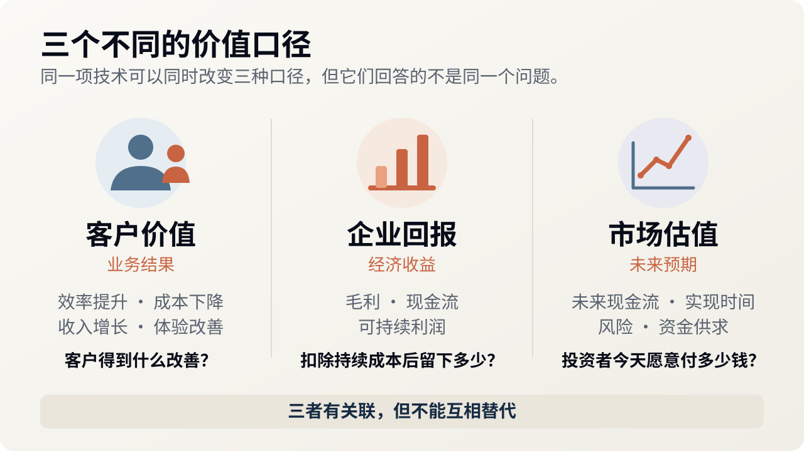
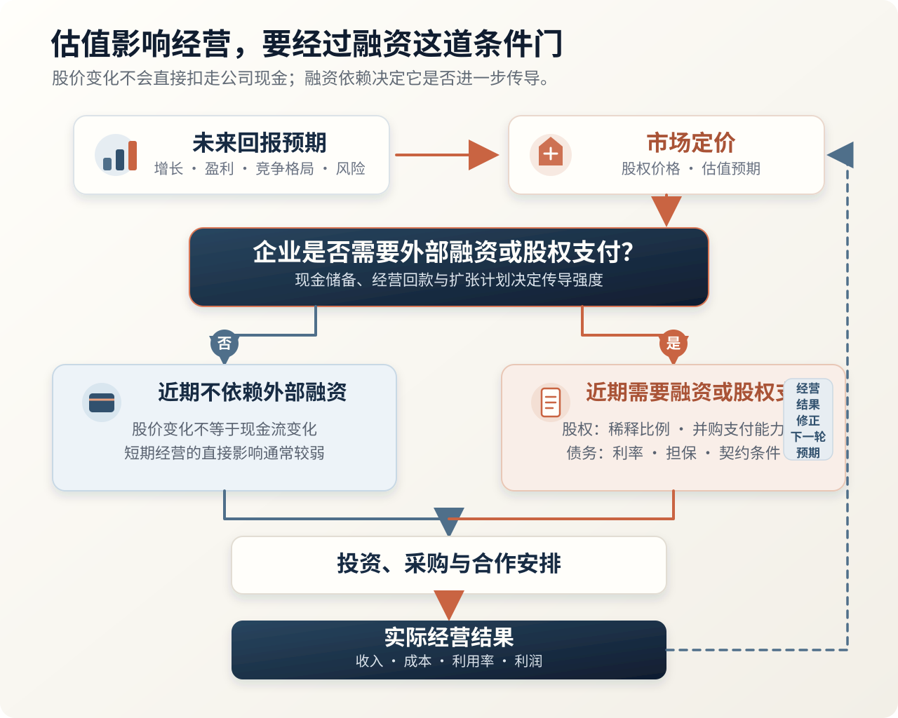
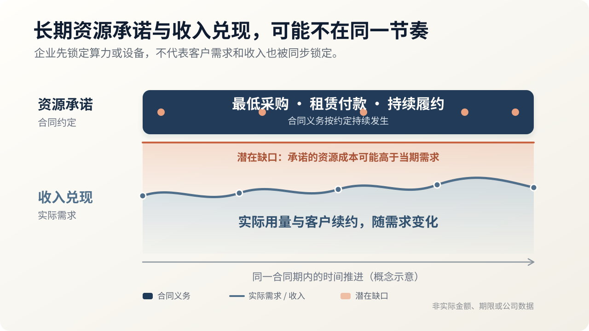
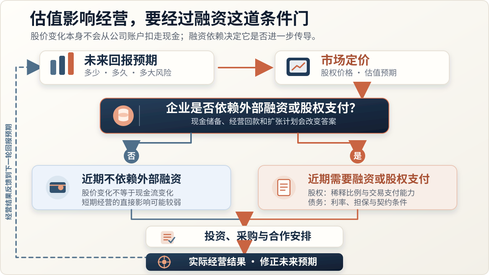

# 技术最领先的人，为什么不一定拿走最大的价值？

> 技术创造的业务价值、企业能够保留的经济回报、资本市场愿意为未来回报支付的价格，是三个相关但不同的口径。技术领先不自动带来高利润；商业化所需的互补资产、交易双方的替代选择，以及取得资源时承担的投入与风险，都会影响回报。估值则可能通过融资条件，反过来改变企业下一轮经营选择。

---

最近看 AI 相关股票的波动，我最直观的感受是：技术进展、企业经营和市场估值，并不总是同步变化。2026 年美国中期选举之后，11 月 4 日美股大盘上涨、部分数据中心股票下跌；11 月 5 日，纳斯达克综合指数又下跌了约 5.5%。报道将担忧指向数据中心扩建和融资条件，而不是一次统一的模型能力退步。[Reuters 的两日市场报道](https://wealthinsights.metrobank.com.ph/news/us-stocks-wall-street-ends-higher-after-democrats-win-congress-data-center-stocks-tumble)与[11 月 5 日收盘报道](https://www.reuters.com/legal/transactional/ai-data-center-stocks-slip-democratic-sweep-clouds-expansion-plans-2026-11-05/)呈现了这种变化。

这组波动本身不能证明 AI 的商业价值消失，也不能证明某一层会成为赢家。它把上一篇[《看 AI，不要只问它像历史上的哪一年》](https://marktian-long.github.io/tools/blog/posts/ai-industry-history-mechanisms.html)留下的问题推到眼前：技术可能继续进步，客户也仍然觉得产品有用，为什么企业的商业前景和市场定价仍会变化？如果基础模型是这一轮价值创造最重要的技术源头之一，什么决定收益最终留在模型、算力、应用、渠道，还是客户手里？

本文说的“拿走价值”，指企业能够持续保留的经济回报，不是客户获得的全部业务收益，也不是资本市场给公司的市值。要回答这个问题，必须把价值创造、价值捕获和市场估值分开，再看商业化需要哪些资源、交易双方如何议价，以及取得资源时由谁承担投入和风险。

**本文的分析路线**

1. **分清价值口径**：客户得到什么，企业留下多少，市场愿意为未来回报付多少钱。
2. **找到商业化条件**：技术要进入真实业务，还需要哪些互补资产。
3. **解释收益分配**：交易双方有什么替代选择，谁因此拥有议价空间。
4. **算清投入与风险**：取得关键资源需要作出哪些长期承诺，需求变化时谁承担损失。
5. **看估值的反馈**：资本市场的定价在什么条件下会改变融资、投资和扩张选择。

这是一条文章的阅读路线，不代表现实产业或每家公司都会按固定顺序运行。

## 一、先分清三种价值：客户收益、企业回报与市场定价

技术贡献容易被看见。一项新能力突破后，过去无法完成的任务开始变得可行。但客户购买的不是技术贡献本身，而是它能否改善自己的业务结果。先用一个简化情境区分：一项 AI 服务每年能帮客户节省一百万元，服务商并不因此自动获得一百万元收入，更不能把收入全部留下来。客户会比较其他供应商、自行开发和维持原流程的选择，服务商则还要支付模型、交付、维护等成本。

这里的“创造价值”，是相对于原来可行的做法，结果改善了多少、总投入减少了多少；“捕获价值”，是这些改善经过交易以后，各方能保留多少收益。客户少付的钱也是技术进步的收益，不必全都变成供应商利润。Brandenburger 与 Stuart 的[价值基础商业战略研究](https://business.columbia.edu/faculty/research/value-based-business-strategy)正是把共同创造的价值，与单个参与者能捕获的价值分开：供应方和购买方的替代选择都会约束分配。

“估值”又多了一层未来判断。按照 Aswath Damodaran 对[现金流折现估值的解释](https://pages.stern.nyu.edu/adamodar/New_Home_Page/lectures/approach.html)，股权价值取决于预期最终留给股东的现金流，以及这些现金流何时出现、风险多大。它不等于今天已经赚到的钱，也不等于技术给整个社会创造的价值。实际市场定价还会受到可比资产价格、交易情绪与资金供求影响；[内在估值与相对定价](https://pages.stern.nyu.edu/adamodar/New_Home_Page/littlebook/intrinsicvsrelative.htm)也不是同一种方法。

下图把三个问题并列放在一起。它们是不同观察口径，不是技术发展必经的三个阶段。

因此，即使产品仍然有用，只要投资者预期企业需要先投入更多、利润率更低、回款更晚，或者要求更高的风险补偿，今天愿意支付的价格就可能下降。反过来，一家公司估值很高，也只能说明有人愿意按照某些预期和交易条件给它定价，还不能证明那些回报已经实现。

**技术的使用价值、企业的经营回报和股权的交易价格，不能用同一个“价值”替代。** 本文先解释收益怎样形成，再看市场定价如何反过来影响这个过程。

## 二、技术怎样变成生意：互补资产补上什么？

David Teece 在[1986 年的创新获利研究](https://doi.org/10.1016/0048-7333(86)90027-2)中，把生产、分销、售后等商业化所需的配套资源称为互补资产。他同时考察技术能否被模仿，以及创新者能否取得这些资源。通用、专用和共同专用的区别，主要描述是否需要特殊适配，以及创新与配套资产之间存在单向还是双向依赖，不直接等于稀缺程度或议价权。

EMI 的 CT 扫描仪提供了一个历史例子。EMI 率先实现商业化，却没能长期维持领先。[美国国会技术评估局的同期研究](https://www.princeton.edu/~ota/disk3/1981/8122/812204.PDF)记录了竞争者推出新一代设备、市场扩张放缓，以及包含 CT 业务的 EMI 医疗电子部门从盈利转向亏损。技术演进和需求变化都参与了结果，不能把它缩成“技术公司输给了渠道”的单因果故事。

把这套理论用于 AI，需要先明确分析对象。对基础模型厂商来说，模型是核心技术，算力供给、开发者生态、产品入口和企业交付能力可以成为配套资源。对应用公司来说，模型又可能是它采购的一项投入，业务知识、客户关系与实施能力则可能是它自己积累的资源。同一种资源，换一个分析对象就可能改变角色。

也不能因为某种能力不可缺少，就认定它的提供者一定能赚得很多。所有客户都需要权限控制，如果多家供应商都能提供可兼容的服务，单个供应商仍可能缺乏定价权。反过来，如果进入一个市场必须依赖少数渠道，而技术本身又有多个替代来源，渠道控制者就可能获得更好的交易条件。

数据、上下文和工作流也需要拆开看。客户拥有、能够导出并交给其他服务商的数据，并不自动成为原供应商独占的资产；为某个客户做得很深的定制，既可能让客户难以更换供应商，也可能让供应商难以离开这个客户。这些能力是否有商业价值，要落到控制权、替代代价和后续复用上判断。

互补资产回答的是“把技术变成产品需要谁配合”，还没有回答“这些参与者各自能留下多少”。即使资源不可或缺，交易双方仍然会比较替代方案；这才进入下一步的议价问题。

## 三、有资源不等于有利润：替代选择决定议价空间

我在[《当 AI 能替你造软件，哪些服务仍值得买？》](https://marktian-long.github.io/tools/blog/posts/ai-saas-build-vs-buy.html)中已经展开过买与建的比较。这里承接一个必要前提：能做出可运行的软件，只是让自建进入候选；能在可接受的成本和风险下持续接手任务，才形成可信替代。

这种替代即使没有被实际采用，也可能影响交易。客户可以自己承接一部分任务、缩小采购范围，或者在续约时重新比较价格与响应速度。供应商仍然更合算时，采购关系可以继续；因此，“客户没有流失”并不直接说明原有溢价得到了保留。这是议价机制的推导，不是对 SaaS 已经普遍降价的统计结论。

AI 同时改变双方的成本。供应商可能把一次开发和维护复用于多个客户；客户则可能更了解自己频繁变化的内部规则，减少跨公司解释、排期和验收的代价。不能只让自建的开发成本下降，再把它的维护成本冻结在今天；也不能只看到供应商提效，而忽略客户同样获得了工具。谁更有优势，需要比较同一任务、同一质量要求和同一使用周期。

对价值捕获而言，比较还没有结束。供应商即使收到了更高的合同金额，也要看新增收入是不是依赖等比例增加的驻场、实施和维护。如果每笔交易都重新投入大量人力，收入增长未必形成更好的回报。行业知识只有持续减少错误、改善结果或降低总投入，才构成客户付费的理由。

同样，一层产品今天很有用，也可能主要是在补当前模型的能力缺口。模型升级之后，业务要求可以继续存在，原来的实现和收费方式却未必保留。要问的不只是“这项工作还有没有必要”，还有“是否仍然需要由这家公司，以这种成本来完成”。

但议价空间还不是净回报。企业为了控制关键资源，可能先承担长期采购、租赁、实施和交付义务；这些成本与风险决定合同收入最后能否转化为可持续回报。

## 四、取得关键资源要付出什么：长期承诺与风险归属

互补资产重要，并不意味着利润必然流向模型公司之外。模型公司可以直接经营产品、取得客户关系，也可以自建、采购或合作获得交付资源。技术领先还可能帮助它们吸引用户和开发者，再将这些关系用于下一项产品。技术与商业资产不必由两类公司分别拥有。

Anthropic 在[2026 年 2 月 12 日的公告](https://www.anthropic.com/news/anthropic-raises-30-billion-series-g-funding-380-billion-post-money-valuation)中披露，Claude Code 当时的年化收入运行率已经超过 25 亿美元。这个公司自报指标不能代替全年收入或利润，但说明模型厂商能够直接经营付费工具。OpenAI 在[9 月 29 日 DevDay](https://openai.com/index/devday-2026-recap/)公布的运行服务和 Marketplace 采购安排，则显示它试图进一步进入交付和第三方软件采购过程。产品动作与变现信号，仍需分别检验其成本和长期结果。

扩张的另一面，是取得这些资源需要付出什么条件。Anthropic 的[11 月 2 日 S-1/A](https://www.sec.gov/Archives/edgar/data/2130357/000162828026068676/anthropicpbc-sx1ax1.htm)披露，算力和基础设施相关采购、租赁等承诺合计约 8954 亿美元，其中约 698 亿美元在 2026 年 9 月 30 日后的十二个月内到期。总额跨越多年、包含未开始的租赁，不是当期支出或现有债务。公司同时披露了现金、短期投资与融资渠道，仅凭总额不能判断短期资金缺口。

更值得分析的是期限结构：部分算力合同要求最低采购或“用不用都要付”，而收入主要按实际使用产生，大量收入没有对应的长期承诺。这是风险结构，不是已经违约。取得长期供给，也可能接下需求与利用率风险。

下面用一个简化关系图说明这种错配，不按 Anthropic 的实际金额或合同期限绘制。

长期采购并非天然不划算。如果需求稳定、价格条件有利，它可能帮助企业降低成本并保障供给；如果需求不及预期、交付延期或新技术更便宜，同样的安排就可能变成负担。评估一项互补资产，不能只看“拿到了什么”，还要看“为了拿到它，承诺了什么”。

资产所有权也不完全等于风险归属。假设一方融资购买设备，另一方长期租用，第三方提供担保，那么拥有设备、实际使用设备、垫付资金和承担违约损失的，可能不是同一方。谁先收费、付款有何条件、能否退出，以及损失由谁承担，都要沿合同核对。供应商拿到长期合同，不等于风险消失；它还要考虑客户的履约能力和资产能否转作其他用途。

纵向整合可以扩大企业的价值捕获范围，也可能把更多投入与风险集中到它身上。判断模型公司能否获得持续回报，不能只统计它进入了多少产品层，还要检查这些安排能否共同产生足够的现金回报。

到这里，经营层面的三个问题已经分开：技术如何变成产品、交易如何分配收益、取得资源的成本和风险由谁承担。估值属于另一层——资本市场如何为未来回报定价，以及这种定价在什么条件下会反馈到经营。

## 五、估值怎样反过来影响经营：融资条件与下一轮选择

前面讨论的是经营怎样影响回报。资本市场则会在结果完全出现之前，先为这些回报定价。市场调低价格，不必等到企业的技术或收入已经下降：如果收入可能晚到、前期投资可能更多，或者兑现的不确定性增加，股权价格就可能调整。这也解释了为什么一家公司仍然增长，市场却不一定继续接受原来的估值。

但价格变化与经营变化之间，还需要一条具体的传导路径。二级市场上的股价下跌，本身不会把同等金额从公司账户扣走。影响取决于它接下来是否需要发行股份、再融资、用股权收购，或者以其他方式依赖资本市场。现金充足、经营能持续回款的公司，与需要下一笔融资才能完成建设的公司，对同样波动的承受力不同。

在新股融资额和其他条件相同的假设下，较低的股权定价意味着原股东需要让出更大的持股比例；债务融资则要另看利率、担保和约束条款，不能从股价单独推算借款成本。若资金仍能以可接受条件到位，投资可以继续；若额度不足或条款变化，企业才可能调整采购节奏、合作方式和进入新业务的范围。这个反馈并非自动发生。

OpenAI 的融资报道提供了一个现实信号。[Bloomberg 10 月 23 日报道](https://news.bloomberglaw.com/ip-law/openai-shifts-value-to-1-25-trillion-as-funding-talks-finalize)，其谈判中的目标估值从 1.4 万亿美元调至 1.25 万亿美元；[Reuters 10 月 30 日转述 FT](https://new.streetinsider.com/Reuters/OpenAI%2Bslashes%2Bfunding%2Btarget%2Bby%2B%2410%2Bbillion%2Bamid%2Btech%2Brout%2C%2BFT%2Breports/27267372.html)，称本轮募资目标减少 100 亿美元，转为约 200 亿美元。两项均为媒体援引知情人士的交易进展，不是本轮最终交割公告；目标估值下调，也不等于已经低于上一轮成交估值。这些报道发生在美国选举之前，不能倒写成选举造成的结果。

由此可以把估值与本文主线接起来。图中箭头表示可能的影响，不是每家公司都会发生的循环，也不预设结果只会向上或向下。

这次选举后的市场反应，适合放在这里理解。[Reuters 报道](https://www.reuters.com/legal/government/democrats-seize-congress-sweeping-midterm-repudiation-trump-2026-11-04/)，民主党赢得两院多数，新一届国会将在 2027 年 1 月履职。短期交易面对的首先是政策预期，而不是已经全面实施的新规。市场还同时面对融资、建设和投资回报的不确定性，不能把全部跌幅分配给一个政治变量。

对不同参与者，同一种约束甚至可能产生不同影响。以下是机制上的两种可能：如果新增数据中心建设变慢，依赖新订单的设备商和扩建中的运营商可能承压；但已经拥有可用容量、现金更充足的企业，也可能因为竞争者扩张受限而提高相对地位。融资收紧同样既可能阻碍模型公司的纵向扩张，也可能抬高新进入者门槛。不能从“资本变谨慎”直接跳到“应用层会赢”或“巨头必胜”。

芯片、云、数据中心、模型与应用，仍然需要按各自的成本、替代选择和合同结构分析。基础设施集中不自动等于自然垄断；竞争、安全、互操作和建设审批也不是同一种治理。真正改变本文判断的，应是已经改变的付款条件、可用供给、客户选择和可持续回报，而不是给某一层贴上“基础设施”之后，就替它预定长期利润。

## 结语

技术领先不保证最大回报，因为技术只是商业化的起点。互补资产决定技术能否进入真实业务；替代选择影响交易双方的议价位置；取得资源时的长期承诺和风险归属，决定收入能否转化为可持续回报。

估值不是已经赚到的利润，也不会因为股价下跌就自动从公司账户扣走现金。但当企业需要外部融资、发行股份或用股权完成交易时，市场定价可能改变它取得资源和扩张的条件。它既是对未来回报的判断，也可能成为影响未来经营的一项约束。

对做 AI 产品的人，值得积累的不只是模型能力或一层暂时有用的工程实现，而是能持续改善业务结果、降低交付成本，并且在技术变化后仍然难以替代的能力。同时还要问：取得这些能力需要怎样的长期投入，收入能否覆盖相应义务，外部资金不再宽松时，哪些选择仍然可行。

**技术领先创造机会；企业能否留下回报，取决于它如何组合资源、组织交易并承担风险。估值则可能通过融资条件，改变这套安排下一轮如何继续。**

## 参考资料

### 学术研究与估值方法

- [David J. Teece：Profiting from Technological Innovation（1986）](https://doi.org/10.1016/0048-7333(86)90027-2)。用于解释技术可模仿性、互补资产与创新收益。
- [Brandenburger 与 Stuart：Value-Based Business Strategy](https://business.columbia.edu/faculty/research/value-based-business-strategy)。用于区分共同创造价值与参与者价值捕获。
- [Aswath Damodaran：Approaches to Valuation](https://pages.stern.nyu.edu/adamodar/New_Home_Page/lectures/approach.html)。用于解释未来现金流、风险与股权估值。
- [Aswath Damodaran：Intrinsic vs Relative Value](https://pages.stern.nyu.edu/adamodar/New_Home_Page/littlebook/intrinsicvsrelative.htm)。用于区分估值方法与市场相对定价。

### 监管申报、官方发布与历史资料

- [Anthropic：2026 年 11 月 2 日 S-1/A](https://www.sec.gov/Archives/edgar/data/2130357/000162828026068676/anthropicpbc-sx1ax1.htm)。公司申报的合同承诺与风险因素，不代表未来损失已经发生。
- [Anthropic：2026 年 2 月 12 日融资公告](https://www.anthropic.com/news/anthropic-raises-30-billion-series-g-funding-380-billion-post-money-valuation)。Claude Code 收入运行率为当时公司披露，不是利润数据。
- [OpenAI：DevDay 2026 Recap](https://openai.com/index/devday-2026-recap/)。用于确认产品和采购安排，不作为盈利效果证据。
- [美国国会技术评估局：Policy Implications of the Computed Tomography Scanner（1981），相关章节](https://www.princeton.edu/~ota/disk3/1981/8122/812204.PDF)。用于核对 EMI 与 CT 市场的历史变化。

### 市场与融资报道

- [Reuters：11 月 4 日美股收盘报道，Metrobank 转载](https://wealthinsights.metrobank.com.ph/news/us-stocks-wall-street-ends-higher-after-democrats-win-congress-data-center-stocks-tumble)。区分大盘与不同 AI 相关股票的反应。
- [Reuters：11 月 5 日科技股与 AI 基础设施抛售报道](https://www.reuters.com/legal/transactional/ai-data-center-stocks-slip-democratic-sweep-clouds-expansion-plans-2026-11-05/)。市场观察与受访者解释，不是单一因果识别。
- [Bloomberg：OpenAI Shifts Value to $1.25 Trillion as Funding Talks Finalize](https://news.bloomberglaw.com/ip-law/openai-shifts-value-to-1-25-trillion-as-funding-talks-finalize)。2026 年 10 月 23 日谈判进展报道。
- [Reuters 转述 FT：OpenAI 调整募资目标，StreetInsider 更正稿](https://new.streetinsider.com/Reuters/OpenAI%2Bslashes%2Bfunding%2Btarget%2Bby%2B%2410%2Bbillion%2Bamid%2Btech%2Brout%2C%2BFT%2Breports/27267372.html)。2026 年 10 月 30 日交易进展报道，不作为最终交割公告。
- [Reuters：2026 年美国中期选举后的国会格局](https://www.reuters.com/legal/government/democrats-seize-congress-sweeping-midterm-repudiation-trump-2026-11-04/)。用于区分选举结果与新一届国会履职时间。

### 本站前文

- [看 AI，不要只问它像历史上的哪一年](https://marktian-long.github.io/tools/blog/posts/ai-industry-history-mechanisms.html)。承接价值捕获问题，不重复产业阶段论证。
- [当 AI 能替你造软件，哪些服务仍值得买？](https://marktian-long.github.io/tools/blog/posts/ai-saas-build-vs-buy.html)。承接可信替代与采购边界，不重复完整买建框架。
