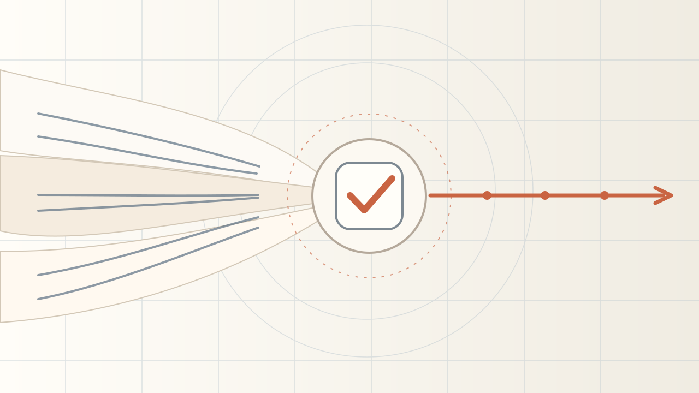

# 黎曼猜想之后，AI 数学真的迎来了里程碑吗？

> 数学家与 Claude 合作完成的黎曼猜想证明，已经获得 Lean 与 Mathlib 社区的明确认证。这是 AI 数学研究的一座重大里程碑，但不是首次有重大成果通过完整形式化核验；理解它的意义，需要区分证明正确、数学价值与后续学术接受。

---

11 月 20 日看到这条新闻时，我的第一反应并不是兴奋。当天和朋友聊起，甚至觉得，它会不会又是一轮 AI 营销？过去几个月，“AI 证明某个数学难题”的消息出现得太密集：有的涉及竞赛题，有的涉及长期开放猜想，有的附带 Lean 代码。看得多了，“证明”两个字反而越来越难让人立刻相信发生了什么。

后来让我重新认真对待这次事件的，是 21 日陆续出现的核验记录和数学家回应。它们不再只是研究者或模型厂商宣称成功。但这究竟是不是里程碑？**最需要回答的不是“谁先表达震撼”，而是这次到底被确认了什么，以及过去那些证明已经走到哪里。**

## 一、这次证明的，究竟是什么问题？

[黎曼猜想](https://www.claymath.org/millennium/Riemann-Hypothesis/)由黎曼在 1859 年提出，是七个千禧年数学难题之一。素数在自然数中的分布看似无规则，数学家知道它们总体出现的趋势；黎曼猜想进一步限制这种分布偏离平均趋势的程度。严格说，它断言黎曼 ζ 函数所有非平凡零点的实部都为 1/2。这不是因为问题历史悠久就自动重要，而是它在解析数论中具有基础地位。

11 月 20 日，数论学家 Levent Alpöge 在[本人说明](https://alpo.ge/remark.pdf)中宣布，他与 Claude 合作找到了证明，并公开了大约 1700 万行 Lean 代码。他先从一个较简单的数学情形寻找可推广结构，再引导 Claude 研究对应的复杂情况；Claude 在后续技术环节提出了令他意外的步骤。这不是对聊天机器人随手提问后得到的一页答案，也不能把人类数学家的判断与贡献抹去。

这次公开的核心产物还不是一份人类能够从头读到尾的传统论文，而是一套能让机器逐步检查的形式化证明。[MIT 数学家 Andrew Sutherland 的记录](https://math.mit.edu/~drew/grh/)显示，核验对象包括经典黎曼猜想以及 Dirichlet L 函数版本的广义黎曼猜想；不能据此延伸到所有一般的 L 函数。**一个如此重要的问题是否真的被证明，要先确认程序中证明的就是数学家所说的那个命题。**

## 二、从“发布代码”到“原命题获得独立核验”

新闻里，“有 Lean 代码”“代码可以编译”和“数学问题得到了严格证明”经常被混为一谈。但数学成果可能在不同环节出错：证明的只是辅助引理，形式化目标被悄悄改写，或者某个关键事实未经证明就被当成前提。

| 需要检查什么 | 排除什么风险 | 本次已公开的核验 |
| --- | --- | --- |
| 命题是否准确 | 程序证明的不是黎曼猜想 | 对应 Mathlib 中专家审查过的标准 RH 命题 |
| 构建是否可复现 | 只有作者自己的机器能运行 | 多个独立构建得到相同的原始证明导出 |
| 目标和公理是否一致 | 偷换定义或加入额外未证明假设 | 独立工具比对命题；只依赖三项标准基础公理 |
| 证明检查是否有效 | 某个检查器错误地接受一个证明 | Lean 内核和多个独立实现的证明检查器均接受 |

11 月 21 日，[Lean 与 Mathlib 社区发表联合声明](https://leanprover-community.github.io/blog/posts/riemann-hypothesis/)，由 Lean FRO 与 Mathlib Initiative 背书，明确确认命题及证明均正确，并说明全部四项核验满足。MIT 和[滑铁卢大学的核验记录](https://www.math.uwaterloo.ca/~mrubinst/alpoge_claude_grh/)还公布了构建、依赖审计及内核检查的具体结果。比一句“官方认证”更有分量的是：这些结果可以让其他研究者重复检查，而不仅靠发布者自己说了算。

这里的“没有额外未证明假设”不代表证明不使用新引理，也不表示数学不依赖公理。新的引理可以很多，前提是它们本身也在系统中得到证明。**Lean 确认的是形式化命题与证明的有效性，不直接评价证明思想有多重要、它是否易于理解，以及 AI 是否已经能解决任意其他难题。**

## 三、和以前的 AI 数学证明相比，究竟不同在哪里？

如果只拿这次与过去那些缺少完整证明的 PR 对照，就很容易宣布它是首次突破。但更公平的比较基准，应包括此前已经得到严肃核验的成果。

| 代表成果 | AI 实际完成了什么 | 验证状态 | 这次与它有何不同 |
| --- | --- | --- | --- |
| 2024：AlphaProof / AlphaGeometry 2 | 解出当年国际数学奥林匹克六题中的四题 | AlphaProof 使用 Lean，另有竞赛标准评阅 | 高水平解题，不是长期开放研究猜想 |
| 2026 年 8 月：OpenAI 十项数学成果 | 多领域的新研究结果 | 发布 Lean 证书和材料；独立核验范围需逐项辨别 | AI 此前已进入真实数学发现 |
| 2026 年 9 月：OpenAI Navier–Stokes | 在千禧年难题官方范围内提出重要结果 | 完整形式化及多个检查器核验；文字稿与形式化内容的对应另有争议 | 此前已有重大开放问题通过类似严格核验 |
| 2026 年 10 月：OpenAI 数学成果仓库 | 批量披露数百份研究稿件 | 不同成果处于不同验证阶段，部分 Lean 仅覆盖支持性结果 | 手稿数量不能等同于已验证的主定理数量 |
| 2026 年 11 月：Alpöge–Claude 黎曼猜想 | 完整 RH 与 Dirichlet L 函数版 GRH | 标准命题、独立构建、目标审计、多内核验证及社区联合认证 | 核心数论难题与高度明确的公开核验集中出现 |

前四项分别可追溯到 [Google DeepMind 的 IMO 报告](https://deepmind.google/blog/ai-solves-imo-problems-at-silver-medal-level/)、[OpenAI 十项成果公告](https://openai.com/index/ten-advances-in-mathematics/)、[Navier–Stokes 公告](https://openai.com/index/navier-stokes-solution/)及 [OpenAI 数学仓库](https://github.com/openai/math/blob/main/README.md)。OpenAI 明确表示，仓库中的手稿处于不同验证阶段，部分未完全形式化的结果可能有问题；不能把几百篇论文直接换算成几百道已解决的猜想。

最有力的反例来自 Navier–Stokes。11 月 12 日，Lean 专家 Kevin Buzzard 在[公开文章](https://xenaproject.wordpress.com/2026/11/12/and-the-proof-is-checked-in-lean/)中确认，该成果已经执行了类似的四项核验；9 月，[Clay 数学研究所也曾积极回应这项进展](https://www.claymath.org/news/navier-stokes-announcement/)。所以，“这是第一份同时完成四项核验的重大 AI 数学证明”并不符合事实。

那为什么仍然是里程碑？因为里程碑并不要求首先发明了某种工具。**它可以发生在已有方法被用来解决一个学科中心难题、并留下足以被独立复核的成果时。**数学贡献的大小与证明的可靠程度，是相互关联但不等同的两条比较轴。

## 四、数学家高度认可，为什么还有人继续审查？

数学家的回应值得细分，而不是简单统计多少人点赞。11 月 20 日，2022 年菲尔兹奖得主 James Maynard 在 [Nature 的报道](https://www.nature.com/articles/d41586-026-03812-7)中表示，如果这项工作通过全面检查，那显然会是数学史上的里程碑。他发言时保留了条件，不能倒写成他已经亲自审查完数千万行代码。

11 月 21 日晚间，丘成桐在[《新京报》采访](https://www.bjnews.com.cn/detail/1795313481168719.html)中给予高度评价，认为这项工作可能意味着数学进入了新阶段；他同时强调，数学家还要决定往哪个方向研究，发展新的理论。**高度认可成果的分量，不等于学界已经完成了对证明思想的理解。**

[Waterloo 的 Michael Rubinstein 已公开一份 164 页的解释性工作稿](https://www.math.uwaterloo.ca/~mrubinst/alpoge_claude_grh/)，试图将机器形式化代码整理成传统解析数论的语言。但其中一个核心不等式仍直接依赖 Lean 证明，并未在该文稿里独立完整证明。这是后续理解工作的进展，而非一份已经自足的最终解释。

制度上的接受也有自己的过程。[Clay 研究所的黎曼猜想页面](https://www.claymath.org/millennium/Riemann-Hypothesis/)目前仍将它列为未解决问题；按照[大奖认定规则](https://www.claymath.org/millennium-problems/rules/)，还需要合格出版、至少两年及全球数学共同体的广泛接受。Lean 社区的形式化认证，与数学思想被全面理解、Clay 正式认定，都不是同一件事。

我们因此可以同时相信两句话：**这份形式化证明已经获得极强的正确性支持；人类如何解释、精炼和推广它，仍然是开放的数学研究工作。**这并不是自相矛盾，而是不同层次的数学认可。

## 结尾：这座里程碑之后，还需要看到什么？

回到 11 月 20 日与朋友的那次聊天，令我从“会不会又是 PR”转向认真研究的，不是新闻标题越来越大，而是多家独立主体陆续留下了可以核对的证据。一次事件具有商业宣传价值，并不意味着成果虚假；反过来，一份证明真实，也不等于围绕它的一切叙事都准确。

我愿意把此次看作 **AI 数学研究的一座重大里程碑**：一个长期处在数论核心的未解问题，出现了由数学家和 AI 合作构建、且经过独立严格核验的证明。其意义也不限于某家模型厂商胜出，还包括数学家如何继续理解、提炼和使用证明中出现的方法。

但它不意味着 AI 从此可以解决绝大多数数学问题。从一个成功案例到广泛、可靠的数学研究能力，还需要看到跨问题成功率、失败记录、计算成本与人类参与程度。**Lean 能确认一份已经找到的证明正确，不保证下一个问题总能找到证明。**

至于递归自我改进（RSI），这次直接展示的是参与重大数学研究的能力，尚未展示研究成果如何提升下一代 AI 并推动自主的持续改进循环。我曾在[《AI 研发已经开始自我加速，但这还不是 RSI》](https://marktian-long.github.io/tools/blog/posts/ai-rd-self-acceleration-rsi.html)讨论过这个区别；它在这里属于值得继续观察的旁支。

真正让我重新判断这条新闻的，是我们已经能够清楚指出：**哪些事情被证实了，哪些仍是数学研究接下来要完成的工作。**

## 参考资料

### 数学原始材料与形式化核验

- [Clay：Riemann Hypothesis](https://www.claymath.org/millennium/Riemann-Hypothesis/)
- [Levent Alpöge：原始说明（2026-11-20）](https://alpo.ge/remark.pdf)
- [Lean／Mathlib 联合验证声明（2026-11-21）](https://leanprover-community.github.io/blog/posts/riemann-hypothesis/)
- [MIT Andrew Sutherland：RH 验证记录](https://math.mit.edu/~drew/grh/)
- [Waterloo Michael Rubinstein：核验与数学解释稿](https://www.math.uwaterloo.ca/~mrubinst/alpoge_claude_grh/)

### 历史成果与独立对照

- [Google DeepMind：IMO 2024 数学推理结果](https://deepmind.google/blog/ai-solves-imo-problems-at-silver-medal-level/)
- [OpenAI：Ten Advances in Mathematics](https://openai.com/index/ten-advances-in-mathematics/)
- [OpenAI：Navier–Stokes Solution](https://openai.com/index/navier-stokes-solution/)
- [OpenAI math 仓库与验证声明](https://github.com/openai/math/blob/main/README.md)
- [Kevin Buzzard：Proof Checked in Lean](https://xenaproject.wordpress.com/2026/11/12/and-the-proof-is-checked-in-lean/)
- [Clay：Navier–Stokes Announcement（2026-09）](https://www.claymath.org/news/navier-stokes-announcement/)

### 数学家回应与制度

- [Nature：James Maynard 等数学家采访](https://www.nature.com/articles/d41586-026-03812-7)
- [新京报：丘成桐回应（2026-11-22）](https://www.bjnews.com.cn/detail/1795313481168719.html)
- [Clay：千禧年大奖规则](https://www.claymath.org/millennium-problems/rules/)

### 相关历史文章

- [AI 研发已经开始自我加速，但这还不是 RSI](https://marktian-long.github.io/tools/blog/posts/ai-rd-self-acceleration-rsi.html)
