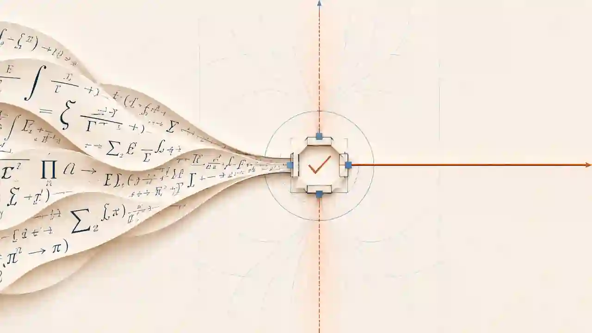
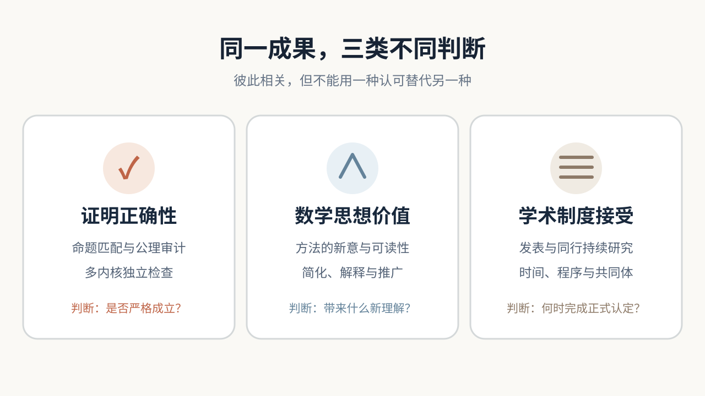

# 黎曼猜想之后，AI 数学真的迎来了里程碑吗？

> 一份由数学家与 Claude 协作完成的黎曼猜想证明，通过了标准命题比对、公理审计和多种独立检查器的复核。它并非首次让重大 AI 数学成果获得严格验证，却使核心数学突破、公开核验和后续数学研究汇聚于同一事件，也留下了需要被理解与推广的新问题。

---

11 月 20 日看到 Claude 参与证明黎曼猜想的新闻时，我的第一反应不是兴奋，而是怀疑。当天和朋友聊天，我还觉得这大概又是一次 AI 厂商的营销。最近几个月，“AI 解决某某数学难题”的消息一再出现：有些是竞赛题，有些是研究猜想，有些只有论文，有些附了 Lean 代码。看得多了，我对这种标题已经有些麻木。

但第二天，事情开始变得不同。数学证明工具社区给出明确认证，独立核验者公布了可复查的结果，数学家也开始认真讨论成果的分量和里面的数学。**我更想知道的不是哪家公司赢了，而是：这一次究竟跨过了什么门槛，足以让人把它称为里程碑？**

## 一、黎曼猜想为什么有如此大的分量？

[黎曼猜想](https://www.claymath.org/millennium/Riemann-Hypothesis/)由黎曼在 1859 年提出，涉及素数分布偏离平均趋势的程度。用数学语言说，它断言黎曼 ζ 函数的所有非平凡零点都位于实部为 1/2 的直线上。它被列为千禧年难题，并非只是因为历史久或奖金高，而是因为在解析数论中有基础地位：大量定理和估计都与它存在深刻联系。

举一个不需要读懂 ζ 函数的例子：统计不超过 x 的数里有多少个素数，可以先用一个平滑公式估计。根据 [NIST 的标准数学参考](https://dlmf.nist.gov/27.12)，黎曼猜想等价于将实际素数数量与一种更精细估计之间的误差，限制在约 √x × log x 的增长量级。这里的 x 是统计范围，谈的是范围扩大时误差最多增长多快，而不是某次计算的精确误差。相比只知道平均趋势，这是一项强得多的控制。

11 月 20 日，数论学家 Levent Alpöge 在[个人说明](https://alpo.ge/remark.pdf)里宣布，他与 Claude 合作找到证明，公开约 1700 万行 Lean 代码。[MIT 的主定理核验记录](https://math.mit.edu/~drew/grh/)列明，成果涵盖经典黎曼猜想，以及 Dirichlet L 函数版本的广义黎曼猜想。这不是对所有更一般 L 函数的泛化证明，范围必须说清。

更值得重视的是 Claude 参与了什么。Alpöge 自己引导研究方向、选择可类比的问题结构，同时描述 Claude 在后续技术探索中提出了令他惊讶的关键步骤。[《自然》对其他数学家的采访](https://www.nature.com/articles/d41586-026-03812-7)也强调 Alpöge 长期建立这套数学研究工作方式的投入。这里的 AI 不只是把一篇现成论文转成代码，而是进入了新证明的搜索与构建；人的研究判断也远未消失。

Alpöge 在[原始说明](https://alpo.ge/remark.pdf)中举过一个具体例子：他希望借鉴函数域上已有的证明思想，把关键构造迁移到整数问题中，但传统方法依赖的某种“重数”结构在这里难以找到。Claude 提议通过串联若干 theta 提升（theta lifts）模拟这一作用，并给出链条长度的具体选择。普通读者不必掌握这些技术细节，也可以看清其贡献类型：模型在研究者确定的方向内提出了新的构造选择，而非单纯整理已有公式。**这项贡献归属来自合作数学家本人的说明；Lean 所验证的是数学结论，不是研究过程中的创意归属。**

## 二、这次不再只是作者声称证明成功

“提供了 Lean 代码”“代码能编译”和“原始数学问题得到证明”，不是同一回事。Lean 专家 Kevin Buzzard 甚至在这次新闻发生之前，就写了[关于如何检验 AI 形式化证明的文章](https://xenaproject.wordpress.com/2026/11/12/and-the-proof-is-checked-in-lean/)：代码可能只证明辅助引理，命题定义可能被悄悄改变，关键结论也可能被偷偷当成公理。

11 月 21 日，[Lean 与 Mathlib 社区的联合声明](https://leanprover-community.github.io/blog/posts/riemann-hypothesis/)明确确认，所证明的数学命题和证明本身均正确，四项标准都已满足。声明获得 Lean FRO 与 Mathlib Initiative 背书，比“厂商宣布验证成功”多出一层可供共同体追责和复查的公共记录。

| 核验对象 | 要排除的风险 | 这次留下的证据 |
| --- | --- | --- |
| **命题是否写对** | 证明的是被改写过的“黎曼猜想” | 使用 Mathlib 中由专家审查的 RH 标准命题 |
| **完整代码是否可构建** | 只有原作者的机器能运行 | 多方独立编译，重现相同的证明导出 |
| **证明的目标和公理是否正确** | 偷换定义、暗中增加未证明前提 | 两套独立工具匹配目标；主定理只依赖 Lean 三项标准基础公理 |
| **证明本身是否可信** | 利用单个内核漏洞通过检查 | 官方内核和多个独立实现的检查器接受完整证明 |

[MIT 数学家 Andrew Sutherland 的日志](https://math.mit.edu/~drew/grh/)更具体：175,187 个 Lean 模块成功编译，五条主定理依赖的公理经过审计，独立的 nanoda、con-leche 等检查器接受原始导出。[滑铁卢大学 Michael Rubinstein 的验证记录](https://www.math.uwaterloo.ca/~mrubinst/alpoge_claude_grh/)还提供了另一套检查步骤和脚本。Sutherland 页面另有耗时更长的附加检查尚未结束；这和社区已经认证的四项标准不矛盾。

还有一项更有意思的交叉检查：MIT 的记录将这份证明与另一套独立形式化的等价判据结合，推出 Robin 和 Lagarias 关于约数和的算术不等式，再次经检查器接受。这不是第二份独立发现的黎曼猜想证明，却说明外界已经能用**另一条形式化的数学关系**检查结果，而不只是看某个文件是否编译成功。

这意味着正确性判断逐渐脱离发布方的叙事：**数学家可以从一份未经信任的 AI 生成材料出发，检查其最终数学命题是否成立。**但这种核验机制到底是不是这次才第一次出现，仍必须放到历史里比较。

## 三、和过去几个月的 AI 数学成果相比，这次究竟不同在哪里？

回想过去那些“AI 数学突破”的新闻，最大的混淆在于它们讨论的根本不是同一类交付物。用同一张表比较，差别会清楚很多。

| 成果与时间 | 数学上做到什么 | 验证与专业回应 | 本次 RH 与它的差异 |
| --- | --- | --- | --- |
| **2024：AlphaProof / AlphaGeometry 2** | 六道 IMO 竞赛题解出四道 | AlphaProof 使用 Lean，解题经竞赛规则评定 | 解出了高难题，但并非未解的研究猜想 |
| **2026 年 8 月：Claude ζ 函数进展** | 零点在临界线上的比例下界从 41.6% 提升到 67.2% | 有数学家审阅及形式化材料 | 和 RH 直接相关，却是局部结果，不是完整 RH |
| **2026 年 8 月：OpenAI 十项研究成果** | 在多个开放研究问题上得到新结果 | 发布 Lean 证书，独立核验程度须逐项区分 | AI 此前已经参与原创数学，不是这次首次 |
| **2026 年 9 月：OpenAI Navier–Stokes** | 针对另一项千禧年难题给出重要结果 | 完整形式化、多检查器接受，Clay 曾积极回应；文字稿与 Lean 仍有对应争议 | 此前已有重大数学问题接受类似的严格检查 |
| **2026 年 10 月：OpenAI 数学手稿集** | 大量数学稿件，结果重要性不一 | 有的主定理形式化，有的只是辅助引理，部分撤回或修订 | “有论文与 Lean”不等于每项已经完成核验 |
| **2026 年 11 月：Alpöge–Claude RH** | 完整 RH 及 Dirichlet L 函数版 GRH | 标准命题、完整独立核验、公开社区认证 | 数论中心问题与强证据、专家严肃回应集中出现 |

来源分别是 [Google DeepMind 的 IMO 报告](https://deepmind.google/blog/ai-solves-imo-problems-at-silver-medal-level/)、[Anthropic 8 月 ζ 函数研究](https://www.anthropic.com/research/riemann-zeta)、[OpenAI 十项成果](https://openai.com/index/ten-advances-in-mathematics/)、[Navier–Stokes 公告](https://openai.com/index/navier-stokes-solution/)和 [OpenAI 数学仓库](https://github.com/openai/math/blob/main/README.md)。注意 67.2% 是某类零点比例的已证明下界，不是“黎曼猜想完成了 67.2%”。更重要的是，Anthropic 在 8 月明确表示，当时的技术路线预计无法直接证明 RH。**11 月的结果不能描述成同一方法从 67.2% 进展到了 100%；两次研究究竟有哪些思想可以复用，还要等新证明得到更清楚的解释。**

最强的反例是 Navier–Stokes。11 月 12 日，Buzzard 就已经指出那项证明完成了类似四项核验；[Clay 研究所此前也曾积极回应](https://www.claymath.org/news/navier-stokes-announcement/)。因此，“此前 GPT 只会发论文，直到 Claude 这次才第一次有可信数学证明”并不成立。

实际上，即使不谈 AI，数学界早已用证明助手检查重大成果：[Flyspeck 项目在 2014 年完成了开普勒猜想的形式化证明](https://github.com/hol-light-family/Flyspeck)。因此，这次值得关注的变化不是“计算机终于能够验证重大定理”，而是 AI 开始参与寻找此前未知的证明，并与人类数学家和形式化验证体系共同完成研究。

但有一件事反而因此更清楚了：**里程碑不要求它是同一种机制的第一次。**此前一个重大问题被攻克，不会使另一个同样处在数学核心的重大问题变得不重要；关键是这一次取得了什么成果，以及这些成果如何被数学界接住。

## 四、为什么我仍然愿意称它为里程碑？

如果只有 RH 的名气，确实可能只是更大的新闻；如果只有 Lean 的四项检查，又不足以称为全新的验证范式。但放在一起看，这次至少有四种性质不同的证据支撑，彼此不能互相替代。

**数学问题的中心性。** 这是完整 RH，而不是普通竞赛题、零散引理，也不是“把已知答案重新写出”。8 月 Claude 关于同一个 ζ 函数的部分进展已经有价值，11 月完整命题被核验则跨越了清楚的数学边界。问题的重要性来自它在学科中的位置，而不是 PR 声量。

**证明结果的独立可靠性。** 一份形式化文件可能远远不足以证明原问题，但这次的标准 Mathlib 命题、目标比较、公理审计和多检查器结果都已留下公开记录。前面 Navier–Stokes 也有强核验，说明一种可靠的交付标准开始在最重要的研究问题上反复发挥作用，而不是只有厂商自证。

**AI 的研究贡献。** Claude 在数学家引导下参与搜索并构建新证明，而非简单转述资料或做公式排版。不能据此说 AI 独立完成了全部科研判断；恰恰是这种人、模型、工具与计算资源共同工作的系统，已经能产生外界可检查的核心数学成果。

**数学界的接续行动。** 不同的外部主体没有重复一句“太厉害了”：形式化专家认真检查逻辑，领域专家评价学科意义，数学家开始把庞大的代码解释为传统数学论证。人类对证明的理解尚在继续，这不是缺陷包装，而是研究实际进入下一阶段的信号。

对“是不是 PR”的质疑也有现实背景：[《自然》报道](https://www.nature.com/articles/d41586-026-03812-7)，成果公布恰在 Anthropic 上市次日；Alpöge 在[本人说明](https://alpo.ge/remark.pdf)中也承认时机不理想，并反对将动机归结为商业宣传。外界无法仅凭这些说法证实或否定动机，但**发布时机与数学命题是否得到独立证明，是两件需要分别判断的事**。即使存在营销收益，也不能用它替代对证明本身的审查。

**对我来说，里程碑意味着一项足够重要、获得强证据支持的成果，已经改变后续研究者可以认真继续做的事。** 这次不必自称“史上第一次所有条件同时成立”，也有充分理由被这样记录。

## 五、数学家的认可，为什么既强烈又谨慎？

2022 年菲尔兹奖得主 James Maynard 在 [《自然》11 月 20 日报道](https://www.nature.com/articles/d41586-026-03812-7)中说，如果全部核验通过，这会是数学史上的里程碑。他当时保留了条件，并不表示自己已经独立审读完整代码。11 月 22 日，[他在《每日经济新闻》采访](https://www.nbd.com.cn/articles/2026-11-22/4655007.html)中又强调，理解一个定理为什么成立，比仅仅知道它被证明更有意义。

这段采访还有一条比赞美更值得注意的判断：Maynard 说，这次结果并未显著改变他对 AI 数学能力的总体看法，因为今年夏季已经出现重要突破。他同时认为，黎曼猜想之所以被寄予厚望，不只是因为大家期待结论正确，更因为人们盼望从证明中发现能够解释素数分布的新理论。**所以，这可以是数学史上的重大成果，却未必代表 AI 能力在同一天第一次跨越全新阶段；证明的长期理论价值仍取决于后续理解。**

丘成桐在[《新京报》采访](https://www.bjnews.com.cn/detail/1795313481168719.html)中称这是“伟大的贡献”，认为数学可能进入新的纪元；他同时谈到数学下一步往哪个方向走，以及怎样建立新理论。这是对成果分量的高度肯定，不等于他个人已经复核了 1700 万行代码。

另一种态度是等待人类能读懂的论证。[2026 年菲尔兹奖得主邓煜的回应](https://app.xinhuanet.com/news/article.html?articleId=20261122050d5923ebaf4c62aa26c7221df3778e)关注可读性，而不是证明稿的页数。[Rubinstein 的 164 页解释性草稿](https://www.math.uwaterloo.ca/~mrubinst/alpoge_claude_grh/)显示这种工作已经开始：它用传统解析数论语言解释证明，但一个关键不等式仍直接取自 Lean 开发，尚未写出自足的人类证明。

另外，[Clay 目前仍把 RH 列为未解决问题](https://www.claymath.org/millennium/Riemann-Hypothesis/)；按其[大奖规则](https://www.claymath.org/millennium-problems/rules/)，还需合格发表、至少两年和全球数学界广泛接受。Lean 社区认证、数学家高度评价、Clay 最终认定是不同环节。

因此，这些回应并不矛盾：**形式化正确性已经得到强有力的确认；解释、简化、教学、推广和制度认定仍在发生。**这次的尊重不是所有人同时给出一个“是”，而是很多不同角色真正开始承担后续工作。

## 结尾：下一座里程碑，可能在哪里？

回到 11 月 20 日和朋友的聊天，让我从“这会不会又是 PR”转向认真对待的，并不是支持者数量，而是来自不同位置的证据相互补强。一次突破具有营销价值，并不能否定成果真实；反过来，数学证明成立也不能自动替所有宣传背书。

接下来值得关注的，是**数学研究的工作次序可能变化**。在一部分问题上，AI 与人类数学家可以先通过大量搜索找到候选证明；形式化系统确认结论有效；数学界再花时间解释关键思想、把它简化成能传授和复用的理论。形式化验证不是今天才发明的，但当 AI 参与产生重大原创结果，这种分工就不再只是数学软件的技术演示。

要判断 AI 能否解决越来越多的数学问题，下一步需要的是跨学科、可重复的成功率与失败记录、计算资源、人类引导程度，而非只看下一条更大的新闻。要判断这次对数学本身的长期影响，还需要看 1700 万行证明能否被提炼出新的数学方法。**Lean 能确认一份已经找到的证明正确，不保证下一个问题总能找到证明。**

RSI（递归式自我改进）仍是更远的一条链：AI 参与数学研究，不等于它已经能通过这些成果持续提升下一代 AI 的研究能力。我在[《AI 研发已经开始自我加速，但这还不是 RSI》](https://marktian-long.github.io/tools/blog/posts/ai-rd-self-acceleration-rsi.html)中讨论过这一边界，这里不再展开。

但这不妨碍我现在就作出判断。**当 AI 参与完成一项处在数学核心的问题，并留下数学共同体能够独立核验、继续理解和使用的成果时，它已不只是一场漂亮的演示。这就是我愿意称之为里程碑的原因。**

## 参考资料

### 数学原始材料与独立核验

- [Clay：Riemann Hypothesis](https://www.claymath.org/millennium/Riemann-Hypothesis/)
- [NIST DLMF：素数定理与黎曼猜想的等价误差界](https://dlmf.nist.gov/27.12)
- [Levent Alpöge：本人声明（11 月 20 日）](https://alpo.ge/remark.pdf)
- [MIT Andrew Sutherland：验证与算术推论](https://math.mit.edu/~drew/grh/)
- [Lean 与 Mathlib 社区联合认证](https://leanprover-community.github.io/blog/posts/riemann-hypothesis/)
- [Waterloo Michael Rubinstein：验证与解释稿](https://www.math.uwaterloo.ca/~mrubinst/alpoge_claude_grh/)

### AI 数学历史成果

- [Kevin Buzzard：Lean 证明四项检查（11 月 12 日）](https://xenaproject.wordpress.com/2026/11/12/and-the-proof-is-checked-in-lean/)
- [DeepMind：2024 年 IMO 成果](https://deepmind.google/blog/ai-solves-imo-problems-at-silver-medal-level/)
- [Anthropic：8 月 ζ 函数研究](https://www.anthropic.com/research/riemann-zeta)
- [OpenAI：十项数学进展](https://openai.com/index/ten-advances-in-mathematics/)
- [OpenAI：Navier–Stokes 研究](https://openai.com/index/navier-stokes-solution/)
- [OpenAI math 公开仓库与验证阶段](https://github.com/openai/math/blob/main/README.md)
- [Clay：Navier–Stokes 公告](https://www.claymath.org/news/navier-stokes-announcement/)
- [Flyspeck：2014 年完成的开普勒猜想形式化证明](https://github.com/hol-light-family/Flyspeck)

### 数学家评价与正式制度

- [Nature：数学家对 RH 证明的讨论](https://www.nature.com/articles/d41586-026-03812-7)
- [每日经济新闻：James Maynard 专访](https://www.nbd.com.cn/articles/2026-11-22/4655007.html)
- [新京报：丘成桐回应](https://www.bjnews.com.cn/detail/1795313481168719.html)
- [新华网：邓煜谈数学证明可读性](https://app.xinhuanet.com/news/article.html?articleId=20261122050d5923ebaf4c62aa26c7221df3778e)
- [Clay：千禧年大奖认定规则](https://www.claymath.org/millennium-problems/rules/)

### 相关历史文章

- [AI 研发已经开始自我加速，但这还不是 RSI](https://marktian-long.github.io/tools/blog/posts/ai-rd-self-acceleration-rsi.html)
