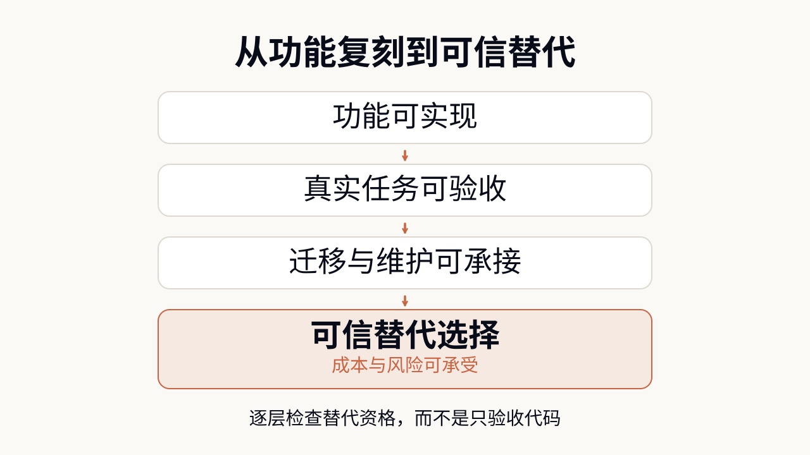
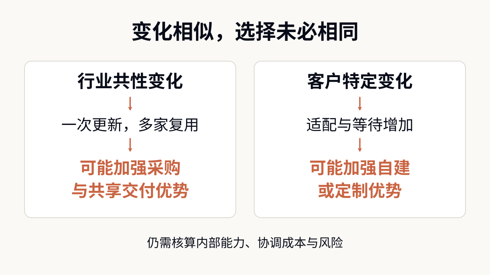
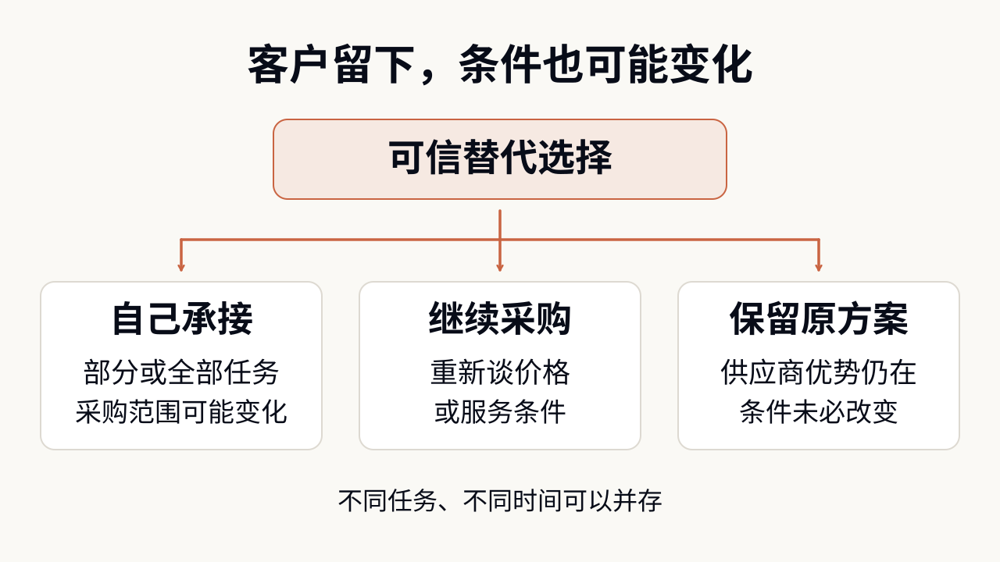

# 当 AI 能替你造软件，哪些服务仍值得买？

> AI 正在让企业拥有更可信的自建选择，但买与建的边界，不由“能不能写出代码”单独决定。谁能更经济地持续处理业务变化，哪些能力值得共同复用，以及客户有没有真正可用的替代方案，会同时影响采购范围和 SaaS 的议价条件。

---

最近看到有人尝试用 AI 重新开发 Adobe 的替代软件，我首先想到的不是“Photoshop 要消失了”，而是一个更贴近自己的问题：以后是不是可以只做自己需要的功能，不必接受整套产品的价格和工作方式？

引起我兴趣的是两个不同的项目。[ArtCraft 的 PhotoCraft](https://github.com/storytold/photocraft)尝试独立重实现 Photoshop，提供图层、蒙版和 PSD 文件处理等能力，项目仍标为早期 Alpha。[REA（Reverse Engineer Anything）](https://rea.tools/)则把软件分析工具交给编码智能体，让它研究程序与运行行为，帮助理解和重建功能。前者是替代应用，后者是分析工具，不能把它们合成一次“Adobe 源码被公开”的事件。

我在意的，是重新实现已有软件和按需修改的门槛正在松动。一个用户不必复制 Photoshop 的全部功能；一家企业也未必需要重造供应商服务所有客户的产品，只要覆盖自己真正需要的任务。

但桌面工具的复现，并不直接证明企业 SaaS 已经容易替换。企业还要让系统接入真实数据，交给多人使用，并在业务变化后继续工作。**如果客户和供应商都能使用越来越强的 AI，哪些服务仍值得买，判断依据究竟会怎样变化？**

## 一、从功能复刻，到一个可信的替代选择

AI Engineer 活动组织者 Swyx 把这个问题做成了 [How to Kill Your SaaS 实验](https://www.youtube.com/watch?v=zlD-CkLVKtU)：面对一款会议演讲者管理软件每年约 4.3 万美元的报价，邀请开发者用 AI 制作替代方案。组织方在[后续复盘](https://latent.space/p/tenex)中披露，人工评审选出的冠军，在 AI 评审榜上只排第 19。这里的报价与排名都是组织方披露，不是独立审计的节省额或行业测评。

这个反差比参赛规模更有用：通过一组预设场景，与让实际运营人员愿意使用，并不是同一项检验。以会议管理为例，能新增讲者、保存日程，只证明某些操作可以完成；讲者临时改期后，审核状态、场地冲突和通知能否一起更新，才影响团队是否还要在系统外补做工作。这是对验收要求的简化举例，不是对参赛产品缺陷的逐项实测。

自动评测当然可以覆盖更多场景，但前提是团队知道哪些情况值得检查。已有软件可以提供界面、文档和可观察的行为，帮助开发者理解需求，却不会自动给出全部业务例外，更不会把 SaaS 服务端的数据与运行能力一并交出来。

下图把“值得拿来比较的替代方案”拆成几项需要补齐的条件。

因此，**有可运行的版本，说明自建进入了候选；能在可接受的成本和风险下持续接手任务，才使它成为可信的替代选择。** Swyx 的实验提供了前进的证据，但尚不能替代多年真实运行的记录。真正进入比较的，也不只有自建，还包括开源组件、其他供应商和几种方式的组合。

## 二、采购的优势，不只是省下一次开发

要解释这些选择，得把两种不同的成本放在一起看。一种是把软件建设和运行起来的投入，另一种是为了让它符合业务而发生的沟通、等待、协调与验证。供应商可以在前一种成本上有优势，却在后一种上让某个客户付出很大代价。

假设多家企业都需要相似的权限管理、数据导入和备份恢复。供应商做一次通用实现、修复一个共同问题，就可能服务多个客户。单个客户只需承担其中一部分成本，也不必为每项能力单独组织团队。这种共同复用，是采购可能更经济的原因。

但客户买到的未必刚好适合自己。为了迁就标准产品而重复录入、等待排期，或者每次修改都重新说明内部规则，同样会占用资源。供应商理解整个行业，不代表它比客户更了解这一家公司的每个特殊流程；客户熟悉自身业务，也不代表它有能力把所有软件工作高效组织起来。

这与科斯讨论的[企业内部组织和市场交易之间的边界](https://www.nobelprize.org/prizes/economic-sciences/1991/coase/lecture/)相通：把工作交给市场需要寻找、协商和监督，在组织内部完成也有管理成本。借用这个视角，买与建就不再只是“订阅费对开发费”，而是比较两种持续提供能力的安排。

[Every 的一场访谈](https://every.to/podcast/transcript-hugging-face-s-first-investor-on-why-technical-founders-win)给出了很具体的例子。咨询负责人 Natalia Quintero 曾用 AI 自建 CRM，使用数月后，因为维护挤占客户交付时间，将数据迁到 Attio。同场受访者 Matt Hartman 做出了本地语音转文字工具 Ghost Pepper，也因后续维护重新认识到持续更新的付费服务的价值。两段经历都是当事人自述，没有提供可横向比较的维护账本。

Natalia 并不是证明了 CRM 不能自建，而是发现这项工作不值得继续占用自己的时间。已有工程团队也不会让机会成本归零，只是承担者和被挤占的事情不同。反过来，购买一个不合适的系统，让业务人员天天绕路，也可能比内部维护更浪费。

**采购是否值得，取决于供应商能够复用的投入，能否抵消客户为适配、协作和依赖付出的代价。** 这是双方的相对优势，不是软件天生属于“应该买”或“应该建”的某一类。

## 三、同样是变化，为什么会把选择推向不同方向？

AI 会同时改变这两边。客户更容易从一个小范围的需求开始开发；供应商也更容易修改产品、提供定制。即使双方获得相同幅度的编码提效，相对优势仍可能变化：当第一次开发已经不那么贵，“把高昂研发分摊给很多客户”所带来的绝对节省会缩小，适配与等待就可能在决策中占据更大分量。这是一项成本机制推导，不是对当前行业平均成本的测量。

维护也不能被冻结在今天的水平。[GitHub Copilot 的官方说明](https://docs.github.com/en/copilot/concepts/copilot-surfaces/copilot-on-github)已经包含让智能体修改代码、执行测试并提交变更的能力。它不等于无人值守的生产维护，却足以提醒我们：不能只让自建方案的开发成本下降，再把未来维护全部按今天的人力估算。厂商同样可以使用这些工具。

更有区分度的问题是：未来的变化主要发生在哪里？下面用两种简化情境说明，它们并不穷尽所有情况。

如果是多家客户共同面对的外部接口或行业规则变化，供应商的一次更新有机会复用于多个客户。在能够共用实现的部分，变化越频繁，共同维护的价值可能越明显。每家企业都重复处理，未必更经济；开源社区或专业基础服务也可能承担这类复用，不只现有 SaaS 厂商能做。

如果变化主要来自某家企业自己的审批规则、数据口径或实验流程，情况可能相反。每次都要跨公司解释、排期、报价和验收，等待本身就可能阻碍业务。在内部能力足够、修改可以验证的前提下，自己掌握这部分实现，或购买可快速修改的定制服务，反而更有吸引力。

这也修正了我在[《AI coding 之后，哪些 B 端 SaaS 会死，哪些会活》](https://marktian-long.github.io/tools/blog/posts/llm-saas-moat-disruption.html)里的一个偏强判断。当时我更倾向于把行业经验深、需求变化快，视为供应商更难被替代的理由。现在需要加上条件：已经体现在功能和流程里的经验并非天然不可复刻；变化究竟是共性的，还是高度客户特定的，可能让结论走向不同方向。

所以，“复杂就采购，简单就自建”并不成立。复杂但决定竞争差异的业务，可能值得内部长期投入；简单但没有差异化收益的工具，也可能因为购买足够便宜而不值得自己维护。供应商的行业知识只有在持续减少错误、提高效果或降低客户投入时，才形成付费理由。

实际比较时，总拥有成本（TCO）仍然有用，但它是核算工具，不是机制的替代品。应先统一任务范围、质量和使用周期，再同时计算自建的建设与维护、采购的实施与适配，以及两边的迁移、内部时间和退出成本；还要比较更快修改、数据控制和及时上线带来的收益。不可接受的安全或业务风险先作为门槛，不能靠一个低报价抵消。也要区分“用 AI 开发软件”和“软件运行时持续调用模型”：前者并不自动产生每次操作的推理费用。

**真正决定边界的，是谁能更经济地处理接下来的变化，而不只是今天谁能把功能做出来。** 如果 AI 把内部维护继续压低，自建范围可能扩大；如果供应商借助共同复用和定制能力降本更多，采购优势也可能增强。

## 四、客户没有离开，采购条件也可能变化

有了可信替代，接下来才进入商业问题：即使客户最后仍然采购，供应商还能收取多高的价格？

可以做一个简化比较。假定两种方案的业务结果和风险已经达到可比水平，客户有一套算过迁移与长期运行投入的自建方案，那么它就多了一个判断采购是否值得的参照。供应商报价之外的实施、适配与协调成本，也要放进来比较。一个便宜的演示版本没有这种作用，因为客户还不能靠它完成替换。

这并不意味着自建成本会机械决定报价。客户还可能愿意为更快上线、更少管理和更好的结果支付溢价；合同周期、迁移条件和供应商之间的竞争，也会影响能否重新协商。但与只有一个可行方案相比，客户多了一项可以实际采取的选择。

由此可以推导出几条可能路径：客户自己承接部分任务，缩小采购范围；继续购买，但重新谈价格与服务；或者发现供应商仍然更划算，维持原安排。

因此，**“客户没有流失”与“供应商的定价能力没有变化”，不是同一个结论。** 目前这些案例能帮助检验替代方案的形成，却不足以证明 SaaS 已经普遍降价。后续更值得观察的是续约折扣、采购范围、定制响应和客户真正承担的内部工作，而不只是退订数量。

同样，“卖 Agent”或“按结果收费”可以改变交付和计费方式，却不会自动消除竞争。客户仍会比较谁能以更合算的投入达到同一标准。供应商要守住的，是可验证的额外价值；如果能力差异缩小，服务可以继续被需要，原来的溢价却未必保得住。

## 五、把选择拆到能独立交付的能力上

回到最初“只做自己需要的功能”的想法，它不必意味着每家企业都去维护一套完整的替代系统。更实际的做法，是检查一套产品里哪些部分值得自己控制，哪些部分继续购买更划算。

[Airtable Omni](https://www.airtable.com/platform/app-building)允许用户通过自然语言创建和修改数据表、界面与自动化。用户可以定义自己的应用，同时继续购买平台能力。这说明个性化开发也可以发生在采购关系内部；它展示的是一种产品路径，不是已经证明最优的成本方案。

但拆得越细并不一定越好。假设企业自建审批界面，采购数据存储和消息服务：如果接口稳定、数据能导出、故障有明确负责方，分工可能降低重复建设；如果每改一项规则都要协调几套系统，而各方又无法独立验收，拆分只是把原来集中处理的问题变成了接口协调。

因此，划分买与建的范围时，比“这是不是核心业务”更具体的检查是：这项能力能否通过清楚的输入、输出和验收条件独立交付；它与邻接系统是否必须一起修改；出错后谁有足够的信息和权限恢复服务。业务重要不自动意味着全部自己做，能力通用也不自动意味着必须交给某一家供应商。

在[《AI 正在把“使用软件”和“操作软件”拆开》](https://marktian-long.github.io/tools/blog/posts/ai-software-operator-shift.html)中，我曾问过：删掉一个产品之后，为了完成任务，还必须补回什么？这次需要继续追问的是，补回这些能力，由谁来组织、在哪个边界上分工，才能既获得个性化，又不制造更多协调负担。

对买方，下一步可以从一个可隔离的小任务开始：验证业务结果，记录后续修改与人工补做的时间，并保留退出路径。对供应商，则要证明客户付费后确实少做了什么、获得了什么，而不是把“维护很麻烦”当成不必继续比较的理由。客户愿意把持续工作交出去，与愿意为旧产品一直支付原价，是两件事。

从 PhotoCraft 和 REA 出发，我仍然看好按自己需要重新制作软件的空间。但它的商业意义不只是多出一些免费替代品，而是让客户更有能力决定哪些工作留在内部、哪些交给外部，以及愿意为后者支付多少。**值得长期购买的服务，是在客户拥有更强自建能力之后，仍能把一部分工作做得更合算的服务。**

## 参考资料

### 开源项目与官方产品资料

- [PhotoCraft：项目 README](https://github.com/storytold/photocraft)
- [REA：Reverse Engineer Anything](https://rea.tools/)
- [GitHub：Copilot on GitHub.com](https://docs.github.com/en/copilot/concepts/copilot-surfaces/copilot-on-github)
- [Airtable：Omni / AI App Building](https://www.airtable.com/platform/app-building)

### 实验组织者与当事人叙述

- [Latent Space：How to Kill Your SaaS 原始节目](https://www.youtube.com/watch?v=zlD-CkLVKtU)
- [Latent Space：Tenex 访谈中的 Kill My SaaS 复盘](https://latent.space/p/tenex)——报价、评审排名和使用预期来自组织方，不是长期成本对照实验。
- [Every：How Hugging Face’s Investor Spots Winners 逐字稿](https://every.to/podcast/transcript-hugging-face-s-first-investor-on-why-technical-founders-win)——Ghost Pepper 与 CRM 迁移均为当事人自述。

### 理论来源

- [Ronald Coase：The Institutional Structure of Production，诺贝尔奖演讲](https://www.nobelprize.org/prizes/economic-sciences/1991/coase/lecture/)——用于理解内部组织与市场交易的相对成本，不直接证明 AI 的行业效果。

### 历史文章

- [AI coding 之后，哪些 B 端 SaaS 会死，哪些会活](https://marktian-long.github.io/tools/blog/posts/llm-saas-moat-disruption.html)
- [AI 正在把“使用软件”和“操作软件”拆开](https://marktian-long.github.io/tools/blog/posts/ai-software-operator-shift.html)
